<p align="center">
  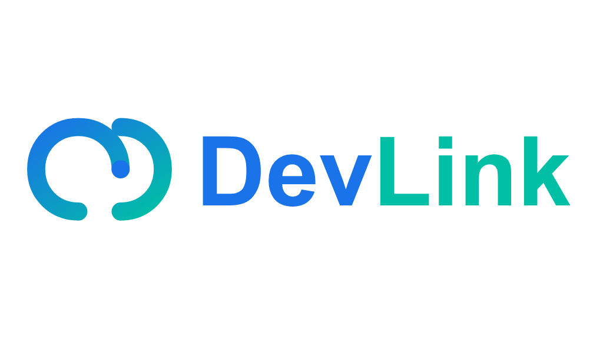
</p>

<h1 align="center">DevLink Frontend</h1>

<p align="center">
  <a href="https://nextjs.org/"></a>
  <a href="https://react.dev/"></a>
  <a href="https://www.typescriptlang.org/"></a>
  <a href="https://redux-toolkit.js.org/"></a>
  <a href="https://tailwindcss.com/"></a>
  <a href="https://jestjs.io/"></a>
  <a href="https://eslint.org/"></a>
</p>

<p align="center">
  <a href="https://quocduy21-10.github.io/it-job-portal-fe/"></a>
  <a href="https://github.com/QuocDuy21-10/it-job-portal-fe/actions/workflows/docs.yml"></a>
</p>

**DevLink** là frontend của một nền tảng tuyển dụng hiện đại, cao cấp, được thiết kế dành riêng cho lập trình viên và các chuyên gia IT. Được xây dựng trên [<u><font color="blue">Next.js 15</font></u>](https://nextjs.org/), [<u><font color="blue">React 18</font></u>](https://react.dev/) và [<u><font color="blue">TypeScript</font></u>](https://www.typescriptlang.org/), dự án có định tuyến theo vai trò, hỗ trợ đa ngôn ngữ, hydrate trạng thái nâng cao, nhắn tin thời gian thực, trình tạo CV tương tác với tính năng xuất PDF, cùng các giao diện dashboard được trau chuốt cho ứng viên, nhà tuyển dụng và quản trị viên.

> 📚 **Website tài liệu**: **https://quocduy21-10.github.io/it-job-portal-fe/** (tìm kiếm, chế độ tối, sơ đồ). Nội dung Markdown tương tự có thể đọc trực tiếp trên GitHub tại [`docs/`](docs/README.md).

| Bắt đầu tại đây | Tìm hiểu sâu hơn |
| :-- | :-- |
| [Giới thiệu](docs/00-start-here/introduction.md) | [Kiến trúc](docs/02-architecture/overview.md) |
| [Chạy cục bộ](docs/01-getting-started/run-locally.md) | [Tính năng](docs/04-features/README.md) |
| [Biến môi trường](docs/01-getting-started/environment-variables.md) | [Luồng nghiệp vụ](docs/05-business-flows/README.md) |

---

## 📌 Tổng quan tính năng

### 👤 Trải nghiệm ứng viên
* **Xác thực**: Đăng nhập/đăng ký bằng tài khoản + Google OAuth.
* **Tìm kiếm việc làm & công ty**: Duyệt, lọc, phân trang, lưu việc làm và theo dõi công ty.
* **Ứng tuyển liền mạch**: Ứng tuyển trực tiếp qua modal, đính kèm CV.
* **Trình tạo CV**: Xây dựng và cấu trúc CV chuyên nghiệp với các mẫu (Modern, Classic, Minimal) và xuất trực tiếp ra PDF.
* **Chatbot tư vấn nghề nghiệp bằng AI**: Phản hồi tức thì về nghề nghiệp, gợi ý chỉnh sửa CV và hỗ trợ tìm việc phù hợp.
* **Hồ sơ & đăng ký nhận tin**: Quản lý dữ liệu cá nhân, tùy chọn tài khoản, thông báo qua email và quy trình yêu cầu xóa tài khoản.

### 🏢 Trung tâm nhà tuyển dụng (HR)
* **Dashboard nhà tuyển dụng**: Thống kê tổng quan, tỷ lệ phản hồi và xu hướng ứng tuyển.
* **Hồ sơ công ty**: Cập nhật thương hiệu, địa điểm văn phòng và thông tin chi tiết của công ty.
* **Quản lý việc làm**: Tạo, chỉnh sửa, đăng và đóng tin tuyển dụng.
* **Quy trình ứng tuyển**: Theo dõi trạng thái ứng viên và xem xét hồ sơ.

### 👑 Dashboard quản trị hệ thống
* **Quản lý người dùng**: Liệt kê, chỉnh sửa, khóa và xóa người dùng thuộc ba vai trò (`SUPER ADMIN`, `HR`, `NORMAL USER`).
* **Vận hành hệ thống**: Toàn quyền xem và quản lý mọi tin tuyển dụng (bao gồm duyệt tin), đăng ký công ty và hồ sơ ứng tuyển.
* **Quyền hạn theo vai trò**: Quyền của giao diện cho từng vai trò được định nghĩa trong mã nguồn (`src/lib/casl/ability.ts`); không có màn hình để chỉnh sửa vai trò hay quyền.
* **Thống kê & biểu đồ**: Phân tích dashboard trực quan sử dụng Recharts để theo dõi mức tăng trưởng nền tảng, người dùng hoạt động và các chỉ số ứng tuyển.

---

## 📸 Ảnh chụp màn hình

Để xem toàn bộ ảnh giao diện, hãy duyệt thư mục [public/images/screenshots/](public/images/screenshots/).

### 🌐 Trải nghiệm khách & Trang chủ

| Trang chủ - Hero | Trang chủ - Công ty hàng đầu | Trang chủ - Danh mục |
| :---: | :---: | :---: |
| 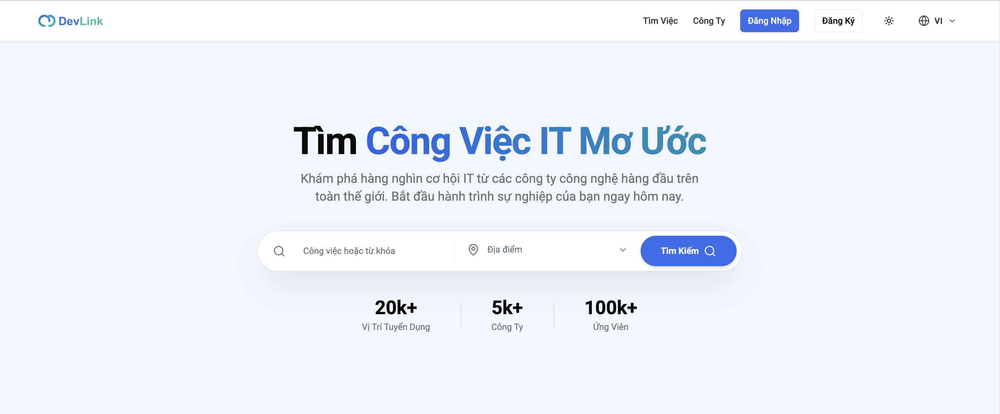 | 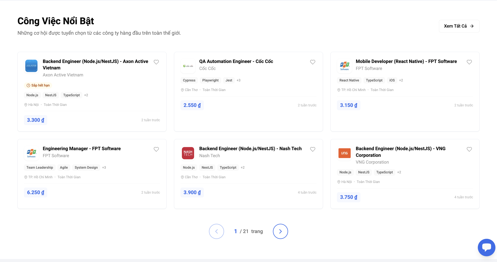 | 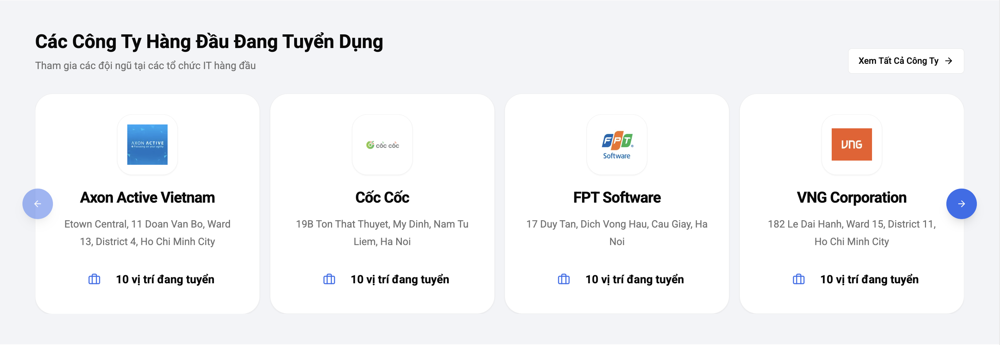 |

| Trang chủ - Thống kê & Quy trình | Trang chủ - Đánh giá / Footer |
| :---: | :---: |
| 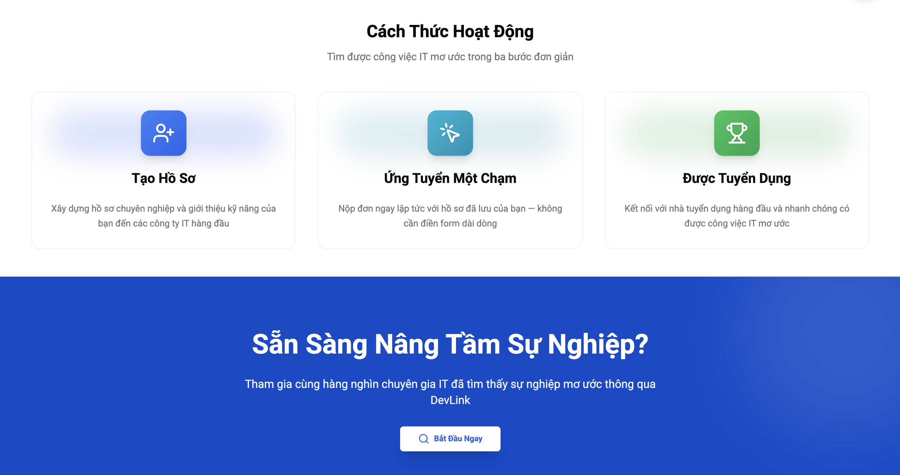 | 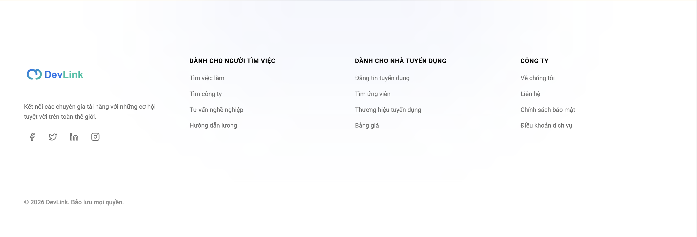 |

### 🔑 Xác thực
| Trang đăng nhập | Trang đăng ký |
| :---: | :---: |
| 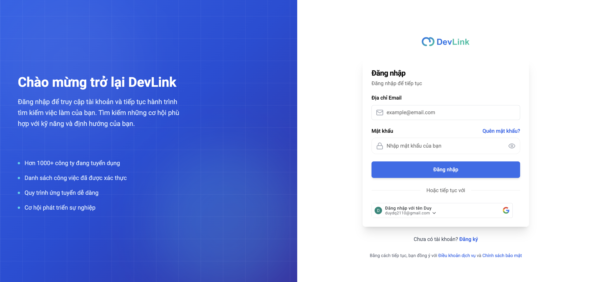 | 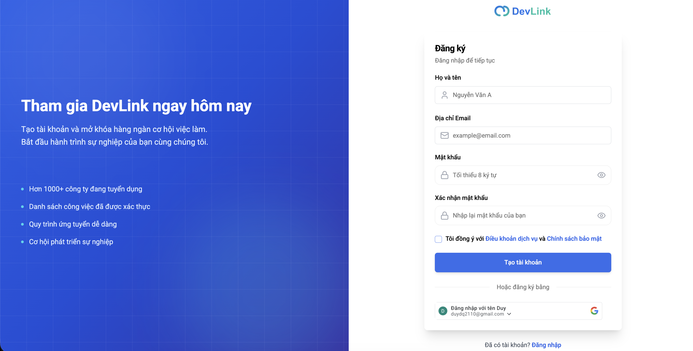 |

### 👤 Tính năng dành cho ứng viên
| Tìm kiếm & lọc việc làm | Trình tạo CV |
| :---: | :---: |
| 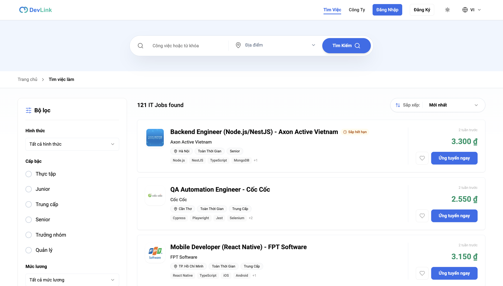 | 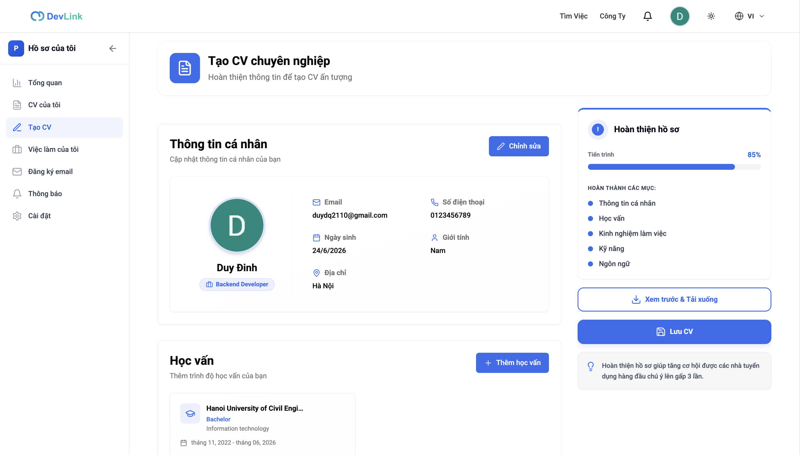 |
| **Chi tiết việc làm & Ứng tuyển** | **Xem trước CV trực tiếp** |
| 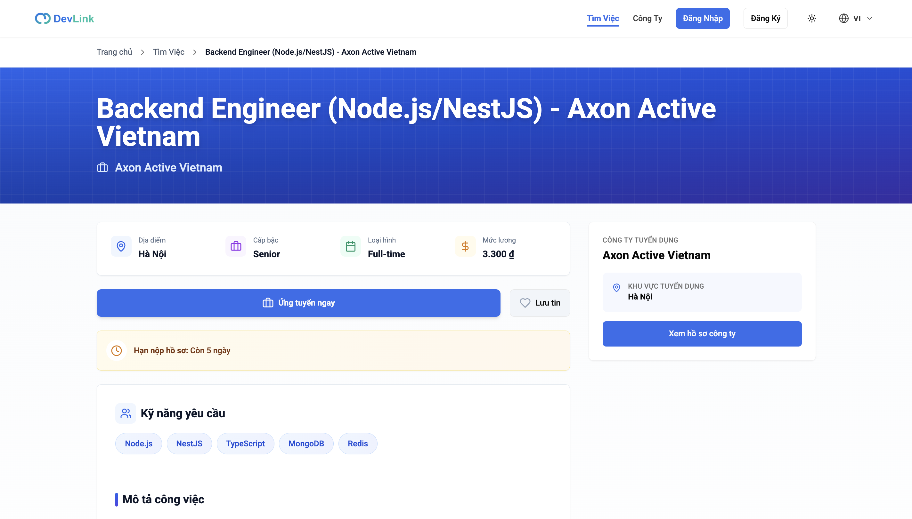 | 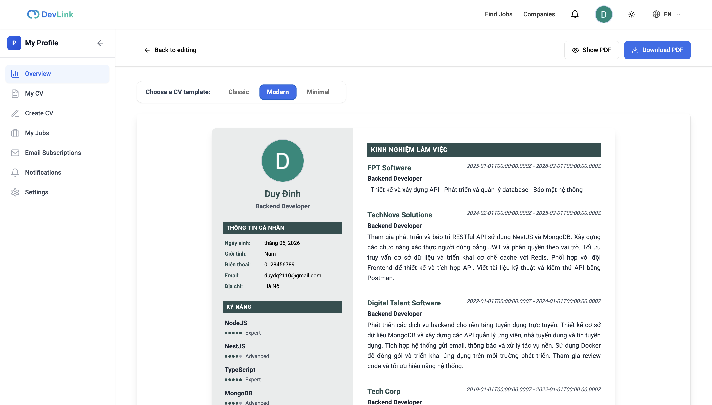 |

### 👑 Dashboard quản trị
| Thống kê tổng quan quản trị | Quản lý người dùng |
| :---: | :---: |
| 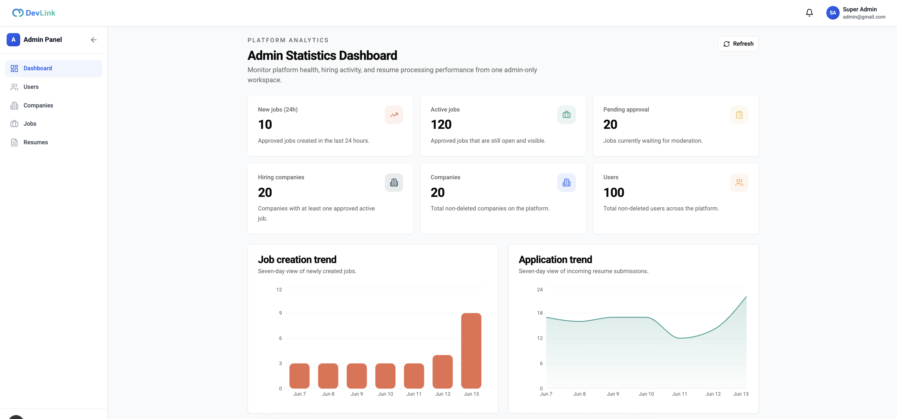 | 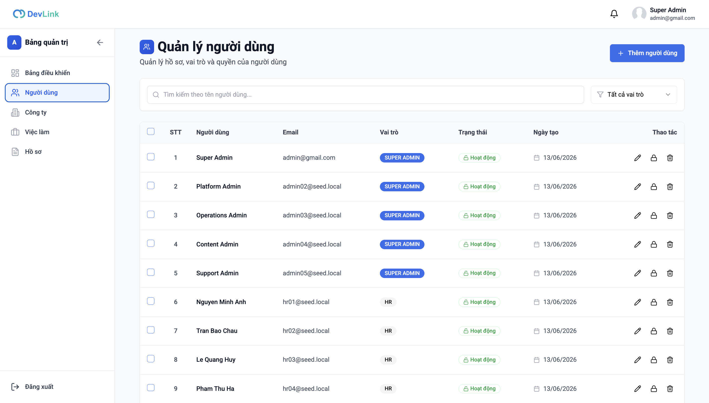 |
| **Quản lý công ty** | **Quản lý CV / hồ sơ ứng tuyển** |
| 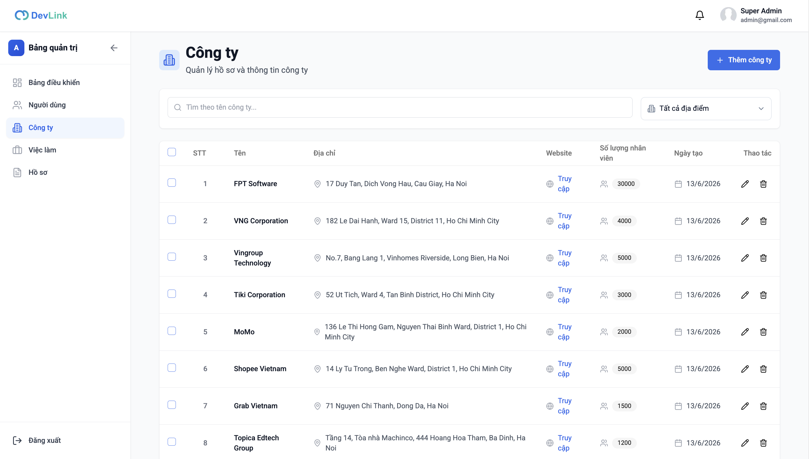 | 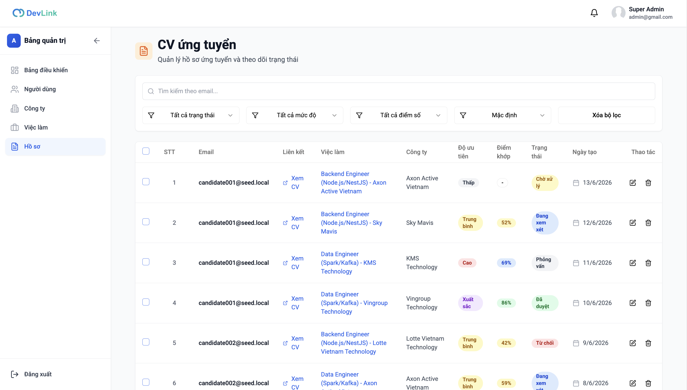 |

## 🛠️ Công nghệ sử dụng

| Tầng | Công nghệ |
| --- | --- |
| **Framework** | [<u><font color="blue">Next.js 15</font></u>](https://nextjs.org/) (App Router, Turbopack), [<u><font color="blue">React 18</font></u>](https://react.dev/), [<u><font color="blue">TypeScript 5</font></u>](https://www.typescriptlang.org/) |
| **Quản lý state** | [<u><font color="blue">Redux Toolkit</font></u>](https://redux-toolkit.js.org/), [<u><font color="blue">Redux Persist</font></u>](https://github.com/rt2xx/redux-persist) (hydrate xác thực), [<u><font color="blue">RTK Query</font></u>](https://redux-toolkit.js.org/rtk-query/overview) |
| **Phân quyền** | [<u><font color="blue">@casl/ability</font></u>](https://casl.js.org/) & [<u><font color="blue">@casl/react</font></u>](https://casl.js.org/) (cấu hình trong `src/lib/casl/`) - xử lý phân quyền và kiểm soát truy cập ở frontend, cho phép ẩn/hiện hoặc vô hiệu hóa các thành phần UI (như nút, menu, liên kết) dựa trên quyền của người dùng |
| **HTTP Client** | [<u><font color="blue">Axios</font></u>](https://axios-http.com/) (với interceptor tự động làm mới token & async-mutex guard) |
| **Styling & UI** | [<u><font color="blue">Tailwind CSS 3</font></u>](https://tailwindcss.com/), các primitive của [<u><font color="blue">Radix UI</font></u>](https://www.radix-ui.com/), component [<u><font color="blue">shadcn/ui</font></u>](https://ui.shadcn.com/), [<u><font color="blue">Lucide Icons</font></u>](https://lucide.dev/) |
| **Form & Validation** | [<u><font color="blue">React Hook Form</font></u>](https://react-hook-form.com/), schema [<u><font color="blue">Zod</font></u>](https://zod.dev/) |
| **Xuất tài liệu** | [<u><font color="blue">@react-pdf/renderer</font></u>](https://react-pdf.org/) để tạo CV dựa trên template |
| **Bộ kiểm thử** | [<u><font color="blue">Jest</font></u>](https://jestjs.io/), [<u><font color="blue">React Testing Library</font></u>](https://testing-library.com/docs/react-testing-library/intro/), [<u><font color="blue">JSDOM</font></u>](https://github.com/jsdom/jsdom) |
| **i18n / Bản địa hóa** | [<u><font color="blue">next-intl</font></u>](https://next-intl-docs.vercel.app/) + `I18nProvider` tùy chỉnh phía client |

---

## 🏗️ Thiết kế kiến trúc

DevLink được tổ chức theo cấu trúc thư mục **theo tính năng (feature-based)**, có tính module hóa cao.

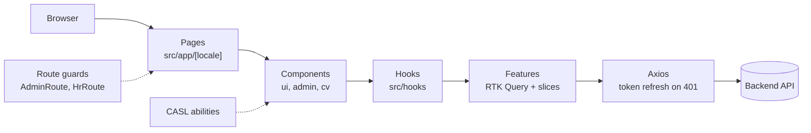

```text
src/
├── app/                        # Next.js App Router (chia theo locale: src/app/[locale])
│   ├── (auth)/                 # Chỉ dành cho khách: đăng nhập, đăng ký, đặt lại mật khẩu, xác minh
│   ├── (main)/                 # Công khai: trang chủ, việc làm (nội bộ + bên ngoài), công ty
│   ├── (profile)/              # Hồ sơ ứng viên, lịch sử ứng tuyển và tùy chọn
│   ├── (dashboard)/            # Khu vực admin (`/admin/*`), được bảo vệ bởi AdminRoute (SUPER ADMIN hoặc HR)
│   ├── (hr-dashboard)/         # Dashboard thống kê HR (`/hr/dashboard`), được bảo vệ bởi HrRoute
│   ├── account/                # Hủy yêu cầu xóa tài khoản bằng token
│   └── api/proxy-image/        # Proxy CORS cho ảnh dùng trong PDF/Canvas (nằm ngoài [locale])
├── components/
│   ├── ui/                     # Các primitive được style bằng shadcn/ui và Tailwind CSS
│   ├── admin/                  # Component theo nghiệp vụ (Việc làm, Công ty, bảng điều khiển Admin)
│   └── cv/                     # Giao diện trình tạo CV & stylesheet @react-pdf
├── features/                   # Các tính năng cốt lõi (redux slice, API, schema Zod)
├── hooks/                      # Custom hook bao bọc Redux action và query
├── lib/                        # Axios instance, cấu hình Redux và cấu hình quyền CASL
├── i18n/                       # Định tuyến next-intl, cấu hình request, điều hướng
├── locales/                    # Bộ bản dịch dạng TypeScript (en.ts, vi.ts)
└── shared/                     # Kiểu dùng chung, cấu hình tĩnh và hằng số tiện ích
```

### Nguyên tắc triển khai chính
* **Bảo vệ route**: `AdminRoute` và `HrRoute` bảo vệ khu vực admin và HR, còn layout `(auth)` chuyển hướng người dùng đã đăng nhập đi nơi khác. `ProtectedRoute` và `GuestGuard` có tồn tại nhưng không được sử dụng. `/profile` không có guard ở frontend. Các guard này chỉ điều hướng giao diện; backend mới là nơi thực thi quyền truy cập.
* **API tập trung**: RTK Query làm việc với `src/lib/redux/api.ts` để điều phối cache, tag và invalidation.
* **Phân quyền chặt chẽ**: Phía client dùng các quy tắc CASL để bật/tắt có điều kiện các thành phần tương tác dựa trên quyền của vai trò người dùng.

---

## 🔗 Repository Backend

Dự án này cần dịch vụ backend API tương ứng để hoạt động đầy đủ. Bạn có thể tìm repository backend tại liên kết sau:
* **Repository Backend**: [<u><font color="blue">DevLink Backend</font></u>](https://github.com/QuocDuy21-10/it-job-portal-be)

---

## ⚙️ Cài đặt & Cấu hình

### 1. Clone dự án
```bash
git clone <repository-url>
cd my-job-portal-fe
```

### 2. Quản lý phiên bản Node
Đảm bảo bạn đang dùng phiên bản Node.js được hỗ trợ, khai báo trong `.nvmrc`:
```bash
nvm use
```

### 3. Cài đặt dependencies
```bash
npm ci
```

### 4. Thiết lập biến môi trường
Tạo file `.env.local` ở thư mục gốc:
```env
NEXT_PUBLIC_GOOGLE_CLIENT_ID=your-google-oauth-client-id
NEXT_PUBLIC_SITE_URL=http://localhost:3000
```

> [!NOTE]
> Địa chỉ backend được **hard-code** là `http://localhost:8081/api/v1` trong `src/shared/constants/constant.ts` và không được đọc từ biến môi trường. `NEXT_PUBLIC_API_URL` chỉ mở rộng danh sách cho phép (allow-list) của image proxy (hãy dùng host thuần như `https://api.example.com`, không kèm đường dẫn). Nếu thiếu `NEXT_PUBLIC_GOOGLE_CLIENT_ID`, trang `/login` sẽ không render được. Xem [biến môi trường](docs/01-getting-started/environment-variables.md).

---

## 🚀 Các lệnh có sẵn

Chạy các script sau trong quá trình phát triển và triển khai:

| Lệnh | Mô tả |
| --- | --- |
| `npm run dev` | Khởi động dev server cục bộ bằng engine **Turbopack** hiệu năng cao |
| `npm run build` | Biên dịch ứng dụng Next.js, chạy kiểm tra kiểu và tối ưu bundle production |
| `npm run start` | Chạy bản build production ở môi trường cục bộ |
| `npm run lint` | Kiểm tra quy tắc style và cú pháp của mã nguồn bằng ESLint |
| `npm test` | Chạy các bộ test unit, page và tích hợp tính năng bằng Jest |
| `npx tsc --noEmit` | Kiểm tra TypeScript biên dịch hợp lệ trên toàn bộ mã nguồn |

---

## 🧪 Phạm vi kiểm thử

Chúng tôi dùng Jest cùng React Testing Library để giữ mã nguồn đáng tin cậy. Phạm vi bao gồm:
* **Redux / RTK Query**: Kiểm tra chuyển đổi state, query bất đồng bộ và mutation lỗi.
* **Kiểm thử component**: Chuyển đổi dialog tương tác, hồ sơ công ty, ứng tuyển việc làm, bộ lọc tìm kiếm và các card.
* **Kiểm tra tiện ích**: Kiểm thử proxy CORS cho ảnh/PDF, chuyển đổi bản dịch i18n và bộ phân giải route.

---

## 👨‍💻 Tác giả & Đóng góp

* **Tác giả**: QuocDuy21-10 (Quốc Duy)
