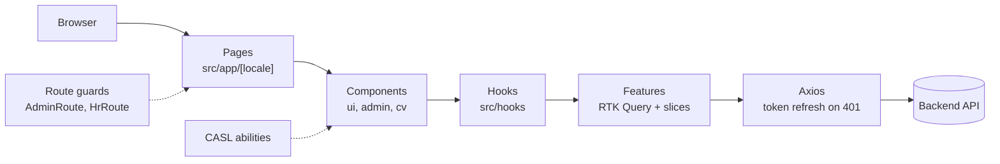

<p align="center">
  
</p>

<h1 align="center">DevLink Frontend</h1>

<p align="center">
  <a href="https://nextjs.org/"></a>
  <a href="https://react.dev/"></a>
  <a href="https://www.typescriptlang.org/"></a>
  <a href="https://redux-toolkit.js.org/"></a>
  <a href="https://tailwindcss.com/"></a>
  <a href="https://jestjs.io/"></a>
  <a href="https://eslint.org/"></a>
</p>

<p align="center">
  <a href="https://quocduy21-10.github.io/it-job-portal-fe/"></a>
  <a href="https://github.com/QuocDuy21-10/it-job-portal-fe/actions/workflows/docs.yml"></a>
</p>

**DevLink** is a modern, premium recruitment platform frontend designed specifically for developers and IT professionals. Built on [<u><font color="blue">Next.js 15</font></u>](https://nextjs.org/), [<u><font color="blue">React 18</font></u>](https://react.dev/), and [<u><font color="blue">TypeScript</font></u>](https://www.typescriptlang.org/), it features role-based routing, internationalization support, advanced state hydration, real-time messaging, interactive CV builders with PDF exports, and highly polished dashboard interfaces for candidates, recruiters, and administrators.

> 📚 **Documentation website**: **https://quocduy21-10.github.io/it-job-portal-fe/** (search, dark mode, diagrams). The same Markdown is readable on GitHub from [`docs/`](docs/README.md).

| Start here | Go deeper |
| :-- | :-- |
| [Introduction](docs/00-start-here/introduction.md) | [Architecture](docs/02-architecture/overview.md) |
| [Run locally](docs/01-getting-started/run-locally.md) | [Features](docs/04-features/README.md) |
| [Environment variables](docs/01-getting-started/environment-variables.md) | [Business flows](docs/05-business-flows/README.md) |

---

## 📌 Features Overview

### 👤 Candidate Experience
* **Authentication**: Credentials login/register + Google OAuth.
* **Job & Company Search**: Browse, filter, paginate, save jobs, and follow companies.
* **Seamless Applications**: Direct, modal-driven job applications with CV attachment.
* **CV Builder**: Build and structure professional CV templates (Modern, Classic, Minimal) and export directly as PDF.
* **AI Career Chatbot**: Instant career-related feedback, resume suggestions, and job matching help.
* **Profile & Subscriptions**: Manage personal data, account preferences, email alerts, and deletion request flows.

### 🏢 Recruiter (HR) Hub
* **Recruiter Dashboard**: High-level statistics, response rates, and application trends.
* **Company Profiles**: Keep company branding, office locations, and details updated.
* **Job Management**: Create, edit, publish, and close job postings.
* **Application Pipeline**: Track applicant statuses and review resumes.

### 👑 System Admin Dashboard
* **User Management**: List, edit, lock, and delete users across the three roles (`SUPER ADMIN`, `HR`, `NORMAL USER`).
* **System Operations**: Complete visibility and management of all job postings (including approval), company registrations, and resumes.
* **Role-based Capabilities**: Per-role UI abilities are defined in code (`src/lib/casl/ability.ts`); there is no screen for editing roles or permissions.
* **Insights & Charts**: Beautiful dashboard analysis utilizing Recharts to track platform growth, active users, and application metrics.

---

## 📸 Screenshots

To view all interface mockups, browse the [public/images/screenshots/](public/images/screenshots/) directory.

### 🌐 Guest Experience & Landing Page

| Home - Hero Section | Home - Top Companies | Home - Categories |
| :---: | :---: | :---: |
|  |  |  |

| Home - Stats & Process | Home - Testimonials / Footer |
| :---: | :---: |
|  |  |

### 🔑 Authentication
| Login Page | Register Page |
| :---: | :---: |
|  |  |

### 👤 Candidate Features
| Job Search & Filtering | CV Builder |
| :---: | :---: |
|  |  |
| **Job Details & Application** | **CV Live Preview** |
|  |  |

### 👑 Administration Dashboard
| Admin Overview Analytics | User Management |
| :---: | :---: |
|  |  |
| **Company Management** | **CV / Resume Management** |
|  |  |

## 🛠️ Technology Stack

| Layer | Technologies |
| --- | --- |
| **Framework** | [<u><font color="blue">Next.js 15</font></u>](https://nextjs.org/) (App Router, Turbopack), [<u><font color="blue">React 18</font></u>](https://react.dev/), [<u><font color="blue">TypeScript 5</font></u>](https://www.typescriptlang.org/) |
| **State Management** | [<u><font color="blue">Redux Toolkit</font></u>](https://redux-toolkit.js.org/), [<u><font color="blue">Redux Persist</font></u>](https://github.com/rt2xx/redux-persist) (auth hydration), [<u><font color="blue">RTK Query</font></u>](https://redux-toolkit.js.org/rtk-query/overview) |
| **Authorization** | [<u><font color="blue">@casl/ability</font></u>](https://casl.js.org/) & [<u><font color="blue">@casl/react</font></u>](https://casl.js.org/) (configured in `src/lib/casl/`) - handling authorization and access control on the frontend, allowing you to hide/show or disable UI elements (like buttons, menus, links) based on user permissions |
| **HTTP Client** | [<u><font color="blue">Axios</font></u>](https://axios-http.com/) (with automatic token refresh interceptor & async-mutex guard) |
| **Styling & UI** | [<u><font color="blue">Tailwind CSS 3</font></u>](https://tailwindcss.com/), [<u><font color="blue">Radix UI</font></u>](https://www.radix-ui.com/) primitives, [<u><font color="blue">shadcn/ui</font></u>](https://ui.shadcn.com/) components, [<u><font color="blue">Lucide Icons</font></u>](https://lucide.dev/) |
| **Forms & Validation** | [<u><font color="blue">React Hook Form</font></u>](https://react-hook-form.com/), [<u><font color="blue">Zod</font></u>](https://zod.dev/) schemas |
| **Document Export** | [<u><font color="blue">@react-pdf/renderer</font></u>](https://react-pdf.org/) for template-driven CV generation |
| **Testing Suite** | [<u><font color="blue">Jest</font></u>](https://jestjs.io/), [<u><font color="blue">React Testing Library</font></u>](https://testing-library.com/docs/react-testing-library/intro/), [<u><font color="blue">JSDOM</font></u>](https://github.com/jsdom/jsdom) |
| **i18n / Localization** | [<u><font color="blue">next-intl</font></u>](https://next-intl-docs.vercel.app/) localization + Custom client `I18nProvider` |

---

## 🏗️ Architecture Design

DevLink is organized around a highly modular, **feature-based** directory structure.



```text
src/
├── app/                        # Next.js App Router (Locale segmented: src/app/[locale])
│   ├── (auth)/                 # Guest-only: Login, register, password reset, verification
│   ├── (main)/                 # Public: Home page, jobs (internal + external), companies
│   ├── (profile)/              # Candidate profile, application history, and preferences
│   ├── (dashboard)/            # Admin area (`/admin/*`), guarded by AdminRoute (SUPER ADMIN or HR)
│   ├── (hr-dashboard)/         # HR statistics dashboard (`/hr/dashboard`), guarded by HrRoute
│   ├── account/                # Cancel account deletion by token
│   └── api/proxy-image/        # Image CORS proxy for PDF/Canvas rendering (outside [locale])
├── components/
│   ├── ui/                     # Primitives styled with shadcn/ui and Tailwind CSS
│   ├── admin/                  # Domain-specific components (Jobs, Companies, Admin panels)
│   └── cv/                     # CV Builder interfaces & @react-pdf styling sheets
├── features/                   # Core application features (redux slices, APIs, Zod schemas)
├── hooks/                      # Custom hooks wrapping Redux actions and queries
├── lib/                        # Axios instance, Redux setup, and CASL abilities configuration
├── i18n/                       # next-intl routing, request config, navigation
├── locales/                    # Translation catalogs as TypeScript (en.ts, vi.ts)
└── shared/                     # Global types, static configurations, and helper constants
```

### Key Implementation Principles
* **Route Protection**: `AdminRoute` and `HrRoute` guard the admin and HR areas, and the `(auth)` layout redirects signed-in users away. `ProtectedRoute` and `GuestGuard` exist but are not used. `/profile` has no frontend guard. These guards only steer the UI; the backend enforces access.
* **Centralized API**: RTK Query interfaces with `src/lib/redux/api.ts` to coordinate caching, tags, and invalidations.
* **Strict Permissions**: The client-side utilizes CASL rules to toggle interactive components conditionally based on user role permissions.

---

## 🔗 Backend Repository

This project requires the corresponding backend API service to function fully. You can find the backend repository at the following link:
* **Backend Repository**: [<u><font color="blue">DevLink Backend</font></u>](https://github.com/QuocDuy21-10/it-job-portal-be)

---

## ⚙️ Installation & Configuration

### 1. Clone the project
```bash
git clone <repository-url>
cd my-job-portal-fe
```

### 2. Node version management
Ensure you are using the supported Node.js version specified in `.nvmrc`:
```bash
nvm use
```

### 3. Install dependencies
```bash
npm ci
```

### 4. Setup environment variables
Create a `.env.local` file in the root directory:
```env
NEXT_PUBLIC_GOOGLE_CLIENT_ID=your-google-oauth-client-id
NEXT_PUBLIC_SITE_URL=http://localhost:3000
```

> [!NOTE]
> The backend address is **hard-coded** to `http://localhost:8081/api/v1` in `src/shared/constants/constant.ts` and is not read from an environment variable. `NEXT_PUBLIC_API_URL` only extends the image-proxy allow-list (give it a bare host such as `https://api.example.com`, without a path). Without `NEXT_PUBLIC_GOOGLE_CLIENT_ID` the `/login` page fails to render. See [environment variables](docs/01-getting-started/environment-variables.md).

---

## 🚀 Available Commands

Run these scripts during development and deployment:

| Command | Description |
| --- | --- |
| `npm run dev` | Starts the local dev server using the high-performance **Turbopack** engine |
| `npm run build` | Compiles the Next.js application, running type-checks and production bundle optimizations |
| `npm run start` | Launches the production-built bundle locally |
| `npm run lint` | Inspects codebase styles and syntax rules with ESLint |
| `npm test` | Runs unit, page, and feature integration test suites under Jest |
| `npx tsc --noEmit` | Validates TypeScript syntax compiles correctly across the codebase |

---

## 🧪 Testing Scope

We use Jest alongside React Testing Library to keep code reliable. Coverage includes:
* **Redux / RTK Query**: Verifying state transitions, async queries, and error mutations.
* **Component Testing**: Interactive dialog transitions, company profiles, job applications, search filters, and card components.
* **Utility Verification**: Testing image/PDF CORS proxies, i18n translation switches, and route resolvers.

---

## 👨‍💻 Author & Contributions

* **Author**: QuocDuy21-10 (Quoc Duy)
