<p align="center">
  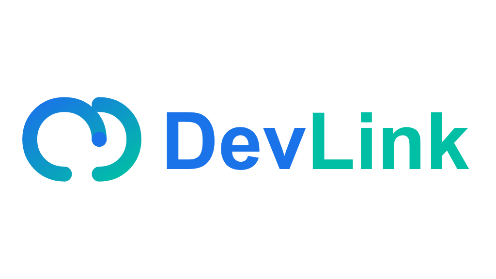
</p>

<h1 align="center">DevLink Frontend</h1>

<p align="center">
  <a href="https://nextjs.org/"></a>
  <a href="https://react.dev/"></a>
  <a href="https://www.typescriptlang.org/"></a>
  <a href="https://redux-toolkit.js.org/"></a>
  <a href="https://tailwindcss.com/"></a>
  <a href="https://jestjs.io/"></a>
  <a href="https://eslint.org/"></a>
</p>

**DevLink** is a modern, premium recruitment platform frontend designed specifically for developers and IT professionals. Built on [<u><font color="blue">Next.js 15</font></u>](https://nextjs.org/), [<u><font color="blue">React 18</font></u>](https://react.dev/), and [<u><font color="blue">TypeScript</font></u>](https://www.typescriptlang.org/), it features role-based routing, internationalization support, advanced state hydration, real-time messaging, interactive CV builders with PDF exports, and highly polished dashboard interfaces for candidates, recruiters, and administrators.

---

## 📌 Features Overview

### 👤 Candidate Experience
* **Authentication**: Credentials login/register + Google OAuth.
* **Job & Company Search**: Browse, filter, paginate, save jobs, and follow companies.
* **Seamless Applications**: Direct, modal-driven job applications with CV attachment.
* **CV Builder**: Build and structure professional CV templates (Modern, Classic, Minimal) and export directly as PDF.
* **AI Career Chatbot**: Instant career-related feedback, resume suggestions, and job matching help.
* **Profile & Subscriptions**: Manage personal data, account preferences, email alerts, and deletion request flows.

### 🏢 Recruiter (HR) Hub
* **Recruiter Dashboard**: High-level statistics, response rates, and application trends.
* **Company Profiles**: Keep company branding, office locations, and details updated.
* **Job Management**: Create, edit, publish, and close job postings.
* **Application Pipeline**: Track applicant statuses, review resumes, and manage applicant communication.

### 👑 System Admin Dashboard
* **User & Roles Management**: Fine-grained access control over candidates, HRs, and admins.
* **System Operations**: Complete visibility and management of all job postings, company registrations, and resumes.
* **Permissions & Capabilities**: Customize CASL rules, roles, and administrative permissions.
* **Insights & Charts**: Beautiful dashboard analysis utilizing Recharts to track platform growth, active users, and application metrics.

---

## 📸 Screenshots

To view all interface mockups, browse the [public/images/screenshots/](public/images/screenshots/) directory.

### 🌐 Guest Experience & Landing Page

| Home - Hero Section | Home - Top Companies | Home - Categories |
| :---: | :---: | :---: |
| 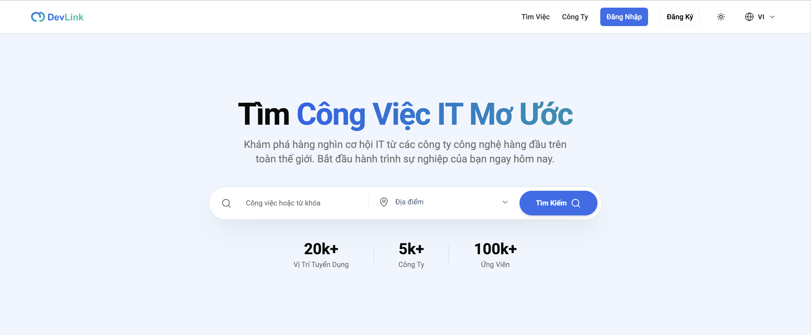 | 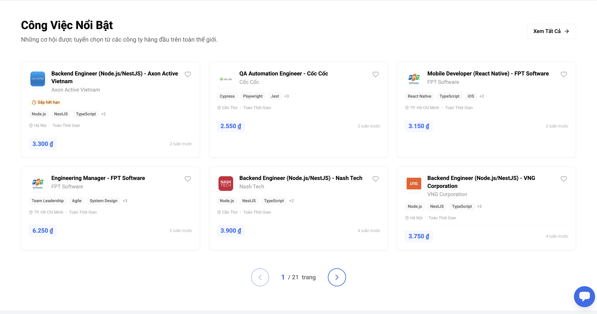 | 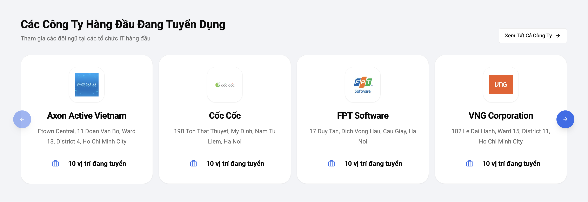 |

| Home - Stats & Process | Home - Testimonials / Footer |
| :---: | :---: |
| 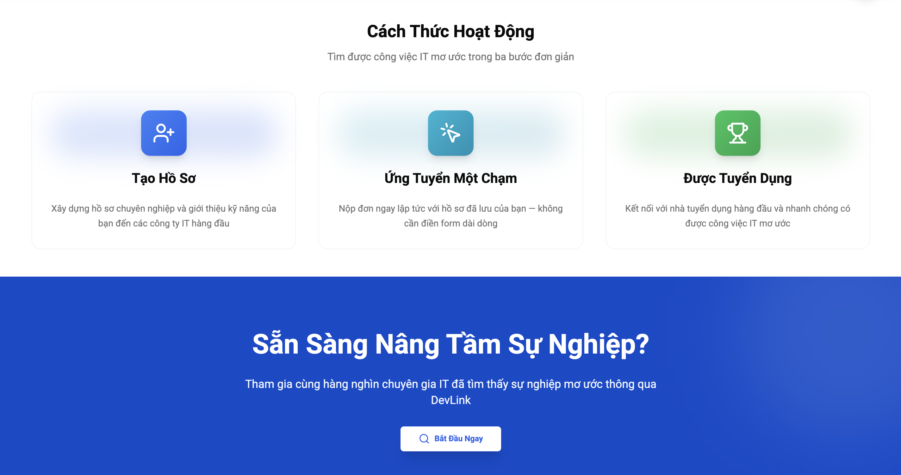 | 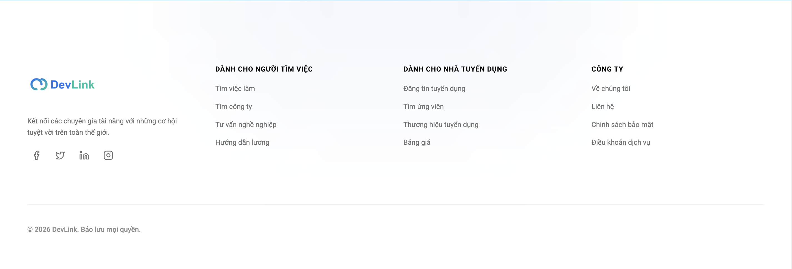 |

### 🔑 Authentication
| Login Page | Register Page |
| :---: | :---: |
| 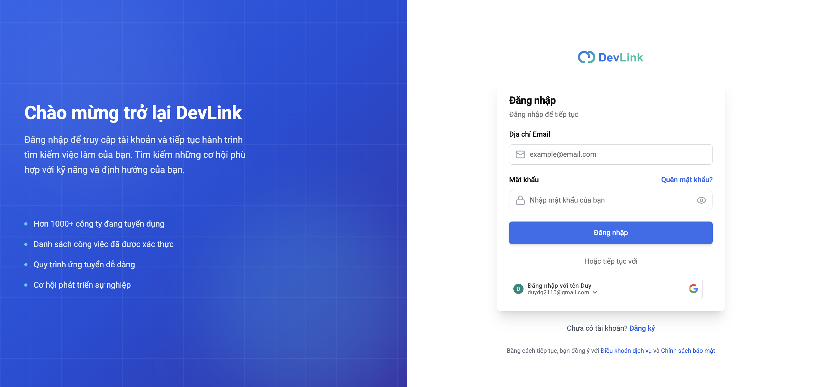 | 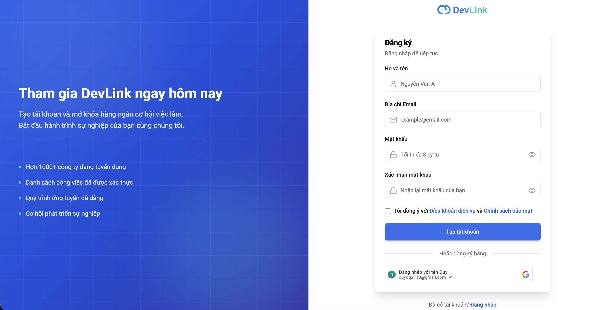 |

### 👤 Candidate Features
| Job Search & Filtering | CV Builder |
| :---: | :---: |
| 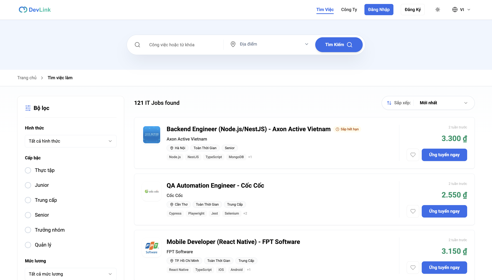 | 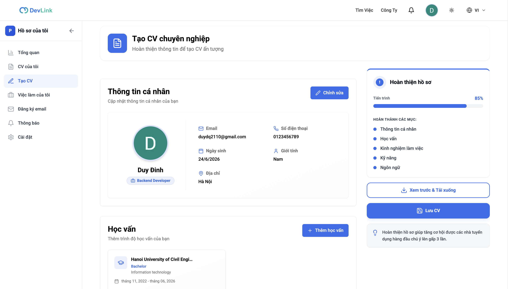 |
| **Job Details & Application** | **CV Live Preview** |
| 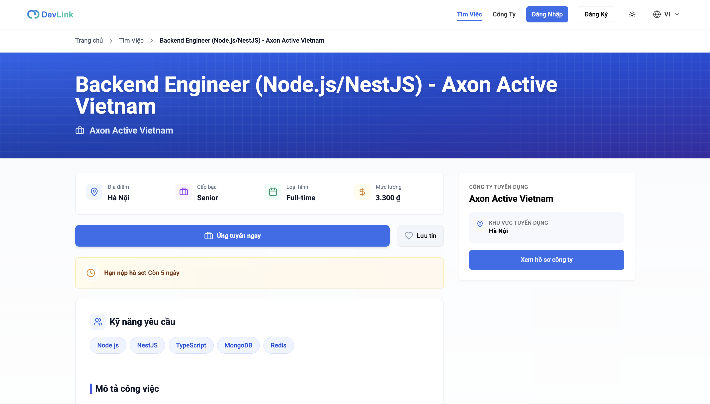 | 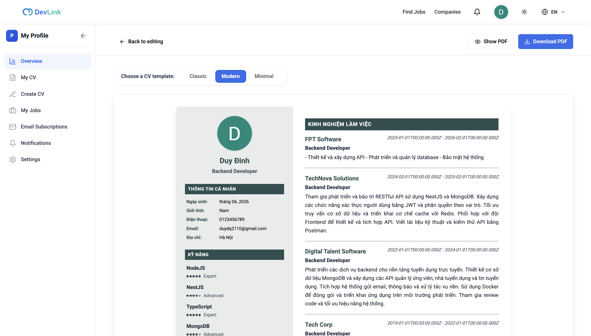 |

### 👑 Administration Dashboard
| Admin Overview Analytics | User Management |
| :---: | :---: |
| 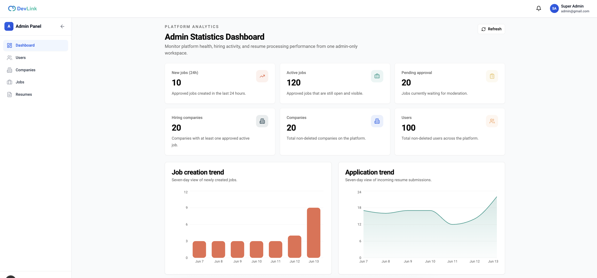 | 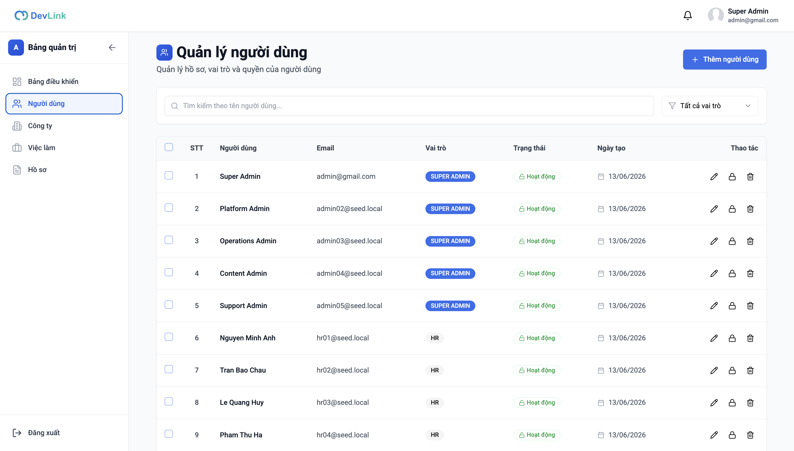 |
| **Company Management** | **CV / Resume Management** |
| 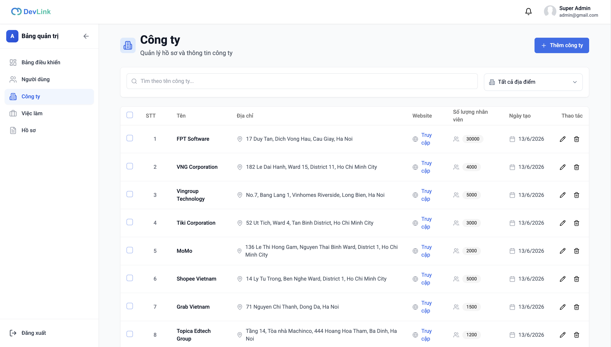 | 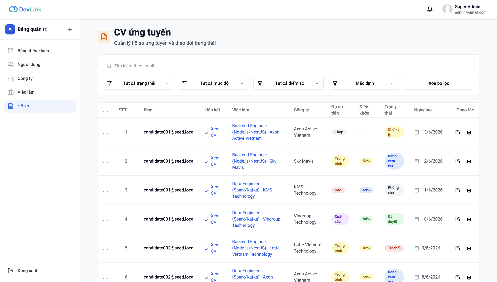 |

## 🛠️ Technology Stack

| Layer | Technologies |
| --- | --- |
| **Framework** | [<u><font color="blue">Next.js 15</font></u>](https://nextjs.org/) (App Router, Turbopack), [<u><font color="blue">React 18</font></u>](https://react.dev/), [<u><font color="blue">TypeScript 5</font></u>](https://www.typescriptlang.org/) |
| **State Management** | [<u><font color="blue">Redux Toolkit</font></u>](https://redux-toolkit.js.org/), [<u><font color="blue">Redux Persist</font></u>](https://github.com/rt2xx/redux-persist) (auth hydration), [<u><font color="blue">RTK Query</font></u>](https://redux-toolkit.js.org/rtk-query/overview) |
| **Authorization** | [<u><font color="blue">@casl/ability</font></u>](https://casl.js.org/) & [<u><font color="blue">@casl/react</font></u>](https://casl.js.org/) (configured in `src/lib/casl/`) - handling authorization and access control on the frontend, allowing you to hide/show or disable UI elements (like buttons, menus, links) based on user permissions |
| **HTTP Client** | [<u><font color="blue">Axios</font></u>](https://axios-http.com/) (with automatic token refresh interceptor & async-mutex guard) |
| **Styling & UI** | [<u><font color="blue">Tailwind CSS 3</font></u>](https://tailwindcss.com/), [<u><font color="blue">Radix UI</font></u>](https://www.radix-ui.com/) primitives, [<u><font color="blue">shadcn/ui</font></u>](https://ui.shadcn.com/) components, [<u><font color="blue">Lucide Icons</font></u>](https://lucide.dev/) |
| **Forms & Validation** | [<u><font color="blue">React Hook Form</font></u>](https://react-hook-form.com/), [<u><font color="blue">Zod</font></u>](https://zod.dev/) schemas |
| **Document Export** | [<u><font color="blue">@react-pdf/renderer</font></u>](https://react-pdf.org/) for template-driven CV generation |
| **Testing Suite** | [<u><font color="blue">Jest</font></u>](https://jestjs.io/), [<u><font color="blue">React Testing Library</font></u>](https://testing-library.com/docs/react-testing-library/intro/), [<u><font color="blue">JSDOM</font></u>](https://github.com/jsdom/jsdom) |
| **i18n / Localization** | [<u><font color="blue">next-intl</font></u>](https://next-intl-docs.vercel.app/) localization + Custom client `I18nProvider` |

---

## 🏗️ Architecture Design

DevLink is organized around a highly modular, **feature-based** directory structure.

```text
src/
├── app/                        # Next.js App Router (Locale segmented: src/app/[locale])
│   ├── (auth)/                 # Guest-only: Login, register, password reset, verification
│   ├── (main)/                 # Public: Home page, search jobs, companies list
│   ├── (profile)/              # Candidate profile, application history, and preferences
│   ├── (dashboard)/            # Admin/HR dashboards (role-protected navigation)
│   └── api/proxy-image/        # Image CORS proxy for PDF/Canvas rendering
├── components/
│   ├── ui/                     # Primitives styled with shadcn/ui and Tailwind CSS
│   ├── admin/                  # Domain-specific components (Jobs, Companies, Admin panels)
│   └── cv/                     # CV Builder interfaces & @react-pdf styling sheets
├── features/                   # Core application features (redux slices, APIs, Zod schemas)
├── hooks/                      # Custom hooks wrapping Redux actions and queries
├── lib/                        # Axios instance, Redux setup, and CASL abilities configuration
├── locales/                    # Translation JSON catalogs (English 'en' & Vietnamese 'vi')
└── shared/                     # Global types, static configurations, and helper constants
```

### Key Implementation Principles
* **Route Protection**: Automated guards (`ProtectedRoute`, `GuestGuard`, `AdminRoute`) enforce role access.
* **Centralized API**: RTK Query interfaces with `src/lib/redux/api.ts` to coordinate caching, tags, and invalidations.
* **Strict Permissions**: The client-side utilizes CASL rules to toggle interactive components conditionally based on user role permissions.

---

## ⚙️ Installation & Configuration

### 1. Clone the project
```bash
git clone <repository-url>
cd my-job-portal-fe
```

### 2. Node version management
Ensure you are using the supported Node.js version specified in `.nvmrc`:
```bash
nvm use
```

### 3. Install dependencies
```bash
npm install
```

### 4. Setup environment variables
Create a `.env.local` file in the root directory:
```env
NEXT_PUBLIC_GOOGLE_CLIENT_ID=your-google-oauth-client-id
NEXT_PUBLIC_API_URL=http://localhost:8081/api/v1
NEXT_PUBLIC_SITE_URL=http://localhost:3000
```

> [!NOTE]
> The primary API base url used for standard data requests is configured globally inside `src/shared/constants/constant.ts`.

---

## 🚀 Available Commands

Run these scripts during development and deployment:

| Command | Description |
| --- | --- |
| `npm run dev` | Starts the local dev server using the high-performance **Turbopack** engine |
| `npm run build` | Compiles the Next.js application, running type-checks and production bundle optimizations |
| `npm run start` | Launches the production-built bundle locally |
| `npm run lint` | Inspects codebase styles and syntax rules with ESLint |
| `npm test` | Runs unit, page, and feature integration test suites under Jest |
| `npx tsc --noEmit` | Validates TypeScript syntax compiles correctly across the codebase |

---

## 🧪 Testing Scope

We use Jest alongside React Testing Library to keep code reliable. Coverage includes:
* **Redux / RTK Query**: Verifying state transitions, async queries, and error mutations.
* **Component Testing**: Interactive dialog transitions, company profiles, job applications, search filters, and card components.
* **Utility Verification**: Testing image/PDF CORS proxies, i18n translation switches, and route resolvers.

---

## 👨‍💻 Author & Contributions

* **Author**: QuocDuy21-10 (Quoc Duy)
