# Ảnh giao diện

Đây là các ảnh chụp màn hình thật của DevLink, nhóm theo vai trò, để bạn hình dung giao diện trước khi chạy dự án. Ảnh dùng lại từ thư mục `public/images/screenshots/` nên không có bản sao nào được tạo ra.

## Dành cho khách

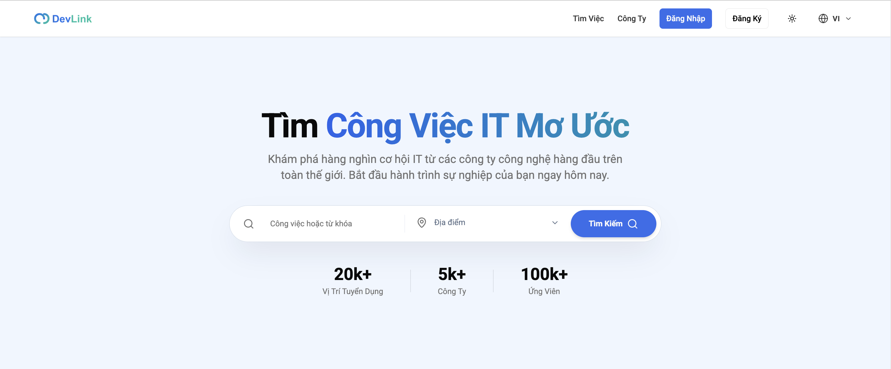

*Trang chủ với ô tìm kiếm theo từ khóa và địa điểm. Thanh trên cùng có nút Đăng nhập, Đăng ký, đổi giao diện sáng tối và đổi ngôn ngữ.*

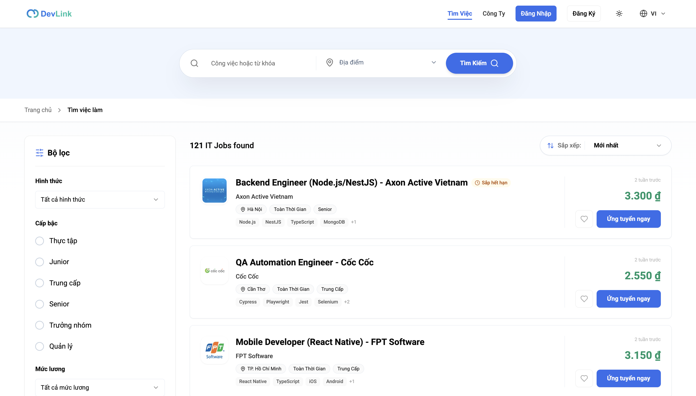

*Danh sách việc làm. Bộ lọc hình thức, cấp bậc và mức lương nằm bên trái; mỗi thẻ có tên việc, công ty, địa điểm, kỹ năng, mức lương, nút lưu và nút "Ứng tuyển ngay".*

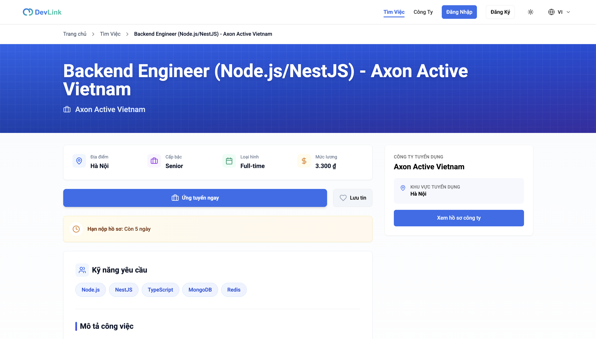

*Chi tiết việc làm: thông tin tóm tắt, nút ứng tuyển và lưu tin, thông báo hạn nộp hồ sơ, kỹ năng yêu cầu và khung thông tin công ty.*

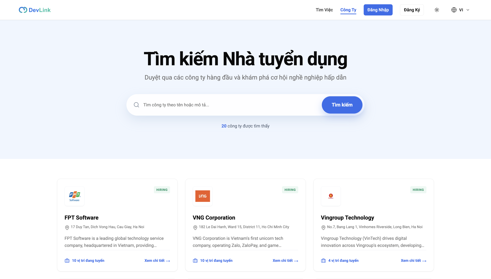

*Danh sách công ty với ô tìm kiếm và số vị trí đang tuyển của từng công ty.*

## Dành cho ứng viên

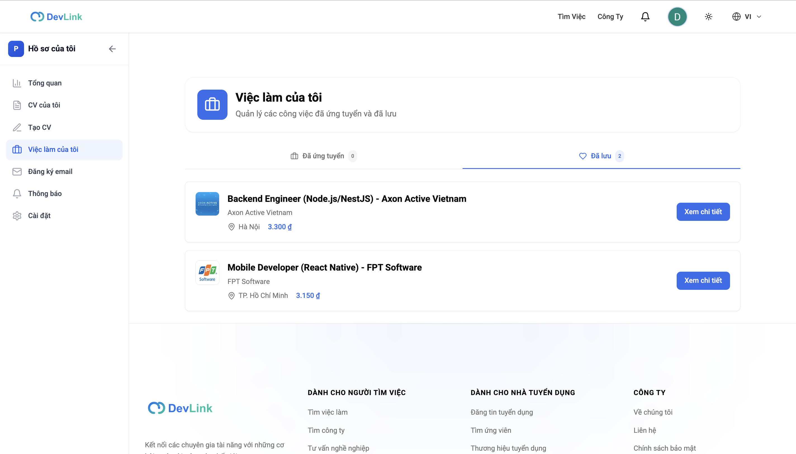

*Trang "Việc làm của tôi" với hai tab: đã ứng tuyển và đã lưu. Thanh bên trái là menu khu hồ sơ cá nhân.*

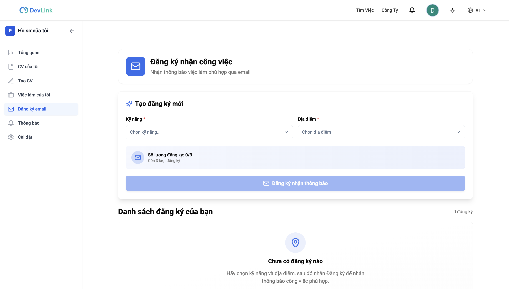

*Đăng ký nhận việc phù hợp: chọn kỹ năng và địa điểm. Mỗi người có tối đa 3 đăng ký.*

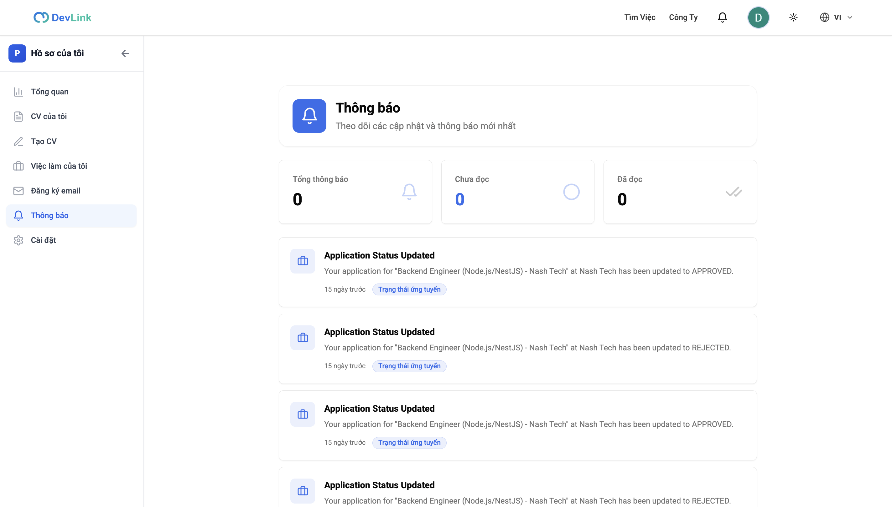

*Trang thông báo: tổng số, chưa đọc, đã đọc và danh sách cập nhật trạng thái hồ sơ ứng tuyển.*

## Dành cho quản trị

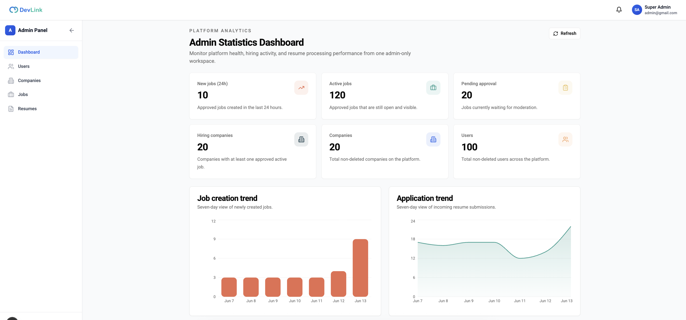

*Bảng thống kê của quản trị viên: số việc làm mới, việc đang mở, tin chờ duyệt, công ty, người dùng, kèm biểu đồ theo bảy ngày.*

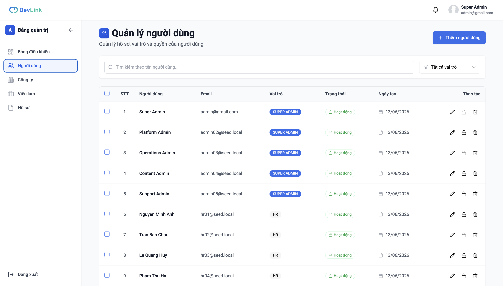

*Quản lý người dùng: tìm theo tên, lọc theo vai trò, sửa, khóa và xóa. Dữ liệu trong ảnh là dữ liệu mẫu.*

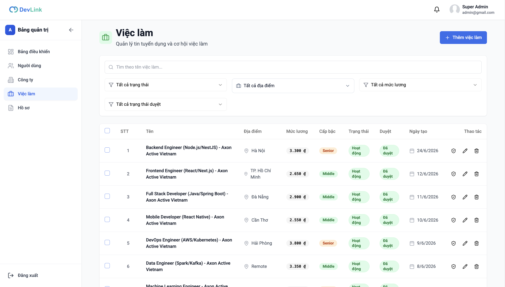

*Quản lý tin tuyển dụng: lọc theo trạng thái, địa điểm, mức lương và trạng thái duyệt; mỗi dòng có nút duyệt, sửa, xóa.*

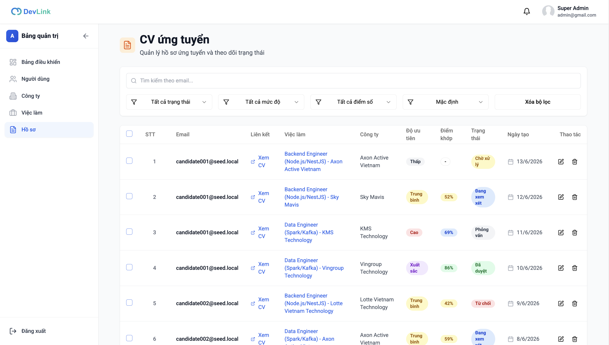

*Quản lý hồ sơ ứng tuyển: lọc theo trạng thái, mức độ ưu tiên và điểm khớp, kèm liên kết xem CV. Dữ liệu trong ảnh là dữ liệu mẫu.*

## Về các ảnh khác trong thư mục

Thư mục ảnh còn nhiều ảnh nữa. Ảnh nào cho thấy tên và email của một tài khoản thật thì **không** được dùng ở đây (gồm tổng quan hồ sơ, cài đặt, tạo CV, xem trước CV và trang đăng nhập). Các ảnh còn lại chưa được rà soát nên cũng không đưa vào. Ảnh minh họa mới nên dùng dữ liệu mẫu và không chứa thông tin cá nhân.
