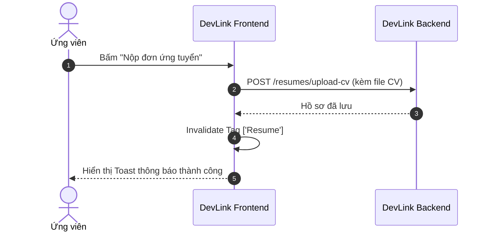

# Quy tắc viết tài liệu chuẩn DevLink

Tài liệu kỹ thuật của DevLink được xây dựng theo triết lý **"Documentation as Code"** và vận hành theo mô hình **hai lớp hiển thị (Dual-Layer)**:
1. **Lớp 1 — Đọc trực tiếp trên GitHub**: Markdown chuẩn GFM, sơ đồ Mermaid native, bảng biểu, ảnh chụp và liên kết tương đối trỏ thẳng vào source code.
2. **Lớp 2 — Duyệt trên Website tài liệu (VitePress)**: Giao diện tĩnh siêu nhanh, hỗ trợ tìm kiếm full-text, sidebar điều hướng tự động, dark mode và mục lục bên phải trang.

Để toàn bộ bộ tài liệu luôn **đẹp, chuyên nghiệp, dễ đọc và không nhàm chán**, mọi trang tài liệu trong dự án đều phải tuân thủ nghiêm ngặt các quy tắc dưới đây.

---

## 1. Khung cấu trúc trang chuẩn (5 phần bắt buộc)

Mỗi tài liệu kỹ thuật hoặc nghiệp vụ đều phải tuân thủ thứ tự 5 phần nhất quán:

```
┌────────────────────────────────────────────────────────┐
│  1. TIÊU ĐỀ RÕ RÀNG & TÓM LƯỢC NGẮN (Hero & TL;DR)     │
│  2. GIẢI THÍCH TRƯỚC (Bối cảnh, Lý do, Giá trị, Rủi ro)│
│  3. TRỰC QUAN HÓA (Sơ đồ Mermaid hoặc Ảnh UI thực tế)  │
│  4. KỸ THUẬT SAU (Cơ chế, Bảng field, Code mẫu tối giản)│
│  5. LIÊN KẾT MỞ RỘNG (File mã nguồn & Chủ đề liên quan)│
└────────────────────────────────────────────────────────┘
```

### Chi tiết từng phần:

1. **Tiêu đề & Tóm lược (Hero & TL;DR)**:
   - Dùng tiêu đề H1 ngắn gọn, phản ánh đúng trọng tâm.
   - 1 đoạn văn (2–3 câu) giải thích ngắn gọn trang này nói về cái gì và đối tượng nào nên đọc.
2. **Giải thích trước (Why Before How)**:
   - Trả lời 3 câu hỏi cốt lõi:
     - *Tại sao hệ thống cần tính năng/thành phần này?*
     - *Khách hàng / Ứng viên / HR được lợi gì từ nó?*
     - *Đánh đổi (Trade-off) và rủi ro dữ liệu/hiệu năng là gì?*
3. **Trực quan hóa (Visuals)**:
   - Sơ đồ Mermaid (Flowchart, Sequence, State) mô tả hành trình dữ liệu hoặc trạng thái.
   - Đối với hướng dẫn sử dụng: Dùng ảnh chụp màn hình UI thật, có đóng khung/mũi tên chú thích.
4. **Kỹ thuật sau (Technical Details)**:
   - Chi tiết cài đặt, các endpoint, cấu hình Redux/RTK Query, validation Zod.
   - Bắt buộc dùng **Bảng (Tables)** khi liệt kê các fields, props, query params hoặc mã lỗi.
5. **Liên kết mở rộng & Source code (Footers)**:
   - Trỏ trực tiếp đến các file code triển khai (`src/...`) để người đọc có thể kiểm chứng.
   - Gợi ý 2–3 trang tài liệu liên quan tiếp theo.

---

## 2. Nguyên tắc "Giải thích trước — Kỹ thuật sau"

> [!IMPORTANT]
> **Không bao giờ bắt đầu tài liệu bằng một khối code hoặc danh sách API vô hồn.**
> Một tài liệu chuyên nghiệp giúp người đọc hiểu **nguyên nhân sâu xa** trước khi họ phải ghi nhớ **cú pháp triển khai**.

### Ví dụ so sánh:

#### ❌ Cách viết nhàm chán, thuần kỹ thuật:
> *"RTK Query cache trong dự án được cấu hình trong `api.ts`. Thẻ cache gồm `Job`, `User`. Khi gọi `createJob` thì trigger `invalidatesTags: ['Job']`. Thời gian giữ mặc định 60s."*

#### ✅ Cách viết chuyên nghiệp, lôi cuốn:
> *"**Vì sao đổi lại bộ lọc vừa xem không phải tải lại từ đầu?**  
> Ứng viên thường đổi qua lại giữa vài bộ lọc. RTK Query giữ kết quả đã tải trong bộ nhớ trình duyệt, nên có thể dùng lại thay vì gọi backend thêm lần nữa. Kết quả không còn component nào dùng được giữ mặc định 60 giây.  
> 
> **Đánh đổi:** dữ liệu có thể chưa mới. Thao tác tạo, sửa, xóa trong cùng phiên sẽ làm các truy vấn liên quan tải lại qua `invalidatesTags`, còn thay đổi do người khác thực hiện thì không tự cập nhật."*

> [!WARNING]
> **Giải thích hay nhưng phải đúng.** Không đưa con số chưa đo, lợi ích hoặc lý do không có căn cứ, và không viết code mẫu khác code thật. Không có căn cứ thì ghi "Chưa có ghi chép về lý do".

---

## 3. Quy chuẩn trực quan: "Visual with Purpose"

Tuyệt đối **không chèn các hình ảnh trang trí, vector trừu tượng hoặc ảnh meme** vào tài liệu kỹ thuật chỉ để "làm cho có màu sắc". Mọi yếu tố trực quan phải phục vụ việc hiểu thông tin nhanh hơn đọc chữ.

### 3.1. Sơ đồ Mermaid (Workflow, Sequence, State Machine)
- Dùng cho luồng xác thực token, chu kỳ sống của ứng tuyển, đường đi của API request.
- Viết bằng cú pháp Mermaid chuẩn để render đẹp cả trên GitHub và VitePress.



### 3.2. Ảnh chụp giao diện thực tế (Screenshots)
- Áp dụng cho: Hướng dẫn người dùng, flow nộp hồ sơ, thao tác tạo CV, trang quản trị Admin.
- Ảnh chụp từ màn hình thật của sản phẩm, không dùng mockup ảo.
- Tham chiếu trực tiếp ảnh trong `public/images/screenshots/`, không sao chép sang `docs/`.
- Ảnh mới đặt tên theo cách đang dùng trong thư mục đó, ví dụ `job_list_page.png`.

### 3.3. Bảng biểu (Tables) cho dữ liệu có cấu trúc
Bất kỳ thông tin nào có dạng danh sách thuộc tính đều phải chuyển thành bảng:

| Tên trường (Field) | Kiểu dữ liệu | Bắt buộc | Ý nghĩa nghiệp vụ |
| --- | --- | :---: | --- |
| `name` | `string` | Có | Tên tin tuyển dụng hiển thị cho ứng viên |
| `salary` | `number` | Có | Mức lương dạng số |
| `approvalStatus` | `'PENDING' \| 'APPROVED' \| 'REJECTED'` | Không | Trạng thái duyệt tin |

---

## 4. Sử dụng Callouts (Alerts) đúng ngữ cảnh

GitHub và VitePress đều hỗ trợ định dạng alert chuẩn. Hãy dùng đúng mức độ cảnh báo:

> [!NOTE]
> Thông tin bổ sung hữu ích, ngữ cảnh phụ giúp hiểu sâu hơn.

> [!TIP]
> Lời khuyên tối ưu hiệu năng, mẹo lập trình hoặc phím tắt hữu ích.

> [!IMPORTANT]
> Yêu cầu tiên quyết hoặc quy chuẩn bắt buộc phải làm theo.

> [!WARNING]
> Cảnh báo rủi ro về bảo mật, mất dữ liệu hoặc khả năng gây xung đột hệ thống.

---

## 5. Danh sách kiểm tra trước khi xuất bản (Checklist)

Trước khi commit một trang tài liệu mới, hãy tự kiểm tra:

- [ ] Tiêu đề H1 rõ ràng, có đoạn mở đầu tóm lược nội dung trong 2–3 câu.
- [ ] Đã có phần **Giải thích trước (Why)**: Bài toán thực tế, lợi ích người dùng và rủi ro/đánh đổi.
- [ ] Luồng nghiệp vụ phức tạp đã có sơ đồ **Mermaid** minh họa.
- [ ] Toàn bộ tham số, props hoặc fields đều trình bày bằng **Bảng**.
- [ ] Không có ảnh trang trí vô nghĩa; ảnh UI (nếu có) là ảnh chụp thực tế rõ ràng.
- [ ] Đã thêm liên kết tới file code thực tế trong `src/` và các tài liệu liên quan ở chân trang.
- [ ] Đã chạy `npm run docs:build` thử nghiệm và không có lỗi biên dịch.
- [ ] Không có con số chưa đo, lợi ích không có căn cứ hoặc code mẫu khác code thật.

