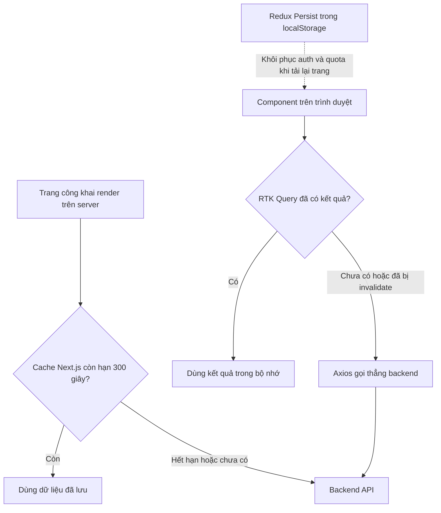

# Chiến lược cache

Dữ liệu trong DevLink được giữ lại ở ba chỗ khác nhau: cache của Next.js trên server, cache của RTK Query trong bộ nhớ trình duyệt, và vùng lưu trữ cục bộ của trình duyệt qua Redux Persist. Trang này chỉ rõ chỗ nào giữ dữ liệu gì và bao lâu, để bạn hiểu vì sao đôi khi dữ liệu hiển thị chưa mới.

## Vì sao cần nhiều lớp cache

Mỗi lớp giải quyết một việc khác nhau:

- Trang công khai cần có dữ liệu ngay khi render trên server, và nhiều người xem cùng một nội dung, nên phản hồi được giữ lại trên server.
- Người dùng qua lại giữa các màn hình trong cùng một phiên, nên trình duyệt giữ kết quả đã tải để không gọi lại backend.
- Người dùng tải lại trang vẫn cần thấy trạng thái đăng nhập và hạn mức chat, nên một phần state được lưu vào `localStorage`.

> [!WARNING]
> Đánh đổi của cache là dữ liệu có thể cũ. Trang công khai có thể hiển thị bản cũ trong khoảng 5 phút sau khi dữ liệu đổi. Frontend chưa có cơ chế làm mới theo yêu cầu: `src` không gọi `revalidateTag` hay `revalidatePath`.

## Hai đường đi của dữ liệu

Sơ đồ cho thấy hai đường độc lập: request từ trình duyệt không đi qua cache Next.js, và cache RTK Query không dùng chung với server.

## Ba lớp cache

| Lớp | Giữ gì | Thời gian sống |
| --- | --- | --- |
| Cache phía server (Next.js `fetch` và `cache()` của React) | Phản hồi của các lời gọi `fetchPublic*` | 300 giây (`revalidate`); `cache()` chỉ gộp lời gọi trùng trong một lần render |
| RTK Query (trình duyệt) | Kết quả các endpoint, gắn thẻ để làm mới | Mặc định 60 giây sau khi không còn component nào dùng; mất khi tải lại trang |
| Redux Persist (trình duyệt) | Một phần state của `auth` và `chatBot` | Lưu lâu dài trong `localStorage` |

### Lớp 1: cache phía server

`fetchPublicEntity` trong `src/lib/utils/public-content.ts` gọi `fetch` với `next: { revalidate: 300 }`. Dữ liệu việc làm hoặc công ty mà trang công khai thấy ban đầu có thể cũ khoảng 5 phút. Khi lời gọi lỗi hoặc backend trả mã không thành công, hàm trả về `null` thay vì ném lỗi, và trang xử lý như không có dữ liệu.

Các hàm như `fetchPublicJobById` được bọc thêm `cache()` của React, để cùng một lần render, `generateMetadata` và component trang gọi cùng một địa chỉ mà chỉ phát sinh một lời gọi.

### Lớp 2: cache RTK Query

`baseApi` khai báo các thẻ: `Auth`, `User`, `Company`, `Job`, `Resume`, `CVProfile`, `Subscriber`, `Statistics`, `Notification`, `Skill`. Endpoint đọc dữ liệu dùng `providesTags`; endpoint ghi dùng `invalidatesTags`. Ví dụ `createJob` làm mất hiệu lực thẻ `Job`, nên mọi truy vấn việc làm đang được giữ sẽ tự tải lại.

Code không đặt thời gian giữ riêng cho từng endpoint, ngoại trừ hai endpoint danh mục kỹ năng trong `skill.api.ts` (1 giờ và 1 ngày). Code cũng không gọi `setupListeners`, nên RTK Query không tự tải lại khi cửa sổ lấy lại tiêu điểm hoặc có mạng trở lại.

Ở trang danh sách việc làm, hook `useJobList` bỏ qua RTK Query khi bộ lọc còn trùng với trạng thái ban đầu và dùng luôn dữ liệu từ server. Chỉ khi người dùng đổi bộ lọc hoặc trang thì mới có lời gọi RTK Query.

### Lớp 3: Redux Persist

Store chỉ lưu lại hai phần:

| Slice | Trường được lưu |
| --- | --- |
| `auth` | `user`, `isAuthenticated` |
| `chatBot` | `quota`, đã qua bộ biến đổi `getActiveChatQuotaStatus` để bỏ hạn mức đã hết hạn |

Cache RTK Query không được lưu lại, nên sau khi tải lại trang mọi truy vấn sẽ chạy lại. Token truy cập không nằm trong phần Redux Persist mà được lưu riêng, xem [Xác thực](authentication.md).

## Cache ảnh của proxy

Route `/api/proxy-image` trả ảnh với `Cache-Control: public, max-age=31536000, immutable`, nghĩa là trình duyệt giữ ảnh tới một năm. Nếu ảnh trên backend đổi nhưng địa chỉ giữ nguyên, bản trong cache của trình duyệt có thể không đổi theo.

## Source code liên quan

- [`src/lib/utils/public-content.ts`](../../src/lib/utils/public-content.ts): `revalidate` 300 giây và `cache()`
- [`src/lib/redux/api.ts`](../../src/lib/redux/api.ts): danh sách thẻ cache RTK Query
- [`src/features/skill/redux/skill.api.ts`](../../src/features/skill/redux/skill.api.ts): endpoint đặt `keepUnusedDataFor` riêng
- [`src/lib/redux/store.ts`](../../src/lib/redux/store.ts): cấu hình Redux Persist
- [`src/hooks/use-job-list.ts`](../../src/hooks/use-job-list.ts): bỏ qua truy vấn khi dùng dữ liệu từ server
- [`src/features/job/redux/job.api.ts`](../../src/features/job/redux/job.api.ts): ví dụ `providesTags` và `invalidatesTags`
- [`src/app/api/proxy-image/route.ts`](../../src/app/api/proxy-image/route.ts): header cache của ảnh

Đọc tiếp: [Quản lý state](state-management.md), [Giao tiếp API](api-communication.md), [Rendering và SEO](rendering-and-seo.md).
