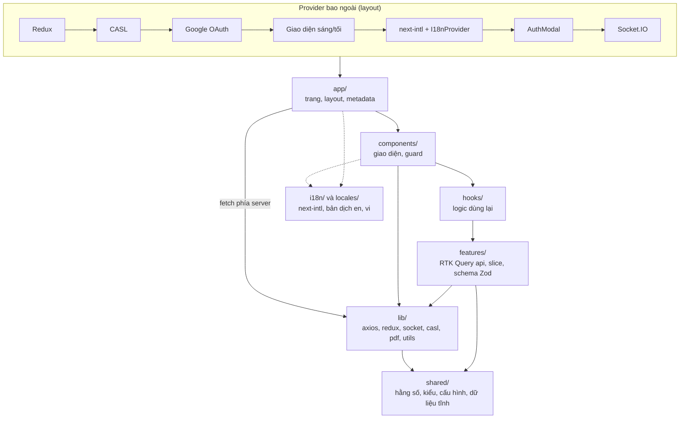

# Sơ đồ thành phần

Sơ đồ này vẽ các lớp của mã nguồn trong `src/` và hướng phụ thuộc giữa chúng, kèm các provider bọc ứng dụng. Nó là bản hình ảnh của trang [Các lớp của frontend](../frontend-layers.md).

*Hình: Hướng phụ thuộc từ trên xuống. Mũi tên nét liền là lời gọi thường gặp; mũi tên nét đứt là việc dùng bản dịch. Mũi tên từ `app` thẳng xuống `lib` là ngoại lệ: trang gọi `public-content.ts` để lấy dữ liệu trên server mà không qua hook.*

Đây là xu hướng quan sát được, không phải quy tắc được công cụ kiểm soát. Thứ tự các provider khớp với `src/app/layout.tsx` và `src/app/[locale]/layout.tsx`.

## Source code liên quan

- [`src/app/layout.tsx`](../../../src/app/layout.tsx): Redux, CASL, Google OAuth, giao diện sáng/tối
- [`src/app/[locale]/layout.tsx`](../../../src/app/[locale]/layout.tsx): dịch thuật, modal đăng nhập, Socket.IO
- [`src/lib/utils/public-content.ts`](../../../src/lib/utils/public-content.ts): ngoại lệ `app` gọi `lib`
- [`src/features/job/hooks/use-job-list.ts`](../../../src/features/job/hooks/use-job-list.ts): ví dụ lớp hook
- [`src/features/job/redux/job.api.ts`](../../../src/features/job/redux/job.api.ts): ví dụ lớp module nghiệp vụ
