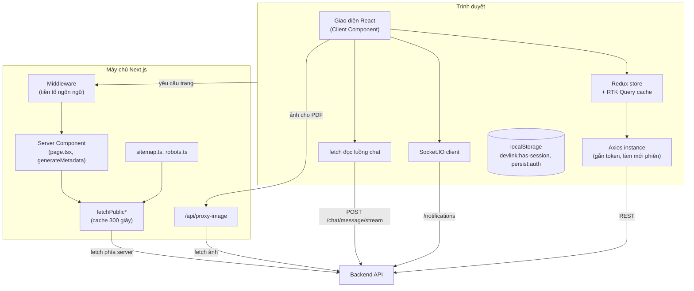

# Sơ đồ container

Sơ đồ này tách DevLink Frontend thành hai nơi chạy code: máy chủ Next.js và trình duyệt, và cho thấy mỗi nơi nói chuyện với backend bằng cách nào. Cần hiểu sơ đồ này để biết lời gọi nào có `localStorage` và lời gọi nào không.

*Hình: Hai nơi chạy code. Lời gọi `fetchPublic*` chạy trên máy chủ nên không có token; mọi lời gọi từ trình duyệt lấy access token từ memory qua `src/lib/auth/session.ts`.*

## Cách đọc

- **Trang công khai:** trình duyệt gửi yêu cầu tới máy chủ Next.js. Middleware xử lý tiền tố ngôn ngữ, Server Component lấy dữ liệu bằng `fetchPublic*` rồi trả HTML. Sitemap dùng cùng đường này.
- **Tương tác sau khi trang đã tải:** giao diện gọi RTK Query, qua Axios tới backend, không đi qua máy chủ Next.js.
- **Chat và thông báo:** dùng kết nối riêng tới backend (luồng chat bằng `fetch`, thông báo bằng Socket.IO), cả hai đọc token từ `localStorage` lúc gửi hoặc kết nối.
- **Ảnh cho PDF:** trình duyệt nhờ `/api/proxy-image` lấy ảnh từ backend để tránh lỗi CORS khi dựng CV.

## Source code liên quan

- [`src/middleware.ts`](../../../src/middleware.ts): middleware tiền tố ngôn ngữ
- [`src/lib/utils/public-content.ts`](../../../src/lib/utils/public-content.ts): `fetchPublic*`
- [`src/lib/redux/store.ts`](../../../src/lib/redux/store.ts): store và Redux Persist
- [`src/lib/axios/axios-instance.ts`](../../../src/lib/axios/axios-instance.ts): Axios instance
- [`src/app/api/proxy-image/route.ts`](../../../src/app/api/proxy-image/route.ts): proxy ảnh
- [`src/app/sitemap.ts`](../../../src/app/sitemap.ts): sitemap
