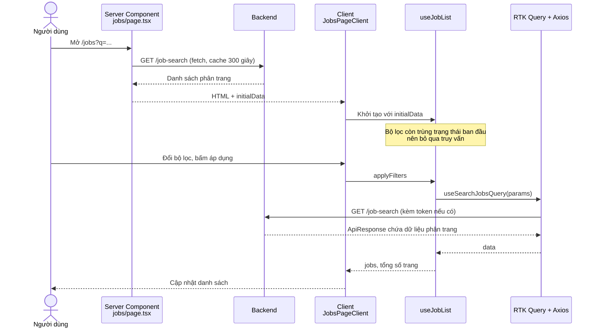
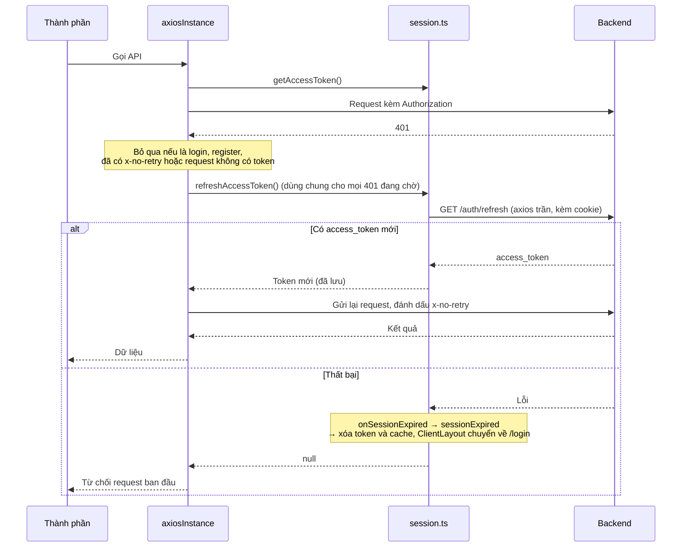

# Sơ đồ luồng dữ liệu

Hai sơ đồ dưới đây theo dõi hai luồng dữ liệu quan trọng nhất: trang danh sách việc làm nhận dữ liệu từ server rồi lọc ở trình duyệt, và một request bị 401 được làm mới phiên rồi gửi lại. Các sơ đồ đã được đơn giản hóa để dễ đọc; phần giải thích đầy đủ nằm ở [Giao tiếp API](../api-communication.md) và [Xác thực](../authentication.md).

## Luồng 1: tìm kiếm việc làm

*Hình 1: Lần tải đầu tiên do server cấp dữ liệu, các lần lọc sau do RTK Query xử lý. Trang này lấy dữ liệu từ endpoint `/job-search` của backend; đây là địa chỉ API, không phải địa chỉ trang.*

## Luồng 2: request bị 401 và làm mới phiên

*Hình 2: Mọi request 401 cùng lúc dùng chung một lần làm mới. Khi thất bại, session báo hết phiên: token và cache RTK Query bị xóa, `ClientLayout` hiện thông báo và chuyển về trang đăng nhập, xem [Xác thực](../authentication.md).*

## Source code liên quan

- [`src/app/[locale]/(main)/jobs/page.tsx`](../../../src/app/[locale]/(main)/jobs/page.tsx): Server Component lấy dữ liệu ban đầu
- [`src/app/[locale]/(main)/jobs/jobs-page-client.tsx`](../../../src/app/[locale]/(main)/jobs/jobs-page-client.tsx): Client Component
- [`src/features/job/hooks/use-job-list.ts`](../../../src/features/job/hooks/use-job-list.ts): quyết định dùng dữ liệu server hay truy vấn
- [`src/features/job/redux/job.api.ts`](../../../src/features/job/redux/job.api.ts): endpoint `searchJobs`
- [`src/lib/utils/public-content.ts`](../../../src/lib/utils/public-content.ts): `fetchPublicJobSearch`
- [`src/lib/axios/axios-instance.ts`](../../../src/lib/axios/axios-instance.ts): interceptor và làm mới token
