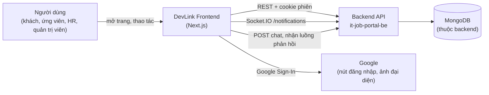

# Sơ đồ bối cảnh hệ thống

Sơ đồ này cho thấy DevLink Frontend đứng ở đâu so với người dùng và các hệ thống bên ngoài. Nó chỉ gồm những kết nối có trong code; giải thích từng kết nối nằm ở [Bối cảnh hệ thống](../system-context.md).

*Hình: Bối cảnh hệ thống. Ba mũi tên từ Frontend tới Backend là ba kênh khác nhau: REST, Socket.IO và luồng chat. Frontend không truy cập trực tiếp cơ sở dữ liệu.*

## Source code liên quan

- [`src/shared/constants/constant.ts`](../../../src/shared/constants/constant.ts): địa chỉ backend được viết cứng
- [`src/lib/axios/axios-instance.ts`](../../../src/lib/axios/axios-instance.ts): kênh REST
- [`src/lib/socket/socket-provider.tsx`](../../../src/lib/socket/socket-provider.tsx): kênh Socket.IO
- [`src/hooks/use-stream-chat.ts`](../../../src/hooks/use-stream-chat.ts): kênh chat
- [`src/components/google-oauth-provider.tsx`](../../../src/components/google-oauth-provider.tsx): kết nối Google
