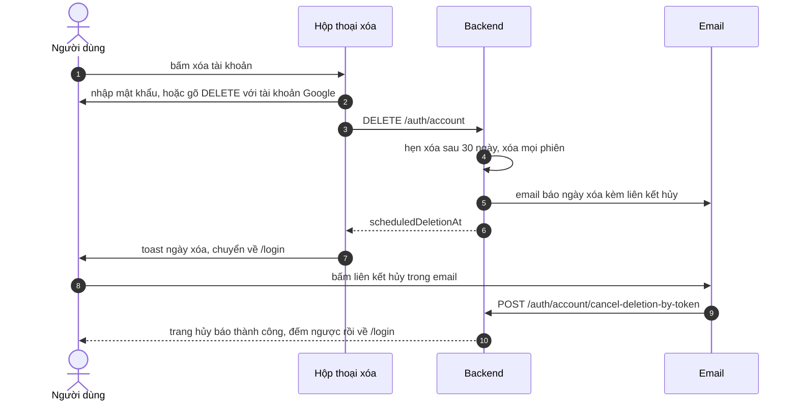

# Xóa tài khoản

Tính năng cho phép người dùng yêu cầu xóa tài khoản, có thời gian chờ để đổi ý. Trang dành cho người muốn biết quy trình xóa và cách hủy, và cho developer sửa hộp thoại xóa hoặc trang hủy.

## Vì sao có thời gian chờ

Xóa tài khoản không đảo ngược được, nên backend không xóa ngay mà hẹn xóa sau 30 ngày. Trong thời gian đó người dùng có thể hủy, bằng đường liên kết trong email hoặc trong ứng dụng.

**Đối tượng:** người dùng đã đăng nhập (yêu cầu xóa); người có liên kết hủy trong email (hủy).

**Đánh đổi:** ngay khi yêu cầu xóa, backend đăng xuất mọi phiên của tài khoản, nên người dùng bị chuyển về trang đăng nhập; muốn hủy thì dùng liên kết trong email.

## Giao diện

Khu vực xóa nằm cuối tab cài đặt, xem ảnh ở [Hồ sơ người dùng](user-profile.md). Yêu cầu xóa mở một hộp thoại xác nhận.

## Luồng nghiệp vụ

Sơ đồ rút gọn; chi tiết xử lý ở backend nằm ở tài liệu backend.

| Bước | Giải thích |
| --- | --- |
| 2 | Tài khoản Google (`isGoogleUser`) xác nhận bằng cách gõ đúng chữ `DELETE`; tài khoản còn lại nhập mật khẩu (bắt buộc ít nhất 1 ký tự ở form) |
| 3 | Frontend gửi `{ password }` hoặc `{}` |
| 4 | Backend yêu cầu mật khẩu cho tài khoản đăng ký bằng email và từ chối với 401 nếu sai; từ chối với 409 nếu đã có yêu cầu chờ |
| 8 | Trước khi chuyển trang, frontend dispatch `sessionEnded`, listener xóa token và cache RTK Query |
| 10 | Trang `/account/cancel-deletion?token=...` có bốn trạng thái: rảnh, đang xử lý, thành công, lỗi; thiếu `token` thì báo lỗi ngay |

## Hủy bằng nút trong ứng dụng

Banner chờ xóa ở đầu `/profile` hiện ngày xóa và nút hủy, gọi `POST /auth/account/cancel-deletion`. Backend từ chối nếu không có yêu cầu chờ hoặc đã quá thời gian chờ.

> [!NOTE]
> Vì mọi phiên bị xóa khi yêu cầu xóa, banner chỉ hiện nếu người dùng đăng nhập lại được trong thời gian chờ. Chưa kiểm tra backend có cho đăng nhập khi tài khoản đang chờ xóa hay không; tài liệu backend ghi tài khoản chờ xóa nhận 403. Đường hủy chắc chắn dùng được là liên kết trong email.

## API liên quan

| Hook | Endpoint | Dùng ở |
| --- | --- | --- |
| `useRequestAccountDeletionMutation` | `DELETE /auth/account` | `account-deletion-dialog.tsx` |
| `useCancelAccountDeletionMutation` | `POST /auth/account/cancel-deletion` | `pending-deletion-banner.tsx` |
| `useCancelAccountDeletionByTokenMutation` | `POST /auth/account/cancel-deletion-by-token` | `account/cancel-deletion/page.tsx` |

Bảng đầy đủ: [Endpoint Auth](../06-api-and-data/endpoints/auth.md).

## Dữ liệu và kiểm tra

`scheduledDeletionAt` có trong người dùng đang đăng nhập, xem [Model User](../06-api-and-data/models/user.md). Phản hồi của yêu cầu xóa gồm `message` và `scheduledDeletionAt`.

## Trường hợp lỗi

| Tình huống | Hành vi |
| --- | --- |
| Sai mật khẩu, đã có yêu cầu chờ | Toast với thông điệp của backend, không đăng xuất |
| Hủy khi quá hạn hoặc không có yêu cầu | Toast lỗi (nút) hoặc trang lỗi (liên kết) |
| Liên kết hủy thiếu hoặc sai token | Trang hủy hiện lỗi |

## Test cases

Chưa có test cho hộp thoại xóa, banner chờ xóa và trang hủy.

## Source code liên quan

- [`src/features/profile/components/account-deletion-dialog.tsx`](../../src/features/profile/components/account-deletion-dialog.tsx): hộp thoại xóa
- [`src/features/profile/components/pending-deletion-banner.tsx`](../../src/features/profile/components/pending-deletion-banner.tsx): banner và nút hủy
- [`src/app/[locale]/account/cancel-deletion/page.tsx`](../../src/app/[locale]/account/cancel-deletion/page.tsx): trang hủy bằng liên kết
- [`src/features/profile/components/pages/settings-page/delete-account-section.tsx`](../../src/features/profile/components/pages/settings-page/delete-account-section.tsx): nơi đặt khu vực xóa
- [`src/features/auth/redux/auth.api.ts`](../../src/features/auth/redux/auth.api.ts): endpoint

Backend: [Use case xóa tài khoản](https://github.com/QuocDuy21-10/it-job-portal-be/blob/main/docs/06-workflows/use-cases/account-deletion.md).

Đọc tiếp: [Hồ sơ người dùng](user-profile.md), [Xác thực](authentication.md), [Endpoint Auth](../06-api-and-data/endpoints/auth.md).
