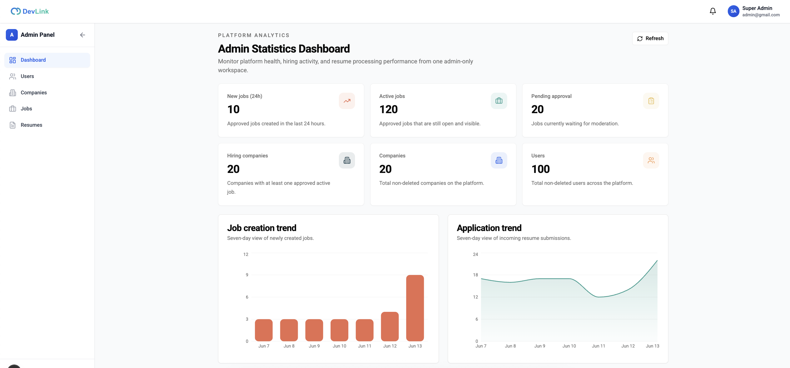

# Trang quản trị

Khu vực `/admin` là nơi quản trị viên và nhà tuyển dụng quản lý người dùng, công ty, tin tuyển dụng và hồ sơ. Trang dành cho người dùng khu vực này, và developer thêm hoặc sửa một trang quản trị.

## Vì sao cần

Dữ liệu của nền tảng (người dùng, công ty, tin, hồ sơ) cần một nơi quản lý tập trung. Mỗi vai trò thấy và làm được phần khác nhau, giao diện thể hiện điều đó bằng cách ẩn mục và nút mà vai trò không có quyền.

**Đối tượng:** `SUPER ADMIN` và `HR`. `AdminRoute` bao các trang `(dashboard)`: chưa đăng nhập thì chuyển tới `/login`, đăng nhập nhưng không phải quản trị hoặc HR thì về `/`.

> [!WARNING]
> `AdminRoute` và CASL chỉ điều khiển giao diện. Quyền thật do backend quyết định bằng `@Roles` ở từng route; xem [Phân quyền](../02-architecture/authorization.md).

**Đánh đổi:** khu vực này thiết kế cho màn hình lớn; trên màn hình nhỏ có biểu ngữ nhắc nên dùng máy tính.

## Giao diện

Dashboard quản trị: thanh bên điều hướng, sáu thẻ số liệu, biểu đồ cột việc làm mới và biểu đồ vùng hồ sơ nhận được theo bảy ngày.

Chưa dùng ảnh trang quản lý người dùng vì ảnh chứa tên và email của người dùng seed.

## Các trang

| Trang | Đường dẫn | Nội dung |
| --- | --- | --- |
| Dashboard | `/admin` | Số liệu toàn nền tảng cho `SUPER ADMIN`; HR được chuyển sang [Dashboard HR](hr-dashboard.md) |
| Người dùng | `/admin/users` | Tìm theo tên, lọc theo vai trò, thêm, sửa, khóa và mở khóa, xóa, xóa hàng loạt |
| Công ty | `/admin/companies` | Danh sách, thêm, sửa, xóa, xóa hàng loạt, tải logo |
| Việc làm | `/admin/jobs` | Quản lý tin và duyệt tin, xem [Duyệt tin tuyển dụng](job-approval.md) |
| Hồ sơ | `/admin/resumes` | Lọc theo trạng thái, đổi trạng thái, xóa, xóa hàng loạt |
| Thông tin cá nhân | `/admin/personal-info` | Cập nhật thông tin của chính mình |
| Đổi mật khẩu | `/admin/change-password` | Đổi mật khẩu của chính mình |

Hai trang cuối không có trong thanh bên mà mở từ menu người dùng ở đầu trang. Không có trang quản lý vai trò hay quyền: ba vai trò và quyền của chúng cố định trong `src/lib/casl/ability.ts`.

## Ai thấy gì

Thanh bên lọc mục theo quyền CASL (`useFilteredNavigation`). Mỗi mục gắn một đối tượng quyền:

| Mục | Đối tượng | `SUPER ADMIN` | `HR` |
| --- | --- | :---: | :---: |
| Dashboard | `Statistic` | Có | Có (chuyển sang dashboard HR) |
| Người dùng | `User` | Có | Không |
| Công ty | `Company` | Có | Có, chỉ đọc và sửa |
| Việc làm | `Job` | Có | Có, tạo, đọc, sửa, xóa |
| Hồ sơ | `Resume` | Có | Có, đọc và sửa |

Nút thêm công ty hiện với người có quyền `create` trên `Company`, nút xóa người dùng, công ty và hồ sơ theo quyền `delete`, nên `HR` không thấy các nút đó; nút duyệt tin theo quyền `approve`. Phạm vi dữ liệu theo công ty của HR do backend áp dụng, không phải giao diện.

## Xóa hàng loạt

Các bảng người dùng, công ty, tin và hồ sơ có hộp chọn từng dòng (`useTableSelection`) và hộp thoại xác nhận (`BulkDeleteConfirmDialog`). Mỗi trang gọi endpoint `DELETE .../bulk` tương ứng với danh sách mã.

## API liên quan

| Trang | Endpoint chính |
| --- | --- |
| Người dùng | [Endpoint Users](../06-api-and-data/endpoints/users.md) |
| Công ty | [Endpoint Companies](../06-api-and-data/endpoints/companies.md) |
| Việc làm | [Endpoint Jobs](../06-api-and-data/endpoints/jobs.md) |
| Hồ sơ | [Endpoint Resumes](../06-api-and-data/endpoints/resumes.md) |
| Dashboard | [Endpoint Statistics](../06-api-and-data/endpoints/statistics.md) |
| Đổi mật khẩu | [Endpoint Auth](../06-api-and-data/endpoints/auth.md) |

## Dữ liệu và kiểm tra

Số liệu dashboard quản trị: `countActiveJobs`, `countPendingApprovalJobs`, `countHiringCompanies`, `countCompanies`, `countUsers`, xu hướng việc làm và hồ sơ, kỹ năng được cần nhiều nhất, tình trạng xử lý hồ sơ, kèm `generatedAt` và `fromCache`; chi tiết ở [Endpoint Statistics](../06-api-and-data/endpoints/statistics.md). Có nút làm mới (`refetch`) và nhãn độ mới.

## Trường hợp lỗi

| Tình huống | Hành vi |
| --- | --- |
| Chưa đăng nhập hoặc không có quyền vào khu vực | Chuyển về `/login` hoặc `/` |
| Dashboard lỗi | Thông báo lỗi kèm nút thử lại |
| HR mở `/admin` | Chuyển sang `/hr/dashboard` |
| Thao tác bị backend từ chối | Toast với thông điệp của backend |

## Test cases

| Test | Nội dung |
| --- | --- |
| `src/components/statistics/admin-statistics-page.test.tsx` | Hiển thị số liệu từ endpoint của quản trị; chuyển HR khỏi trang |
| `src/components/user/user-form.test.tsx` | Form người dùng |

Chưa có test cho: `AdminRoute`, thanh bên lọc theo quyền, các trang danh sách và xóa hàng loạt.

## Source code liên quan

- [`src/app/[locale]/(dashboard)/layout.tsx`](../../src/app/[locale]/(dashboard)/layout.tsx): khung, `AdminRoute`
- [`src/components/admin-route.tsx`](../../src/components/admin-route.tsx): chặn truy cập
- [`src/components/admin/`](../../src/components/admin): thanh bên, đầu trang, xóa hàng loạt
- [`src/shared/config/admin-navigation.ts`](../../src/shared/config/admin-navigation.ts): mục điều hướng và quyền
- [`src/lib/casl/ability.ts`](../../src/lib/casl/ability.ts): quyền theo vai trò
- [`src/components/statistics/admin-statistics-page.tsx`](../../src/components/statistics/admin-statistics-page.tsx): dashboard
- [`src/app/[locale]/(dashboard)/admin/users/page.tsx`](../../src/app/[locale]/(dashboard)/admin/users/page.tsx), [`companies`](../../src/app/[locale]/(dashboard)/admin/companies/page.tsx), [`jobs`](../../src/app/[locale]/(dashboard)/admin/jobs/page.tsx), [`resumes`](../../src/app/[locale]/(dashboard)/admin/resumes/page.tsx): các trang quản trị

Tài liệu backend: [Statistics](https://github.com/QuocDuy21-10/it-job-portal-be/blob/main/docs/03-modules/statistics.md).

Đọc tiếp: [Dashboard HR](hr-dashboard.md), [Duyệt tin tuyển dụng](job-approval.md), [Phân quyền](../02-architecture/authorization.md).
