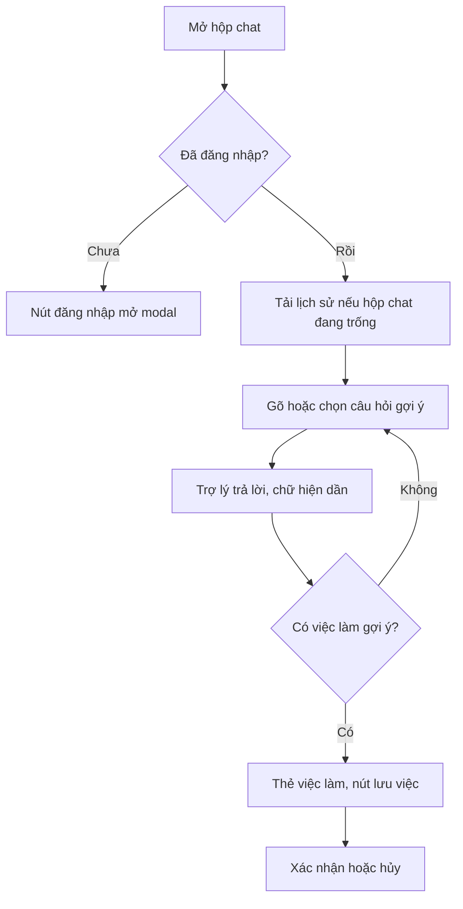

# Trợ lý AI

Trợ lý AI là hộp chat nổi trên website, giúp người dùng hỏi về việc làm, công ty và CV, nhận gợi ý việc làm phù hợp và lưu việc ngay trong cuộc trò chuyện. Trang dành cho người muốn biết trợ lý làm được gì, và developer sửa hộp chat.

## Vì sao cần

Tìm việc bằng bộ lọc đòi hỏi người dùng biết mình cần gì. Hỏi bằng ngôn ngữ thường giúp ứng viên diễn đạt nhu cầu, còn nhà tuyển dụng có trợ lý riêng trong khu vực HR.

**Đối tượng:** người dùng đã đăng nhập. Khách mở hộp chat sẽ thấy nút mời đăng nhập, không gửi được tin.

**Đánh đổi:**

- Mỗi người có hạn mức lượt hỏi theo ngày; hết hạn mức thì ô nhập bị vô hiệu cho tới thời điểm đặt lại.
- Câu trả lời do AI sinh ra nên giao diện luôn hiện lời nhắc về độ chính xác.
- Frontend không gọi nhà cung cấp AI trực tiếp: không có mã nào trong `src` gọi dịch vụ AI. Mọi tin nhắn đi qua backend.

## Giao diện

Hộp chat mở từ nút nổi ở góc màn hình. Chưa có ảnh chụp riêng của hộp chat trong `public/images/screenshots/`.

| Nơi hiện | Thành phần | Ghi chú |
| --- | --- | --- |
| Trang công khai (`(main)`) và trang cá nhân (`(profile)`) | `ChatWidget` | Màn hình lớn: bảng cố định bên phải rộng 420 px. Màn hình nhỏ: ngăn kéo (`Sheet`) |
| Dashboard nhà tuyển dụng (`(hr-dashboard)`) | `HrChatAssistant` | Dùng cùng `ChatSurface` |
| Trang quản trị (`(dashboard)`) | Không có | Layout này không gắn trợ lý |

`ChatSurface` là phần chat dùng chung: màn hình chào với các thẻ tính năng và câu hỏi gợi ý, danh sách tin nhắn, ô nhập, đồng hồ hạn mức và lời nhắc AI.

## Luồng nghiệp vụ

Sơ đồ rút gọn; trình tự kỹ thuật xem [Stream chat AI](../05-business-flows/sequences/ai-chat-streaming.md).

| Chức năng | Hành vi |
| --- | --- |
| Câu hỏi gợi ý | Màn hình chào có sáu câu gợi ý (việc làm, kỹ năng hot, công ty, CV, việc phù hợp, so sánh lương); trên trang chi tiết tin có thêm câu hỏi về tin đó |
| Ngữ cảnh tin đang xem | Trên `/jobs/<id>`, mã tin được gửi kèm tin nhắn |
| Gợi ý tiếp theo | Sau mỗi câu trả lời có thể có các câu hỏi gợi ý; chọn một câu sẽ gửi kèm mã tin của trang |
| Thẻ việc làm | Hiện việc làm gợi ý; với mã chưa có dữ liệu, giao diện gọi `GET /jobs/:id` để bổ sung |
| Lưu việc qua chat | Phản hồi có thể kèm hành động `save_job` chờ xác nhận; xác nhận thì gọi backend và đánh dấu việc đã lưu |
| Hạn mức | Đồng hồ hiện số lượt còn lại, hoặc nhãn "không giới hạn" khi gói không giới hạn; chỉ hiện sau khi backend đã gửi hạn mức; cảnh báo khi sắp hết hoặc hết; ô nhập bị vô hiệu cho tới giờ đặt lại |
| Dừng | Khi đang stream có nút dừng, giữ phần đã nhận |
| Lịch sử | Tải 50 tin gần nhất (`page` 1, `limit` 50) khi mở hộp chat đang trống; nút xóa lịch sử ở đầu hộp chat, hạn mức vẫn giữ nguyên sau khi xóa (theo test của slice) |

> [!WARNING]
> Trên trang chi tiết tin bên ngoài (`/jobs/external/<id>`), mã tin lấy từ đường dẫn sẽ là chuỗi `external` và được gửi lên backend, vốn yêu cầu mã hợp lệ; tin nhắn có thể bị từ chối. Chi tiết ở [Endpoint Chat](../06-api-and-data/endpoints/chat.md). Đây là suy luận từ code, chưa chạy thử.

## API liên quan

| Hook hoặc hàm | Endpoint | Dùng ở |
| --- | --- | --- |
| `sendStreamMessage` | `POST /chat/message/stream` | `use-stream-chat.ts` |
| `useSendMessageMutation` | `POST /chat/message` | Đường dự phòng |
| `useLazyGetChatHistoryQuery` | `GET /chat/history` | Tải lịch sử |
| `useClearChatHistoryMutation` | `DELETE /chat/clear` | Xóa lịch sử |
| `useConfirmToolActionMutation`, `useCancelToolActionMutation` | `POST` và `DELETE /chat/tool-actions/:id` | Xác nhận, hủy hành động |

Bảng đầy đủ: [Endpoint Chat](../06-api-and-data/endpoints/chat.md).

## Dữ liệu và kiểm tra

Dạng dữ liệu ở [Model Chat Message](../06-api-and-data/models/chat-message.md). Frontend giới hạn tin nhắn tối đa 1000 ký tự, và bỏ qua tin trống.

## Trường hợp lỗi

| Tình huống | Hành vi |
| --- | --- |
| Chưa đăng nhập | Toast yêu cầu đăng nhập, không gửi |
| Vượt hạn mức | Ô nhập bị vô hiệu kèm lý do; thông tin hạn mức lấy từ phản hồi hoặc lỗi |
| Stream không dùng được | Tự chuyển sang đường gửi thường |
| Lỗi khác | Toast với thông điệp của backend |
| Hành động hết hạn | Gỡ khỏi tin nhắn và báo hết hạn |
| Không tải được lịch sử | Toast lỗi |

## Test cases

| Test | Nội dung |
| --- | --- |
| `src/features/chatbot/hooks/use-chat.test.tsx` | Lưu hạn mức kèm lịch sử |
| `src/features/chatbot/components/chat-surface/chat-surface.test.tsx` | Lời nhắc AI; vô hiệu ô nhập khi hết hạn mức; bật lại sau giờ đặt lại; chú thích hạn mức mỗi ngày |
| `src/features/chatbot/components/chat-widget.test.tsx` | Khung chat chỉ được tải và render sau lần mở đầu tiên, và được giữ lại sau khi đóng |
| `src/features/chatbot/components/chat-composer.test.tsx` | Gửi bằng Enter, không gửi bằng Shift Enter hoặc khi đang gõ tiếng Việt, đếm ký tự, nút dừng, trạng thái vô hiệu |
| `src/features/chatbot/components/chat-quota-meter.test.tsx` | Hiển thị đồng hồ, không giới hạn, cảnh báo, định dạng giờ đặt lại |
| `src/features/chatbot/components/chat-typing-indicator.test.tsx` | Chỉ báo đang trả lời |
| `src/features/chatbot/components/chat-job-card.test.tsx` | Kích thước và số kỹ năng của thẻ việc làm trên màn hình nhỏ và lớn |
| `src/features/chatbot/lib/chat-stream.utils.test.ts` | Đọc sự kiện SSE: token, done, error |
| `src/features/chatbot/lib/chat-message.utils.test.ts` | Chuẩn hóa hành động chờ xác nhận và hạn mức |
| `src/features/chatbot/lib/chat-route.utils.test.ts` | Lấy mã tin từ đường dẫn |
| `src/features/chatbot/redux/chat-bot.slice.test.ts` | Lưu và khôi phục hạn mức |

Chưa có test cho: luồng gửi tin và dự phòng trong `use-chat`, `use-stream-chat`, xác nhận và hủy hành động, trợ lý HR, đường dẫn tin bên ngoài.

## Source code liên quan

- [`src/features/chatbot/components/chat-widget.tsx`](../../src/features/chatbot/components/chat-widget.tsx): nút nổi, bảng và ngăn kéo
- [`src/features/chatbot/components/hr-chat-assistant.tsx`](../../src/features/chatbot/components/hr-chat-assistant.tsx): trợ lý của HR
- [`src/features/chatbot/components/chat-surface/index.tsx`](../../src/features/chatbot/components/chat-surface/index.tsx): phần chat dùng chung
- [`src/features/chatbot/components/chat-composer.tsx`](../../src/features/chatbot/components/chat-composer.tsx): ô nhập
- [`src/features/chatbot/components/chat-quota-meter.tsx`](../../src/features/chatbot/components/chat-quota-meter.tsx): đồng hồ hạn mức
- [`src/features/chatbot/components/chat-job-card.tsx`](../../src/features/chatbot/components/chat-job-card.tsx): thẻ việc làm gợi ý
- [`src/features/chatbot/hooks/use-chat.ts`](../../src/features/chatbot/hooks/use-chat.ts): điều phối
- [`src/features/chatbot/hooks/use-stream-chat.ts`](../../src/features/chatbot/hooks/use-stream-chat.ts): stream
- [`src/features/chatbot/lib/chat-route.utils.ts`](../../src/features/chatbot/lib/chat-route.utils.ts): lấy mã tin từ đường dẫn

Tài liệu backend: [Module AI chat](https://github.com/QuocDuy21-10/it-job-portal-be/blob/main/docs/03-modules/ai-chat.md).

Đọc tiếp: [Stream chat AI](../05-business-flows/sequences/ai-chat-streaming.md), [Trạng thái stream chat](../05-business-flows/state-machines/chat-streaming-status.md), [Giao tiếp thời gian thực](../02-architecture/realtime-communication.md).
