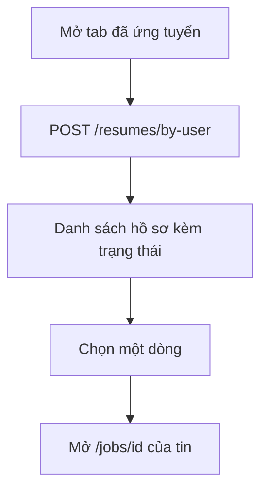

# Theo dõi hồ sơ đã nộp

Tính năng cho phép ứng viên xem các hồ sơ mình đã nộp và trạng thái hiện tại của từng hồ sơ. Trang dành cho người muốn biết xem kết quả ứng tuyển ở đâu, và cho developer sửa trang "Việc của tôi".

## Vì sao cần

Sau khi nộp, ứng viên cần biết nhà tuyển dụng đã xem hay chưa và kết quả ra sao. Trạng thái do nhà tuyển dụng cập nhật, ứng viên chỉ xem.

**Đối tượng:** ứng viên đã đăng nhập.

**Đánh đổi:** danh sách chỉ được tải một lần khi mở trang; trạng thái mới chỉ hiện khi tải lại trang. Thông báo thời gian thực có báo khi trạng thái đổi, xem [Thông báo](notifications.md).

## Giao diện

Xem ảnh ở [Việc làm đã lưu](saved-jobs.md): tab "đã ứng tuyển" là tab mặc định của trang "Việc của tôi" (`/profile?tab=my-jobs`).

## Luồng nghiệp vụ

Sơ đồ rút gọn.

| Chức năng | Hành vi |
| --- | --- |
| Tải danh sách | `takeOutAppliedJob` gọi `POST /resumes/by-user` khi component mount; kết quả được giữ trong state của component, không vào cache RTK Query |
| Mỗi dòng | Logo và tên công ty, tên tin, địa điểm, lương, ngày nộp, nhãn trạng thái và nút xem |
| Nhãn nút | Đổi chữ theo trạng thái (xem chi tiết, xem phản hồi, xem thư mời); đều dẫn tới trang chi tiết tin |
| Số đếm | Số hồ sơ đã nộp hiện ở tab và ở trang tổng quan hồ sơ |
| Phân trang | Không có; trả về toàn bộ danh sách một lần |
| Đổi trạng thái | Chỉ nhà tuyển dụng và quản trị, xem [Trạng thái hồ sơ](../05-business-flows/state-machines/application-status.md) |

> [!WARNING]
> Trang chỉ phân biệt ba trạng thái `PENDING`, `REVIEWING`, `APPROVED`; mọi giá trị còn lại, kể cả `INTERVIEWING` của backend, đều hiện nhãn "Từ chối". Chi tiết ở [Trạng thái hồ sơ](../05-business-flows/state-machines/application-status.md).

## API liên quan

| Hook | Endpoint | Dùng ở |
| --- | --- | --- |
| `useTakeOutAppliedJobMutation` | `POST /resumes/by-user` | `my-jobs-page.tsx`, `overview-page.tsx` |

Bảng đầy đủ: [Endpoint Resumes](../06-api-and-data/endpoints/resumes.md).

## Dữ liệu và kiểm tra

Dạng một hồ sơ trong danh sách (`ResumeAppliedJob`): `jobId` (`_id`, `name`, `location`, `salary`), `companyId` (`_id`, `name`), `status`, `createdAt`. Xem [Model Resume](../06-api-and-data/models/resume.md).

## Trường hợp lỗi

| Tình huống | Hành vi |
| --- | --- |
| Không tải được danh sách | Toast lỗi, danh sách rỗng |
| Chưa có hồ sơ nào | Màn hình trạng thái rỗng |
| Chưa đăng nhập | `/profile` không có guard phía frontend; lời gọi bị backend từ chối (chưa kiểm tra giao diện hiển thị) |

## Test cases

Chưa có test cho trang "Việc của tôi" và tab "đã ứng tuyển".

## Source code liên quan

- [`src/features/profile/components/pages/my-jobs-page.tsx`](../../src/features/profile/components/pages/my-jobs-page.tsx): danh sách và nhãn trạng thái
- [`src/features/profile/components/pages/overview-page.tsx`](../../src/features/profile/components/pages/overview-page.tsx): số hồ sơ đã nộp
- [`src/features/resume/redux/resume.api.ts`](../../src/features/resume/redux/resume.api.ts): `takeOutAppliedJob`
- [`src/features/resume/schemas/resume.schema.ts`](../../src/features/resume/schemas/resume.schema.ts): `ResumeAppliedJob`

Tài liệu backend: [Resumes](https://github.com/QuocDuy21-10/it-job-portal-be/blob/main/docs/03-modules/resumes.md).

Đọc tiếp: [Ứng tuyển](job-application.md), [Trạng thái hồ sơ](../05-business-flows/state-machines/application-status.md), [Việc làm đã lưu](saved-jobs.md).
