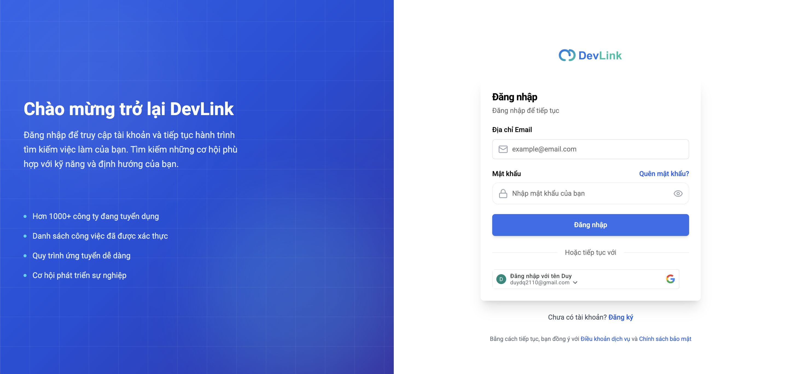
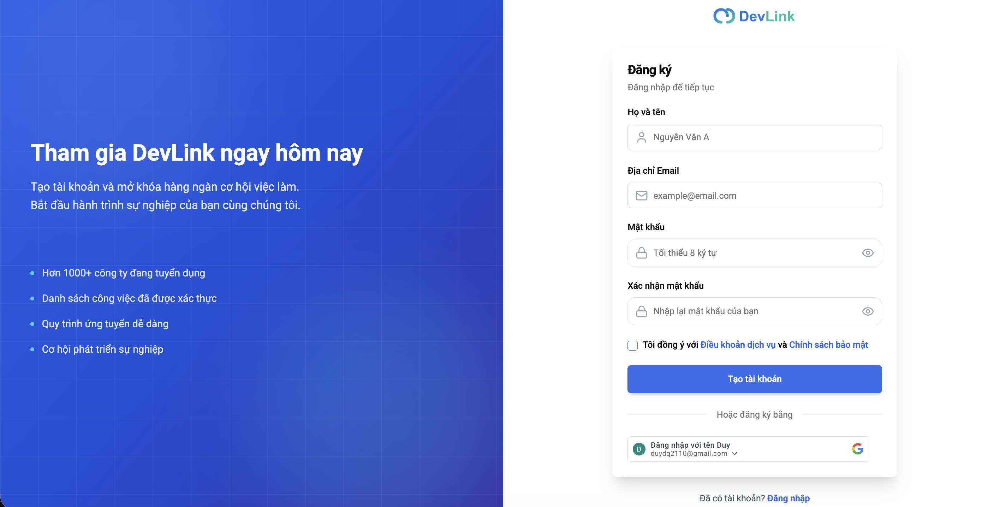
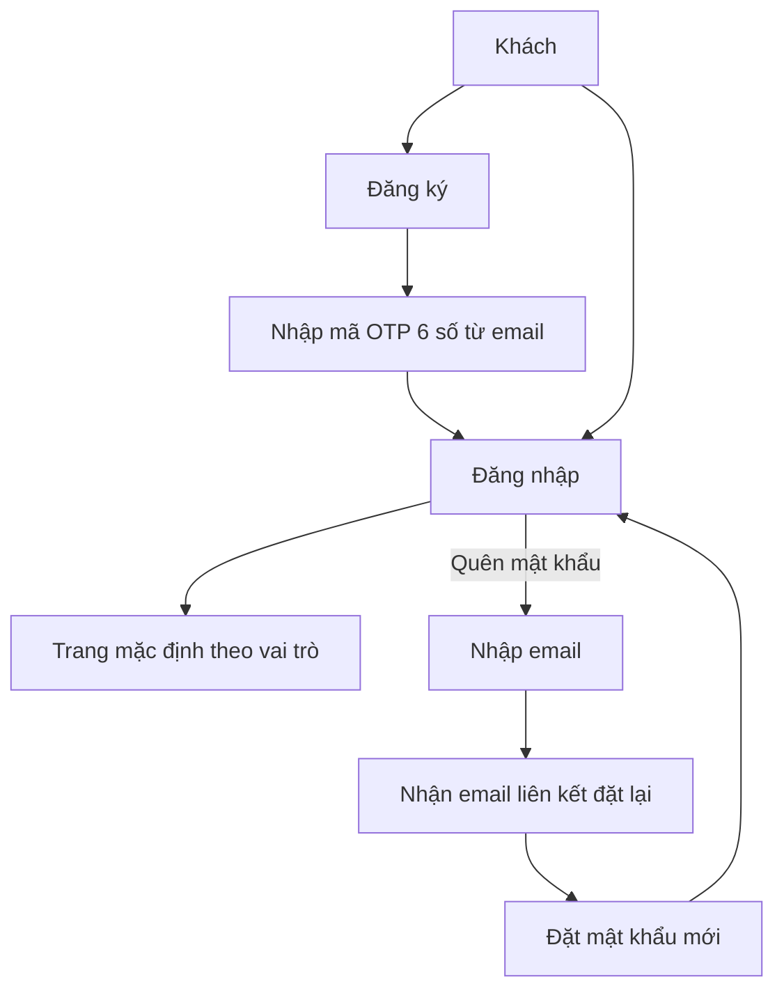

# Xác thực người dùng

Tính năng này cho phép khách đăng ký, xác minh email, đăng nhập (email hoặc Google), lấy lại mật khẩu và đổi mật khẩu. Trang dành cho người muốn hiểu người dùng đi qua những màn hình nào, và cho developer cần biết mỗi màn hình dùng hook nào.

## Vì sao cần

Ứng viên phải có tài khoản để ứng tuyển, lưu việc và theo dõi công ty; nhà tuyển dụng và quản trị viên cần đăng nhập để vào khu vực quản trị. Việc gửi mã xác minh qua email giúp bảo đảm tài khoản dùng email có thật.

**Đối tượng:** khách (đăng ký, đăng nhập), người dùng đã đăng nhập (đổi mật khẩu, đặt mật khẩu), mọi vai trò.

**Đánh đổi:** access token được lưu trong `localStorage` nên mọi script trên trang đều đọc được; đây là hiện trạng của code, xem [Xác thực](../02-architecture/authentication.md).

## Giao diện

Trang đăng nhập: form email và mật khẩu, nút đăng nhập Google và đường dẫn tới đăng ký, quên mật khẩu.

Trang đăng ký: họ tên, email, mật khẩu, xác nhận mật khẩu và đồng ý điều khoản.

## Hai cách vào: trang riêng và modal

Cùng một nghiệp vụ được đưa ra bằng hai giao diện:

| | Trang riêng | Modal |
| --- | --- | --- |
| Mở bằng | Vào `/login`, `/register` | `openModal("signin" hoặc "signup")` từ `AuthModalContext` |
| Dùng khi | Người dùng chủ động đăng nhập, hoặc bị chuyển về do phiên hết hạn | Đang ở giữa một thao tác cần đăng nhập, ví dụ nộp đơn, theo dõi công ty, dùng chatbot |
| Sau khi đăng nhập | Chuyển tới `returnUrl` nếu có, nếu không thì tới trang mặc định theo vai trò | Gọi callback `onSuccess` đã truyền khi mở modal (ví dụ mở hộp thoại ứng tuyển) |
| Sau khi đăng ký | Chuyển sang `/verify-email?email=...` | Quay về tab đăng nhập của modal |

Các trang `(auth)` chỉ dành cho khách: `layout.tsx` chuyển người đã đăng nhập tới trang mặc định của họ.

## Luồng nghiệp vụ

Sơ đồ rút gọn hành trình của khách; luồng token xem [Đăng nhập và làm mới token](../05-business-flows/sequences/login-and-refresh-token.md).

| Chức năng | Màn hình | Hành vi |
| --- | --- | --- |
| Đăng ký | `/register`, tab đăng ký của modal | Gửi form, thành công thì sang bước xác minh |
| Xác minh email | `/verify-email?email=...` | Nhập OTP 6 số, tự gửi khi đủ 6 số; nút gửi lại có thời gian chờ 60 giây; thiếu `email` trong URL thì quay về `/register`; thành công thì sang `/login?verified=true` |
| Đăng nhập email | `/login`, modal | Xem bảng trang mặc định bên dưới |
| Đăng nhập Google | Nút trên `/login` và modal | Gửi `credential` của Google lên backend rồi xử lý như đăng nhập thường |
| Quên mật khẩu | `/forgot-password` | Gửi email; luôn hiện thông báo thành công, kể cả khi lỗi, để không lộ email nào đã đăng ký; thời gian chờ 60 giây chỉ đặt khi gửi thành công |
| Đặt lại mật khẩu | `/reset-password?token=..&email=..` | Thiếu `token` hoặc `email` thì quay về `/forgot-password`; thành công thì đếm ngược rồi về `/login` |
| Đổi mật khẩu | Trang cài đặt hồ sơ; `/admin/change-password` | Cần mật khẩu hiện tại |
| Đặt mật khẩu | Trang cài đặt hồ sơ | Chỉ cho tài khoản Google chưa có mật khẩu (`authProvider` là `google` và `hasPassword` là `false`) |
| Đăng xuất | Menu ở header, layout quản trị, layout HR | Đặt cờ đăng xuất rồi gọi `POST /auth/logout` |

Trang mặc định sau đăng nhập theo vai trò:

| Vai trò | Trang |
| --- | --- |
| `SUPER ADMIN` | `/admin` |
| `HR` | `/admin/resumes` |
| `NORMAL USER` | `/` |

> [!NOTE]
> Đăng ký bằng Google chưa có: nút Google trên trang đăng ký chỉ hiện cảnh báo "sắp có". Người dùng Google đăng nhập bằng nút ở màn hình đăng nhập.

## API liên quan

| Hook | Endpoint |
| --- | --- |
| `useLoginMutation`, `useGoogleLoginMutation` | `POST /auth/login`, `POST /auth/google/login` |
| `useRegisterMutation` | `POST /auth/register` |
| `useVerifyEmailMutation`, `useResendCodeMutation` | `POST /auth/verify`, `POST /auth/resend-code` |
| `useForgotPasswordMutation`, `useResetPasswordMutation` | `POST /auth/forgot-password`, `POST /auth/reset-password` |
| `useChangePasswordMutation`, `useSetPasswordMutation` | `POST /auth/change-password`, `POST /auth/set-password` |
| `useGetMeQuery`, `useLogoutMutation` | `GET /auth/me`, `POST /auth/logout` |

Bảng đầy đủ: [Endpoint Auth](../06-api-and-data/endpoints/auth.md).

## Dữ liệu và kiểm tra

Quy tắc kiểm tra dữ liệu ở form, gồm mật khẩu 8 đến 128 ký tự cùng các điều kiện về chữ hoa, chữ thường, số và ký tự đặc biệt, nằm ở [Endpoint Auth](../06-api-and-data/endpoints/auth.md#dữ-liệu-và-kiểm-tra). Dạng dữ liệu người dùng: [Model User](../06-api-and-data/models/user.md).

## Trường hợp lỗi

| Tình huống | Hành vi |
| --- | --- |
| Sai email hoặc mật khẩu, tài khoản có vấn đề | Toast với `error.data.message` của backend; không lưu token |
| Chưa xác minh email | Backend quyết định thông báo; frontend hiện nguyên văn |
| OTP chưa đủ 6 số | Thông báo "chưa nhập đủ mã" |
| Google không trả `credential` | Toast báo thiếu thông tin đăng nhập từ Google |
| Phiên hết hạn lúc đang dùng | Xem [Xác thực](../02-architecture/authentication.md) về các điểm chưa chắc chắn |

## Test cases

| Test | Nội dung |
| --- | --- |
| `src/components/modals/auth-modal.test.tsx` | Modal hiện đúng ngôn ngữ cho tab đăng nhập và đăng ký; đăng ký xong thì quay về tab đăng nhập |
| `src/features/auth/redux/auth.slice.test.ts` | Hợp nhất danh sách việc đã lưu; chọn vai trò từ state |
| `src/features/auth/schemas/auth.schema.test.ts` | Quy tắc kiểm tra dữ liệu của schema xác thực |

Chưa có test cho: luồng làm mới token, trang xác minh email, quên và đặt lại mật khẩu, đổi và đặt mật khẩu, đăng nhập Google.

## Source code liên quan

- [`src/app/[locale]/(auth)/login/page.tsx`](../../src/app/[locale]/(auth)/login/page.tsx): trang đăng nhập, `returnUrl`
- [`src/app/[locale]/(auth)/register/page.tsx`](../../src/app/[locale]/(auth)/register/page.tsx): trang đăng ký
- [`src/app/[locale]/(auth)/verify-email/page.tsx`](../../src/app/[locale]/(auth)/verify-email/page.tsx): xác minh email
- [`src/app/[locale]/(auth)/forgot-password/page.tsx`](../../src/app/[locale]/(auth)/forgot-password/page.tsx): quên mật khẩu
- [`src/app/[locale]/(auth)/reset-password/page.tsx`](../../src/app/[locale]/(auth)/reset-password/page.tsx): đặt lại mật khẩu
- [`src/app/[locale]/(auth)/layout.tsx`](../../src/app/[locale]/(auth)/layout.tsx): chuyển người đã đăng nhập đi nơi khác
- [`src/components/modals/auth-modal.tsx`](../../src/components/modals/auth-modal.tsx): modal đăng nhập và đăng ký
- [`src/components/modals/login-form.tsx`](../../src/components/modals/login-form.tsx): form đăng nhập trong modal
- [`src/components/modals/register-form.tsx`](../../src/components/modals/register-form.tsx): form đăng ký trong modal
- [`src/contexts/auth-modal-context.tsx`](../../src/contexts/auth-modal-context.tsx): mở và đóng modal
- [`src/hooks/use-verification.ts`](../../src/hooks/use-verification.ts): OTP và gửi lại mã
- [`src/hooks/use-auth.ts`](../../src/hooks/use-auth.ts): trạng thái đăng nhập
- [`src/features/profile/components/pages/settings-page/change-password-modal.tsx`](../../src/features/profile/components/pages/settings-page/change-password-modal.tsx): đổi mật khẩu
- [`src/features/profile/components/pages/settings-page/set-password-modal.tsx`](../../src/features/profile/components/pages/settings-page/set-password-modal.tsx): đặt mật khẩu
- [`src/features/auth/schemas/auth.schema.ts`](../../src/features/auth/schemas/auth.schema.ts): quy tắc kiểm tra

Tài liệu backend: [Auth và phiên](https://github.com/QuocDuy21-10/it-job-portal-be/blob/main/docs/03-modules/auth-and-sessions.md) và [Use case xác thực](https://github.com/QuocDuy21-10/it-job-portal-be/blob/main/docs/06-workflows/use-cases/authentication.md).

Đọc tiếp: [Đăng nhập và làm mới token](../05-business-flows/sequences/login-and-refresh-token.md), [Phân quyền](../02-architecture/authorization.md), [Vai trò người dùng](../00-start-here/user-roles.md).
