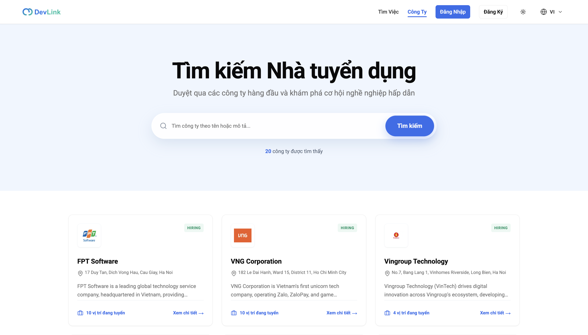
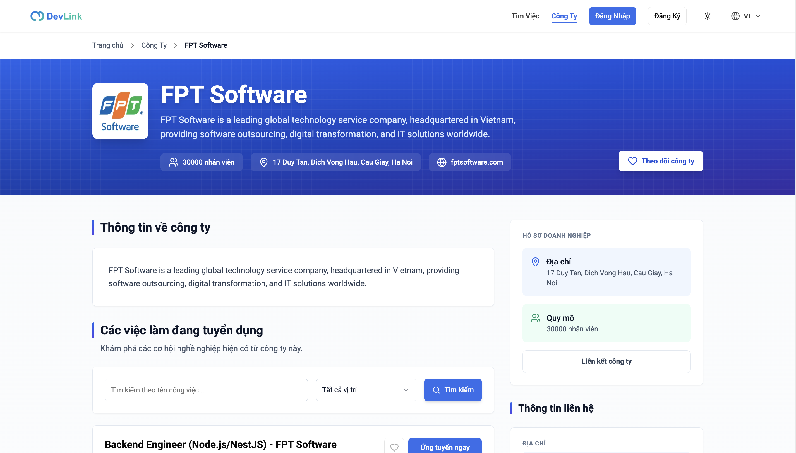
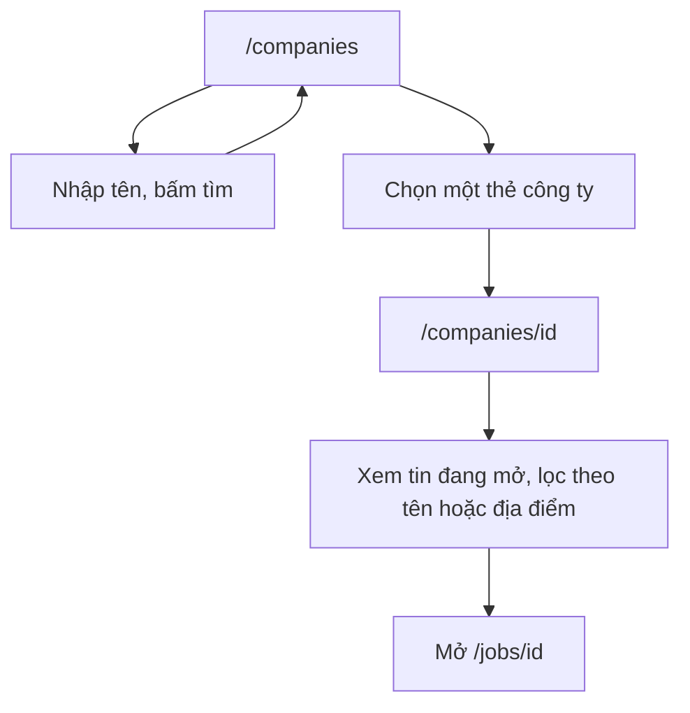

# Danh bạ công ty

Tính năng cho phép mọi người xem danh sách công ty đang tuyển, tìm theo tên và mở trang chi tiết của từng công ty cùng các tin đang mở. Trang dành cho người muốn biết các phần của trang công ty, và cho developer sửa danh sách hoặc trang chi tiết.

## Vì sao cần

Ứng viên muốn biết công ty trước khi ứng tuyển, không chỉ vị trí. Trang công ty gom thông tin giới thiệu và các tin đang mở ở một nơi.

**Đối tượng:** mọi người, kể cả khách. Theo dõi công ty cần đăng nhập, xem [Theo dõi công ty](company-following.md).

**Đánh đổi:** cả danh sách và chi tiết được render trên server và giữ trong cache Next.js khoảng 5 phút, nên công ty hay tin mới có thể chưa hiện ngay; xem [Chiến lược cache](../02-architecture/caching-strategy.md).

## Giao diện

Trang danh sách công ty: ô tìm theo tên và lưới thẻ công ty.

Trang chi tiết: thông tin công ty, nút theo dõi, các tin đang mở, liên hệ và chia sẻ.

## Danh sách `/companies`

| Chức năng | Hành vi |
| --- | --- |
| Tìm theo tên | Chỉ chạy khi người dùng bấm tìm, không chạy khi đang gõ; kết quả lọc bằng `name=/<từ khóa>/i` |
| Phân trang | Mặc định 9 công ty mỗi trang |
| URL | Từ khóa, trang và số lượng được ghi vào URL (`q`, `page`, `limit`) bằng `router.replace`, không cuộn trang |
| Dữ liệu đầu | Render trên server; khi trạng thái giống ban đầu thì bỏ qua truy vấn RTK Query |
| Thẻ công ty | Hiện logo, mô tả rút gọn (đã bỏ thẻ HTML) và số vị trí đang mở; thẻ không có nút theo dõi |

## Trang chi tiết `/companies/<id>`

| Phần | Nội dung |
| --- | --- |
| Dữ liệu | `fetchPublicCompanyById` và `fetchPublicJobs` (tin còn mở của công ty, 20 tin) chạy song song trên server; không có công ty thì trang 404 |
| SEO | Metadata theo công ty và dữ liệu có cấu trúc `Organization` dạng `application/ld+json` |
| Giới thiệu | Phần đầu, tổng quan và mô tả được dựng ngay trong `page.tsx` |
| Tin đang mở | `JobListing` lọc tin còn mở của công ty; có thể lọc thêm theo tên tin và địa điểm, khi đó gọi `GET /jobs` bằng RTK Query |
| Liên hệ, chia sẻ | `CompanyContact`, `ShareCompany` |
| Theo dõi | `CompanyFollowButton` |

## Luồng nghiệp vụ

Sơ đồ rút gọn hành trình xem công ty.

## API liên quan

| Hook hoặc hàm | Endpoint | Dùng ở |
| --- | --- | --- |
| `fetchPublicCompanies` | `GET /companies` | `companies/page.tsx` |
| `useGetCompaniesQuery` | `GET /companies` | `companies-page-client.tsx` |
| `fetchPublicCompanyById` | `GET /companies/:id` | `companies/[id]/page.tsx` |
| `fetchPublicJobs`, `useGetJobsQuery` | `GET /jobs` | Tin đang mở của công ty |

Bảng đầy đủ: [Endpoint Companies](../06-api-and-data/endpoints/companies.md), [Endpoint Jobs](../06-api-and-data/endpoints/jobs.md).

## Dữ liệu và kiểm tra

Dạng dữ liệu: [Model Company](../06-api-and-data/models/company.md).

## Trường hợp lỗi

| Tình huống | Hành vi |
| --- | --- |
| Công ty không tồn tại hoặc backend lỗi | Trang 404 (lỗi bị trả thành `null`) |
| Server không lấy được danh sách đầu | Danh sách tải lại bằng RTK Query khi mở |

## Test cases

| Test | Nội dung |
| --- | --- |
| `src/app/[locale]/(main)/companies/companies-page-client.test.tsx` | Chữ ở phần đầu trang; URL không đổi khi đang gõ; URL đổi sau khi bấm tìm |
| `src/features/company/components/company-card.test.tsx` | Thẻ ưu tiên mô tả, số vị trí đang mở, không có nút theo dõi |

Chưa có test cho: trang chi tiết công ty, `JobListing`, các phần giới thiệu.

## Source code liên quan

- [`src/app/[locale]/(main)/companies/page.tsx`](../../src/app/[locale]/(main)/companies/page.tsx): danh sách trên server
- [`src/app/[locale]/(main)/companies/companies-page-client.tsx`](../../src/app/[locale]/(main)/companies/companies-page-client.tsx): giao diện danh sách
- [`src/app/[locale]/(main)/companies/[id]/page.tsx`](../../src/app/[locale]/(main)/companies/[id]/page.tsx): trang chi tiết
- [`src/features/company/components/company-card.tsx`](../../src/features/company/components/company-card.tsx): thẻ công ty
- [`src/features/company/components/section/job-listing.tsx`](../../src/features/company/components/section/job-listing.tsx): tin đang mở
- [`src/lib/utils/public-listing.ts`](../../src/lib/utils/public-listing.ts): tham số URL và truy vấn

Tài liệu backend: [Companies](https://github.com/QuocDuy21-10/it-job-portal-be/blob/main/docs/03-modules/companies.md).

Đọc tiếp: [Theo dõi công ty](company-following.md), [Tìm kiếm việc làm](job-search.md), [Rendering và SEO](../02-architecture/rendering-and-seo.md).
