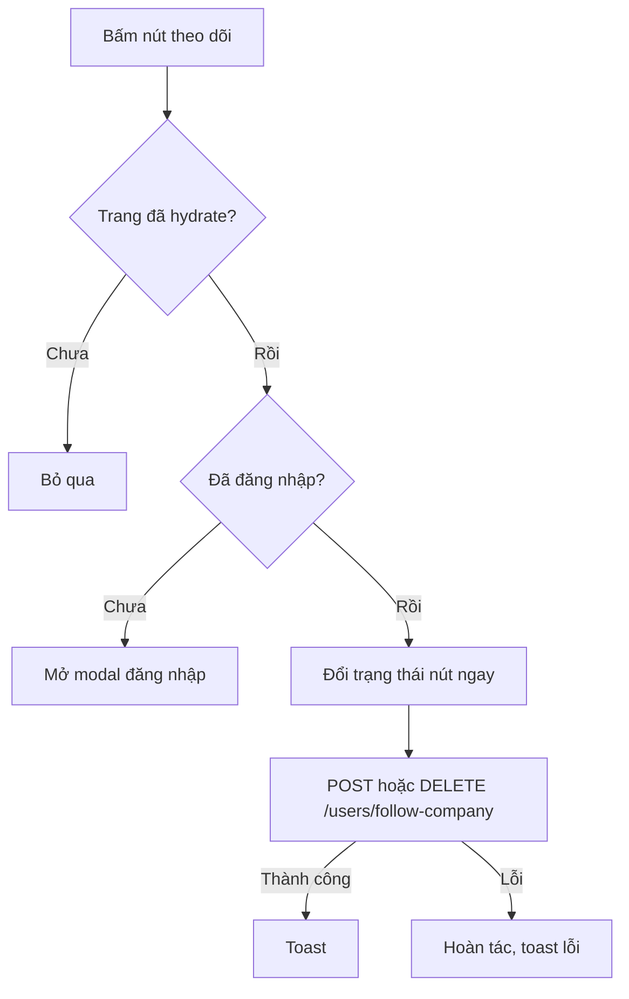

# Theo dõi công ty

Tính năng cho phép ứng viên đánh dấu theo dõi một công ty. Trang dành cho người muốn biết nút theo dõi nằm ở đâu và có tác dụng gì, và cho developer sửa hook theo dõi.

## Vì sao cần

Theo dõi cho ứng viên một danh sách công ty mình quan tâm. Trong code hiện tại, thông tin này được lưu cùng tài khoản và hiển thị ở số liệu trang tổng quan hồ sơ.

**Đối tượng:** người dùng đã đăng nhập. Khách bấm nút sẽ được mời đăng nhập.

**Giới hạn hiện tại:** frontend không có màn hình liệt kê công ty đang theo dõi; `useGetFollowingCompaniesQuery` được khai báo nhưng chưa có nơi nào dùng. Chưa thấy tính năng nào khác dùng danh sách này trong frontend (chưa kiểm tra phía backend).

**Đánh đổi:** nút đổi trạng thái ngay trước khi backend trả lời và hoàn tác nếu lỗi.

## Giao diện

Nút theo dõi nằm ở trang chi tiết công ty (xem ảnh ở [Danh bạ công ty](company-directory.md)). Thẻ công ty ở danh sách không có nút này.

## Luồng nghiệp vụ

Sơ đồ rút gọn hành vi của hook `useCompanyFollow`.

| Chức năng | Hành vi |
| --- | --- |
| Trạng thái ban đầu | Lấy từ danh sách mã công ty trong thông tin đăng nhập (`companyFollowed`); trước khi hydrate là "chưa theo dõi" |
| Đổi trạng thái | Gọi `POST /users/follow-company` hoặc `DELETE /users/follow-company` với `{ companyId }` |
| Số liệu | Trang tổng quan hồ sơ hiện số công ty đang theo dõi |

## API liên quan

| Hook | Endpoint | Dùng ở |
| --- | --- | --- |
| `useFollowCompanyMutation`, `useUnfollowCompanyMutation` | `POST` và `DELETE /users/follow-company` | `hooks/use-company-follow.ts` |

Bảng đầy đủ: [Endpoint Users](../06-api-and-data/endpoints/users.md). Backend trả lỗi nếu theo dõi một công ty đã theo dõi rồi (`BadRequest`); frontend sẽ hiện thông điệp đó và hoàn tác nút.

## Dữ liệu và kiểm tra

Tên danh sách công ty đang theo dõi khác nhau giữa người dùng đang đăng nhập (`companyFollowed`) và bản ghi quản trị (`companyFollowing`), xem [Model User](../06-api-and-data/models/user.md).

## Trường hợp lỗi

| Tình huống | Hành vi |
| --- | --- |
| Chưa đăng nhập | Mở modal đăng nhập |
| Backend từ chối | Hoàn tác nút, toast với thông điệp của backend |

## Test cases

| Test | Nội dung |
| --- | --- |
| `src/hooks/use-company-follow.test.tsx` | Trạng thái chưa theo dõi trước khi hydrate rồi cập nhật sau đó; không gửi trước khi hydrate; theo dõi lạc quan và hoàn tác khi lỗi |

Chưa có test cho: nút theo dõi ở trang chi tiết công ty.

## Source code liên quan

- [`src/hooks/use-company-follow.ts`](../../src/hooks/use-company-follow.ts): logic theo dõi
- [`src/components/company/company-follow-button.tsx`](../../src/components/company/company-follow-button.tsx): nút theo dõi
- [`src/features/user/redux/user.api.ts`](../../src/features/user/redux/user.api.ts): endpoint và cập nhật lạc quan
- [`src/app/[locale]/(main)/companies/[id]/page.tsx`](../../src/app/[locale]/(main)/companies/[id]/page.tsx): nơi đặt nút

Tài liệu backend: [Users](https://github.com/QuocDuy21-10/it-job-portal-be/blob/main/docs/03-modules/users.md).

Đọc tiếp: [Danh bạ công ty](company-directory.md), [Việc làm đã lưu](saved-jobs.md), [Hồ sơ người dùng](user-profile.md).
