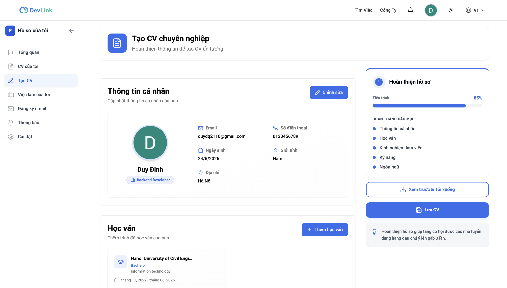
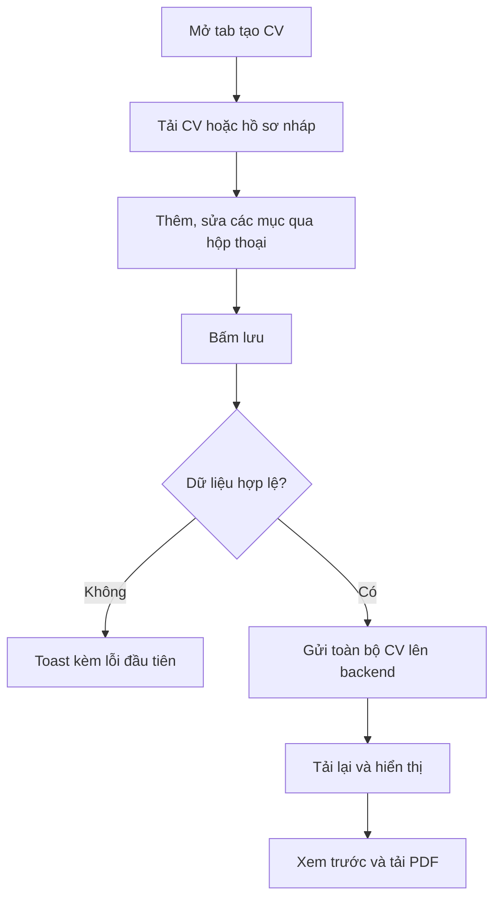

# Tạo CV

Tính năng cho phép ứng viên nhập hồ sơ CV trực tiếp trên DevLink gồm thông tin cá nhân và bảy nhóm nội dung, theo dõi mức hoàn thành và lưu lại. Trang dành cho người muốn biết trình tạo CV làm được gì, và cho developer sửa các phần của form.

## Vì sao cần

Ứng viên cần một CV có cấu trúc để xem trước, tải PDF và dùng lại. Nhập một lần trên DevLink giúp tránh phải soạn lại CV nhiều lần.

**Đối tượng:** người dùng đã đăng nhập. Trang tạo CV nằm ở `/profile?tab=create-cv`; `/profile` không có guard phía frontend, nên người chưa đăng nhập có thể mở được trang nhưng các lời gọi API sẽ bị backend từ chối.

**Đánh đổi:**

- Mọi thay đổi chỉ nằm trong trình duyệt cho tới khi bấm lưu; rời trang khi chưa lưu sẽ mất. Chưa thấy cảnh báo rời trang trong code.
- Mỗi lần lưu gửi toàn bộ CV, không lưu từng mục.

## Giao diện

Trang tạo CV: các nhóm nội dung bên trái và thanh mức hoàn thành kèm nút lưu bên phải.

## Các nhóm nội dung

| Nhóm | Component | Hộp thoại |
| --- | --- | --- |
| Thông tin cá nhân | `PersonalInfoSection` | `personal-info-modal.tsx` |
| Học vấn | `EducationSection` | `education-modal.tsx` |
| Kinh nghiệm làm việc | `WorkExperienceSection` | `work-experience-modal.tsx` |
| Kỹ năng | `SkillsSection` | `skill-modal.tsx` |
| Ngôn ngữ | `LanguagesSection` | `language-modal.tsx` |
| Dự án | `ProjectsSection` | `project-modal.tsx` |
| Chứng chỉ | `CertificatesSection` | `certificate-modal.tsx` |
| Giải thưởng | `AwardsSection` | `award-modal.tsx` |

Mỗi nhóm có hộp thoại riêng, tám hộp thoại dùng chung thành phần `modal-header-banner.tsx`, kèm một hook `use-*-modal.ts` quản lý trạng thái hộp thoại. Email trong thông tin cá nhân chỉ đọc (`isEmailReadOnly`).

## Mức hoàn thành

Mức hoàn thành tính theo trọng số các nhóm đã có nội dung:

| Nhóm | Trọng số |
| --- | :---: |
| Thông tin cá nhân (cần họ tên và email) | 1 |
| Học vấn | 1 |
| Kinh nghiệm | 1 |
| Kỹ năng | 1 |
| Ngôn ngữ | 1 |
| Dự án | 0,5 |
| Chứng chỉ | 0,5 |
| Giải thưởng | 0,5 |

Tổng trọng số 6,5; mức hoàn thành là phần trăm trọng số đã có, làm tròn. Nút xem trước bị vô hiệu khi dưới 15%.

## Luồng nghiệp vụ

Sơ đồ rút gọn; trình tự kỹ thuật xem [Tạo và xuất CV](../05-business-flows/sequences/create-and-export-cv.md).

> [!WARNING]
> Tab "CV của tôi" (`/profile?tab=my-cv`) cho chọn hoặc kéo thả một file PDF, DOC, DOCX và hiện thông báo "tải lên thành công", nhưng `my-cv-page.tsx` chỉ kiểm tra file rồi lưu tên và dung lượng vào state của component. Không có lời gọi API nào, nên file không được gửi đi đâu và mất khi tải lại trang.

## API liên quan

| Hook | Endpoint | Dùng ở |
| --- | --- | --- |
| `useLazyGetMyCVProfileQuery` | `GET /cv-profiles/me` | `use-cv.ts` |
| `useUpsertCVProfileMutation` | `POST /cv-profiles/upsert` | `use-cv.ts` |

Bảng đầy đủ: [Endpoint CV Profiles](../06-api-and-data/endpoints/cv-profiles.md).

## Dữ liệu và kiểm tra

Quy tắc từng field và giới hạn số lượng (tối đa 20 kỹ năng, 5 ngôn ngữ) ở [Model CV Profile](../06-api-and-data/models/cv-profile.md). Trước khi lưu, trang kiểm tra bằng `UpsertCVProfileRequestSchema`.

## Trường hợp lỗi

| Tình huống | Hành vi |
| --- | --- |
| Không tải được CV | Toast lỗi chung |
| Dữ liệu không hợp lệ | Toast "dữ liệu không hợp lệ" kèm đường dẫn field và lỗi đầu tiên |
| Backend từ chối lúc lưu | `useCV` ghi lỗi, trang hiện toast |

> [!NOTE]
> Nút lưu và nút xem trước của thanh thao tác trên màn hình nhỏ có chữ viết cứng bằng tiếng Việt ("Lưu CV", "Xem trước & Tải PDF") thay vì dùng bản dịch.

## Test cases

| Test | Nội dung |
| --- | --- |
| `src/features/cv-builder/components/create-cv-page.test.tsx` | Tải CV hiện tại và truyền dữ liệu vào các phần |
| `src/features/cv-builder/hooks/use-cv.test.tsx` | Trả hồ sơ nháp; ghi lỗi khi tải thất bại; lưu kèm file ảnh |
| `src/features/cv-builder/schemas/cv-profile.schema.test.ts` | Nhận hồ sơ nháp không có `id`; nhận hồ sơ đã lưu; giữ kiểm tra chặt khi lưu |

Chưa có test cho: hộp thoại từng nhóm, mức hoàn thành, trang xem trước, tab "CV của tôi".

## Source code liên quan

- [`src/features/cv-builder/components/create-cv-page.tsx`](../../src/features/cv-builder/components/create-cv-page.tsx): trang tạo CV
- [`src/features/cv-builder/components/sections/`](../../src/features/cv-builder/components/sections): các nhóm nội dung
- [`src/features/cv-builder/components/modals/`](../../src/features/cv-builder/components/modals): hộp thoại từng nhóm
- [`src/features/cv-builder/components/completion-progress.tsx`](../../src/features/cv-builder/components/completion-progress.tsx): thanh hoàn thành và nút lưu
- [`src/features/cv-builder/utils/cv-helpers.ts`](../../src/features/cv-builder/utils/cv-helpers.ts): `calculateCVCompletion`
- [`src/features/cv-builder/hooks/use-cv.ts`](../../src/features/cv-builder/hooks/use-cv.ts): tải và lưu
- [`src/components/profile/pages/my-cv-page.tsx`](../../src/components/profile/pages/my-cv-page.tsx): tab "CV của tôi"

Tài liệu backend: [CV Profiles](https://github.com/QuocDuy21-10/it-job-portal-be/blob/main/docs/03-modules/cv-profiles.md).

Đọc tiếp: [Xuất CV ra PDF](cv-pdf-export.md), [Tạo và xuất CV](../05-business-flows/sequences/create-and-export-cv.md), [Model CV Profile](../06-api-and-data/models/cv-profile.md).
