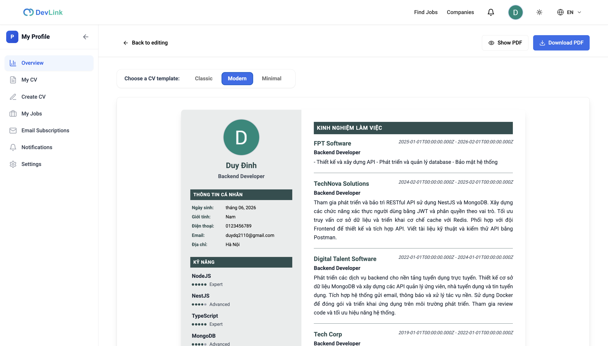
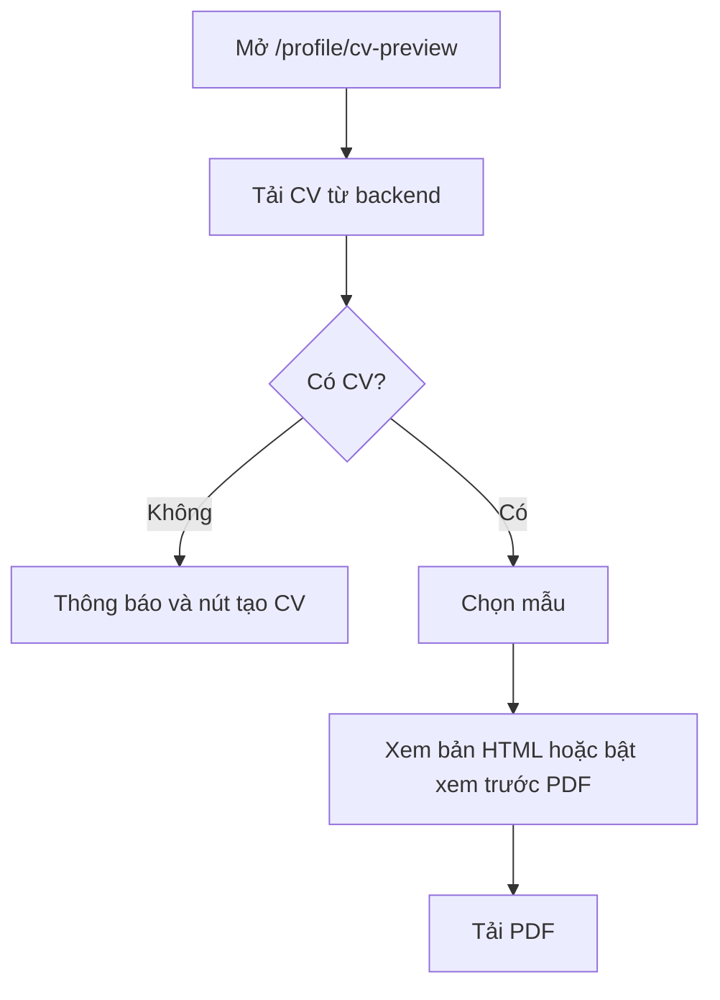

# Xuất CV ra PDF

Tính năng cho phép ứng viên xem CV theo ba mẫu và tải về dạng PDF ngay trên trình duyệt. Trang dành cho người muốn biết các mẫu và giới hạn của file PDF, và cho developer sửa mẫu hoặc xử lý ảnh, font.

## Vì sao cần

CV đã nhập trên DevLink chỉ có giá trị khi ứng viên mang đi nộp được. Xuất PDF cho phép dùng CV ở nơi khác. File được dựng ngay trên máy người dùng nên backend không phải xử lý.

**Đối tượng:** người dùng đã có CV được lưu. Chưa có CV thì trang hiện thông báo và nút quay lại tạo CV.

**Đánh đổi:**

- PDF dựng bằng `@react-pdf/renderer` trên trình duyệt nên chỉ chạy phía client và có thể chậm khi CV dài.
- Xem trước trên trang và file PDF dùng hai bộ mẫu riêng (HTML và PDF), nên hai nơi có thể lệch nhau; chưa có ghi chép về lý do.

## Giao diện

Trang xem trước: chọn mẫu, bật tắt xem trước PDF và nút tải xuống.

## Ba mẫu

| Mẫu | Giá trị | Bản xem trước trên trang | Bản PDF |
| --- | --- | --- | --- |
| Cổ điển | `classic` | `features/cv-builder/components/templates/classic/ClassicTemplate.tsx` | `features/cv-builder/components/pdf/templates/classic/ClassicTemplate.tsx` |
| Hiện đại | `modern` | `features/cv-builder/components/templates/modern/ModernTemplate.tsx` | `features/cv-builder/components/pdf/templates/modern/ModernTemplate.tsx` |
| Tối giản | `minimal` | `features/cv-builder/components/templates/minimal/MinimalTemplate.tsx` | `features/cv-builder/components/pdf/templates/minimal/MinimalTemplate.tsx` |

Mẫu mặc định là `classic`. Khổ giấy là A4. `CVPdfDocument` chọn mẫu PDF theo giá trị `template`; giá trị lạ rơi về `classic`.

## Luồng nghiệp vụ

Sơ đồ rút gọn; trình tự kỹ thuật, kể cả xử lý ảnh, xem [Tạo và xuất CV](../05-business-flows/sequences/create-and-export-cv.md).

## Chi tiết kỹ thuật

| Hạng mục | Cách làm trong code |
| --- | --- |
| Tải file | PDF chỉ được dựng khi bấm nút: nút tải `@react-pdf/renderer` và `CVPdfDocument` bằng `import()`, gọi `pdf(...).toBlob()` rồi tải file qua object URL. Trong lúc dựng, nút hiện spinner và không bấm được |
| Tên file | `CV_<họ tên, khoảng trắng thành _>_<ngày YYYY-MM-DD>.pdf` |
| Xem trước PDF | `PDFViewer`, bật tắt bằng nút; chỉ chạy trên client và được tải bằng `next/dynamic` khi bật lần đầu |
| Khóa dựng lại | `generateCVDataKey` ghép mẫu, thời điểm cập nhật và số mục học vấn, kinh nghiệm, kỹ năng, dự án để buộc dựng lại PDF khi dữ liệu đổi; code ghi chú đây là cách tránh lỗi `Eo is not a function` của `react-pdf` |
| Font | Roboto, đăng ký từ `/fonts/Roboto-Regular.ttf`, `-Medium`, `-Bold`, `-Italic` trong `public/fonts/` |
| Ảnh đại diện | `getProxiedImageUrl` đổi ảnh của backend sang `/api/proxy-image?url=...` để tránh CORS |

Proxy ảnh trả ảnh với `Cache-Control: public, max-age=31536000, immutable` và `Access-Control-Allow-Origin: *`. Route chỉ cho tải từ `localhost:8081` và host lấy từ `NEXT_PUBLIC_API_URL` sau khi bỏ `http://` hoặc `https://`. Nếu biến này chứa đường dẫn (ví dụ `/api/v1`) thì chuỗi sau khi bỏ giao thức vẫn có đường dẫn và sẽ không khớp với `url.host`; chưa kiểm tra giá trị thật trên môi trường triển khai.

## API liên quan

Không có endpoint riêng: PDF dựng hoàn toàn ở trình duyệt. Dữ liệu đầu vào lấy bằng `GET /cv-profiles/me`, xem [Endpoint CV Profiles](../06-api-and-data/endpoints/cv-profiles.md). Ảnh đi qua route nội bộ `GET /api/proxy-image`.

## Dữ liệu và kiểm tra

Dữ liệu vào mẫu là `ICVProfile`, xem [Model CV Profile](../06-api-and-data/models/cv-profile.md). Chưa có kiểm tra riêng cho PDF; dữ liệu đã được kiểm tra khi lưu.

## Trường hợp lỗi

| Tình huống | Hành vi |
| --- | --- |
| Chưa có CV | Thông báo và nút tạo CV |
| Dựng PDF lỗi | Hiện toast lỗi; nút tải bấm lại được |
| Ảnh không tải được | Proxy trả lỗi; ảnh không hiện (chưa kiểm tra cách mẫu xử lý ảnh lỗi) |
| URL ảnh nằm ngoài danh sách cho phép | Proxy trả 403 |
| Thiếu tham số `url` | Proxy trả 400 |

## Test cases

| Test | Nội dung |
| --- | --- |
| `src/features/cv-builder/lib/pdf/image-helpers.test.ts` | Hàm xử lý địa chỉ ảnh cho PDF |
| `src/features/cv-builder/components/pdf/download-pdf-button.test.tsx` | Chưa bấm thì chưa dựng PDF; bấm thì dựng đúng mẫu và tải file; lỗi thì hiện toast và nút bấm lại được |

Chưa có test cho: các mẫu PDF, trang xem trước, route `proxy-image`.

## Source code liên quan

- [`src/features/cv-builder/components/cv-preview-page.tsx`](../../src/features/cv-builder/components/cv-preview-page.tsx): trang xem trước, chọn mẫu
- [`src/features/cv-builder/components/pdf/download-pdf-button.tsx`](../../src/features/cv-builder/components/pdf/download-pdf-button.tsx): tải PDF
- [`src/features/cv-builder/components/pdf/cv-pdf-document.tsx`](../../src/features/cv-builder/components/pdf/cv-pdf-document.tsx): chọn mẫu PDF
- [`src/features/cv-builder/components/pdf/pdf-preview.tsx`](../../src/features/cv-builder/components/pdf/pdf-preview.tsx): xem trước PDF
- [`src/features/cv-builder/components/pdf/templates/`](../../src/features/cv-builder/components/pdf/templates): ba mẫu PDF
- [`src/features/cv-builder/components/templates/`](../../src/features/cv-builder/components/templates): ba mẫu xem trước HTML
- [`src/features/cv-builder/lib/pdf/fonts.ts`](../../src/features/cv-builder/lib/pdf/fonts.ts): đăng ký font
- [`src/features/cv-builder/lib/pdf/helpers.ts`](../../src/features/cv-builder/lib/pdf/helpers.ts): `generateCVDataKey`
- [`src/features/cv-builder/lib/pdf/image-helpers.ts`](../../src/features/cv-builder/lib/pdf/image-helpers.ts): xử lý ảnh
- [`src/app/api/proxy-image/route.ts`](../../src/app/api/proxy-image/route.ts): proxy ảnh

Đọc tiếp: [Tạo CV](cv-builder.md), [Tạo và xuất CV](../05-business-flows/sequences/create-and-export-cv.md), [Giao tiếp API](../02-architecture/api-communication.md).
