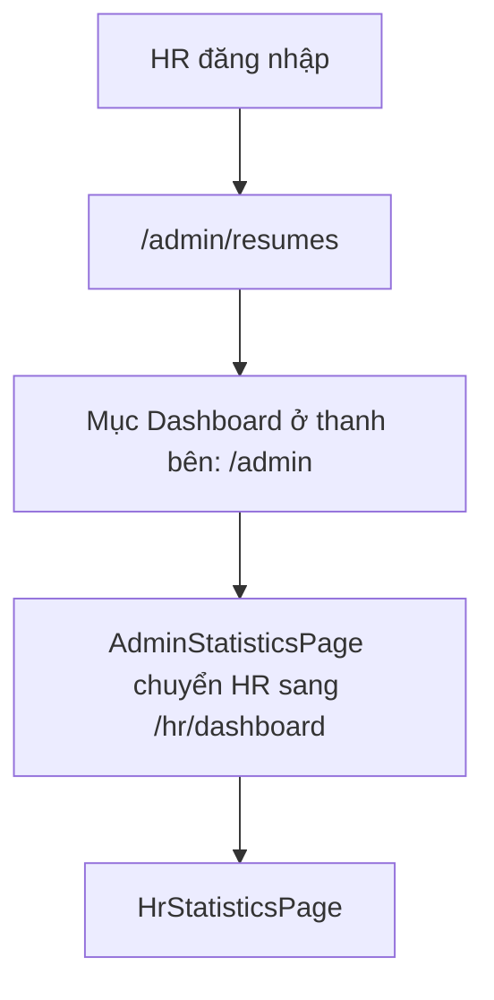

# Dashboard nhà tuyển dụng

Dashboard HR cho nhà tuyển dụng thấy số liệu tuyển dụng của riêng công ty mình: tin đang mở, hồ sơ nhận được, tỷ lệ phản hồi và xu hướng. Trang dành cho nhà tuyển dụng, và developer sửa các thẻ số liệu hoặc biểu đồ.

## Vì sao cần

Nhà tuyển dụng cần biết nhanh tình hình tuyển dụng mà không phải đếm tay từng tin và từng hồ sơ. Backend tính sẵn số liệu theo công ty của HR; frontend chỉ hiển thị.

**Đối tượng:** vai trò `HR`. Route `/hr/dashboard` được bảo vệ bởi `HrRoute`; người không phải HR bị chuyển đi (quản trị viên về `/admin`, người khác về `/`).

**Đánh đổi:** số liệu có thể là bản cache của backend. Giao diện luôn ghi rõ là bản cache hay bản mới cùng thời điểm tạo, để người xem biết độ mới.

## Giao diện

Các thẻ số liệu, biểu đồ và nhãn độ mới của trang này tương tự trang quản trị; xem ảnh ở [Trang quản trị](admin-dashboard.md). Chưa có ảnh chụp riêng của dashboard HR trong `public/images/screenshots/`.

## Cách HR vào trang này

Sau khi đăng nhập, HR được chuyển tới `/admin/resumes` chứ không phải dashboard. Trong thanh bên của khu vực quản trị, mục "Dashboard" trỏ tới `/admin`; trang này chuyển HR sang `/hr/dashboard` ngay khi biết vai trò.

Sơ đồ rút gọn đường đi tới dashboard HR.

## Nội dung

`HrStatisticsPage` gọi `GET /statistics/hr-dashboard` và hiển thị:

| Phần | Dữ liệu |
| --- | --- |
| Thẻ số liệu | `countActiveJobs`, `countPendingApprovalJobs`, `countExpiredJobs`, `totalApplications` (`StatisticsKpiGrid`) |
| Hiệu quả xử lý hồ sơ | `responseRate`, `averageFirstResponseHours`, `averageMatchingScore` |
| Biểu đồ phân bố trạng thái hồ sơ | `applicationStatusDistribution`, thanh ngang |
| Biểu đồ xu hướng hồ sơ | `applicationTrend`, vùng |
| Tin nhiều hồ sơ nhất | `topJobsByApplications` |
| Độ mới | `generatedAt` và `fromCache` (`StatisticsFreshness`) |

Biểu đồ được nạp động (`dynamic`) và dùng thư viện Recharts, nên phần đầu trang hiện trước và biểu đồ hiện khung chờ trong lúc tải.

## Trạng thái giao diện

| Trạng thái | Khi nào | Hiển thị |
| --- | --- | --- |
| Đang tải | Truy vấn chạy lần đầu | Khung chờ |
| Không có công ty | Backend trả 403 | Thông báo HR chưa gắn với công ty nào |
| Lỗi | Lỗi khác | Thông báo lỗi kèm nút thử lại |
| Rỗng | Không có dữ liệu | Thông báo trống |
| Có dữ liệu | Phản hồi hợp lệ | Thẻ, biểu đồ, nhãn độ mới |

## API liên quan

| Hook | Endpoint | Dùng ở |
| --- | --- | --- |
| `useGetHrDashboardStatsQuery` | `GET /statistics/hr-dashboard` | `components/statistics/hr-statistics-page.tsx` |

Bảng đầy đủ: [Endpoint Statistics](../06-api-and-data/endpoints/statistics.md).

## Dữ liệu và kiểm tra

Dạng `IHrDashboardStats` ở [Endpoint Statistics](../06-api-and-data/endpoints/statistics.md#dữ-liệu). Backend giới hạn route này cho `HR`.

## Trường hợp lỗi

Xem bảng trạng thái giao diện ở trên. Mã 403 được hiểu là HR chưa có công ty; chưa kiểm tra backend còn trả 403 trong trường hợp khác hay không.

## Test cases

| Test | Nội dung |
| --- | --- |
| `src/components/statistics/hr-statistics-page.test.tsx` | Hiển thị số liệu từ endpoint của HR; hiện trạng thái "không có công ty" khi bị từ chối |

Chưa có test cho: `HrRoute`, biểu đồ, nhãn độ mới.

## Source code liên quan

- [`src/app/[locale]/(hr-dashboard)/hr/dashboard/page.tsx`](../../src/app/[locale]/(hr-dashboard)/hr/dashboard/page.tsx): trang
- [`src/app/[locale]/(hr-dashboard)/layout.tsx`](../../src/app/[locale]/(hr-dashboard)/layout.tsx): khung, `HrRoute`, trợ lý AI
- [`src/components/hr-route.tsx`](../../src/components/hr-route.tsx): chặn người không phải HR
- [`src/components/statistics/hr-statistics-page.tsx`](../../src/components/statistics/hr-statistics-page.tsx): trang số liệu
- [`src/components/statistics/hr-dashboard-charts.tsx`](../../src/components/statistics/hr-dashboard-charts.tsx): biểu đồ
- [`src/components/statistics/statistics-kpi-grid.tsx`](../../src/components/statistics/statistics-kpi-grid.tsx): thẻ số liệu
- [`src/components/statistics/statistics-helpers.ts`](../../src/components/statistics/statistics-helpers.ts): hàm hỗ trợ

Tài liệu backend: [Statistics](https://github.com/QuocDuy21-10/it-job-portal-be/blob/main/docs/03-modules/statistics.md).

Đọc tiếp: [Trang quản trị](admin-dashboard.md), [Duyệt tin tuyển dụng](job-approval.md), [Phân quyền](../02-architecture/authorization.md).
