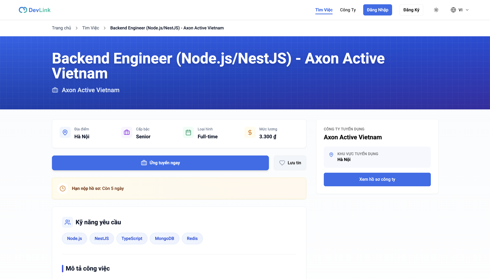
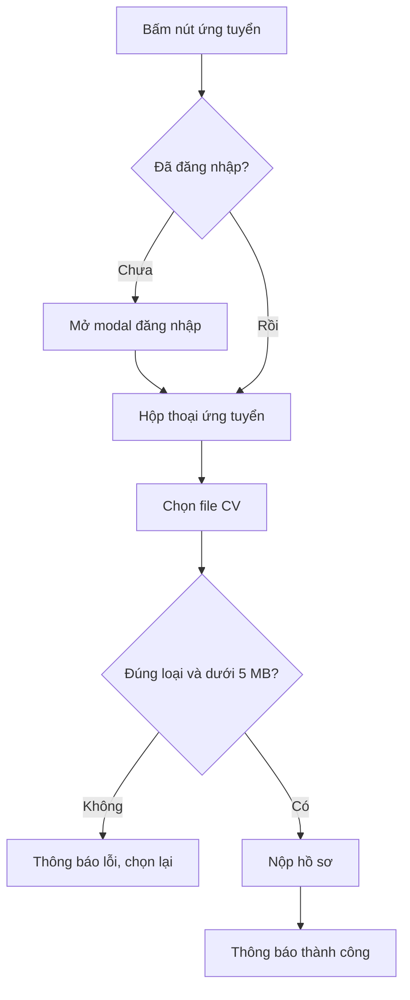

# Ứng tuyển công việc

Tính năng cho phép ứng viên đã đăng nhập nộp file CV vào một tin tuyển dụng nội bộ. Trang dành cho người muốn biết cần gì để ứng tuyển và chuyện gì xảy ra sau đó, và cho developer sửa hộp thoại ứng tuyển.

## Vì sao cần

Đây là hành động chính nối ứng viên với nhà tuyển dụng. Hồ sơ gồm file CV và tin được chọn; nhà tuyển dụng xem và đổi trạng thái, ứng viên theo dõi kết quả.

**Đối tượng:** ứng viên (`NORMAL USER`) đã đăng nhập. Khách bấm nút sẽ được mời đăng nhập trước.

**Điều kiện:**

- Chỉ tin nội bộ có nút ứng tuyển trên DevLink. Tin từ nguồn ngoài dẫn sang website gốc, xem [Việc làm từ nguồn ngoài](external-job-aggregation.md).
- Ứng viên cần một file CV định dạng PDF, DOC hoặc DOCX, tối đa 5 MB.

**Đánh đổi:** frontend chỉ kiểm tra file; trang chi tiết không kiểm tra tin còn hạn hay còn mở trước khi cho mở hộp thoại. Việc chặn nộp vào tin không hợp lệ do backend quyết định. Chưa kiểm tra quy tắc đó phía backend.

## Giao diện

Trang chi tiết tin: nút ứng tuyển và nút lưu việc cạnh thông tin vị trí.

## Luồng nghiệp vụ

Sơ đồ rút gọn; trình tự kỹ thuật xem [Ứng tuyển công việc](../05-business-flows/sequences/apply-for-job.md).

| Bước | Hành vi |
| --- | --- |
| Mở hộp thoại | Điền sẵn họ tên và email từ tài khoản; số điện thoại để trống |
| Chọn file | Kiểm tra loại và dung lượng ngay khi chọn |
| Nộp | Gửi file và mã tin; thành công thì xóa form và đóng hộp thoại |
| Sau khi nộp | Backend tạo hồ sơ `PENDING` và thông báo cho nhà tuyển dụng; ứng viên theo dõi ở trang việc đã ứng tuyển, xem [Trạng thái hồ sơ](../05-business-flows/state-machines/application-status.md) |

> [!NOTE]
> Hộp thoại có các ô họ tên, số điện thoại và email, nhưng chỉ file CV và mã tin được gửi lên backend. Các ô còn lại không nằm trong dữ liệu gửi.

## API liên quan

| Hook | Endpoint | Dùng ở |
| --- | --- | --- |
| `useCreateResumeWithUploadMutation` | `POST /resumes/upload-cv` | `apply-modal.tsx` |

Bảng đầy đủ: [Endpoint Resumes](../06-api-and-data/endpoints/resumes.md).

## Dữ liệu và kiểm tra

| Kiểm tra | Quy tắc ở frontend | Quy tắc ở backend |
| --- | --- | --- |
| Loại file | PDF, DOC, DOCX (theo MIME) | `pdf`, `doc`, `docx`, `txt` (theo phần mở rộng) |
| Dung lượng | Tối đa 5 MB | Tối đa 5 MB |
| Tần suất | Không | Tối đa 20 lần mỗi giờ cho mỗi route |
| Bắt buộc | Phải có file | Mã tin phải là `MongoId` hợp lệ; chưa kiểm tra backend có bắt buộc file hay không |

Dạng dữ liệu hồ sơ: [Model Resume](../06-api-and-data/models/resume.md).

## Trường hợp lỗi

| Tình huống | Hành vi |
| --- | --- |
| Chưa đăng nhập | Mở modal đăng nhập, sau khi đăng nhập hộp thoại ứng tuyển tự mở |
| File sai loại hoặc quá lớn | Toast lỗi, không giữ file |
| Chưa chọn file | Lỗi dưới ô chọn file |
| Backend từ chối | Toast với thông điệp của backend, hoặc thông điệp dự phòng |
| `statusCode` khác 201 | Toast lỗi |

## Test cases

| Test | Nội dung |
| --- | --- |
| `src/components/modals/apply-modal.test.tsx` | Hiện đúng chữ tiếng Anh và tiếng Việt |
| `src/app/[locale]/(main)/jobs/[id]/job-detail-page-client.test.tsx` | Khách bấm ứng tuyển thì mở modal đăng nhập, sau đó mở hộp thoại ứng tuyển; người đã đăng nhập mở thẳng; nút lưu trước và sau khi hydrate |

Chưa có test cho: kiểm tra loại và dung lượng file, gọi API nộp, xử lý lỗi, đóng hộp thoại sau khi nộp.

## Source code liên quan

- [`src/components/modals/apply-modal.tsx`](../../src/components/modals/apply-modal.tsx): hộp thoại, kiểm tra file, gọi API
- [`src/app/[locale]/(main)/jobs/[id]/job-detail-page-client.tsx`](../../src/app/[locale]/(main)/jobs/[id]/job-detail-page-client.tsx): nút ứng tuyển, kiểm tra đăng nhập
- [`src/features/resume/redux/resume.api.ts`](../../src/features/resume/redux/resume.api.ts): `createResumeWithUpload`
- [`src/contexts/auth-modal-context.tsx`](../../src/contexts/auth-modal-context.tsx): mở modal đăng nhập kèm `onSuccess`

Tài liệu backend: [Resumes](https://github.com/QuocDuy21-10/it-job-portal-be/blob/main/docs/03-modules/resumes.md).

Đọc tiếp: [Tìm kiếm việc làm](job-search.md), [Trạng thái hồ sơ](../05-business-flows/state-machines/application-status.md), [Xác thực](authentication.md).
