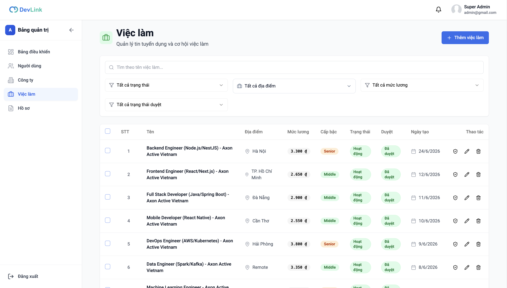
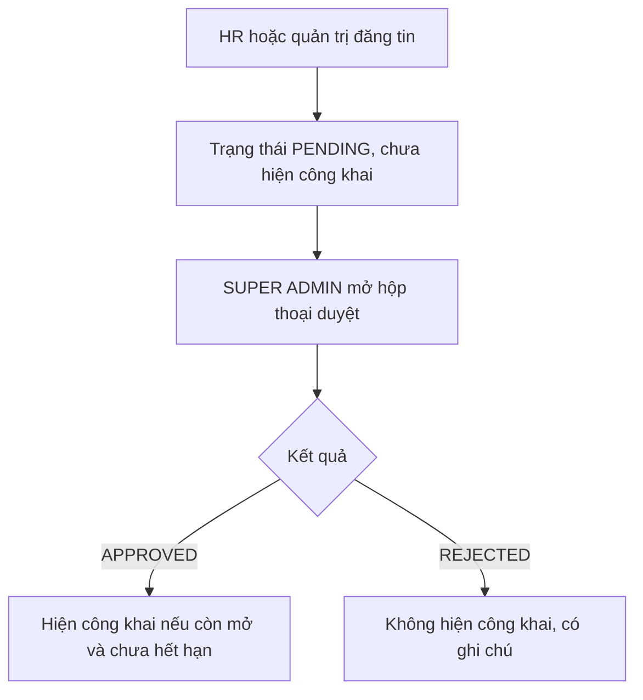

# Duyệt tin tuyển dụng

Tính năng cho phép nhà tuyển dụng đăng tin và quản trị viên duyệt hoặc từ chối trước khi tin hiện công khai. Trang dành cho người đăng và người duyệt tin, và developer sửa trang quản trị tin.

## Vì sao cần

Tin tuyển dụng hiện cho mọi người xem, nên cần một bước kiểm soát nội dung. Nhà tuyển dụng tự đăng, quản trị viên là người quyết định tin nào được hiển thị.

**Đối tượng:** `HR` và `SUPER ADMIN` (đăng, sửa, xóa tin); chỉ `SUPER ADMIN` được duyệt.

**Đánh đổi:** tin vừa đăng chưa hiện công khai cho tới khi được duyệt; sửa tin không đưa tin về trạng thái chờ duyệt, nên nội dung đã duyệt có thể bị sửa mà không cần duyệt lại.

## Giao diện

Trang quản lý tin: ô tìm theo tên, bốn bộ lọc (trạng thái, địa điểm, mức lương, trạng thái duyệt) và bảng tin có cột duyệt, kèm các nút duyệt, sửa, xóa ở mỗi dòng.

## Luồng nghiệp vụ

Sơ đồ rút gọn; các trạng thái chi tiết ở [Trạng thái duyệt tin](../05-business-flows/state-machines/job-approval-status.md).

| Chức năng | Hành vi |
| --- | --- |
| Đăng và sửa tin | Hộp thoại `JobDialog` dùng `JobForm`, kiểm tra bằng `JobSchema` |
| Xóa | Xóa một tin (có xác nhận) hoặc xóa hàng loạt qua các hộp chọn |
| Duyệt | Nút duyệt chỉ hiện với `SUPER ADMIN`; hộp thoại chọn `APPROVED` hoặc `REJECTED` và nhập ghi chú tối đa 500 ký tự |
| Hiển thị kết quả | Cột "Duyệt" có huy hiệu theo trạng thái; ghi chú duyệt hiện dưới huy hiệu nếu có |
| Lọc | Theo tên, trạng thái hoạt động, địa điểm, mức lương và trạng thái duyệt |

## API liên quan

| Hook | Endpoint | Dùng ở |
| --- | --- | --- |
| `useGetJobsQuery` | `GET /jobs` | `(dashboard)/admin/jobs/page.tsx` |
| `useCreateJobMutation`, `useUpdateJobMutation`, `useDeleteJobMutation` | `POST /jobs`, `PATCH /jobs/:id`, `DELETE /jobs/:id` | `hooks/use-job.ts` |
| `useApproveJobMutation` | `PATCH /jobs/:id/approve` | `hooks/use-job.ts` |
| `useBulkDeleteJobsMutation` | `DELETE /jobs/bulk` | `(dashboard)/admin/jobs/page.tsx` |

Bảng đầy đủ: [Endpoint Jobs](../06-api-and-data/endpoints/jobs.md).

## Dữ liệu và kiểm tra

Dạng tin và các field duyệt (`approvalStatus`, `approvalNote`, `approvedBy`, `approvedAt`) ở [Model Job](../06-api-and-data/models/job.md).

## Trường hợp lỗi

| Tình huống | Hành vi |
| --- | --- |
| Thao tác bị backend từ chối | Toast với thông điệp của backend hoặc thông điệp dự phòng |
| `HR` muốn duyệt | Không có nút; backend cũng từ chối route duyệt |
| Ghi chú quá 500 ký tự | Ô nhập giới hạn 500 ký tự |

## Test cases

Chưa có test cho hộp thoại duyệt, bảng tin quản trị và trang quản trị tin. Test của `getJobStatus` (nhãn "mới", "sắp hết hạn") nằm ở `src/lib/utils/job-status.test.ts`.

## Source code liên quan

- [`src/app/[locale]/(dashboard)/admin/jobs/page.tsx`](../../src/app/[locale]/(dashboard)/admin/jobs/page.tsx): trang quản trị tin
- [`src/components/job/job-table.tsx`](../../src/components/job/job-table.tsx): bảng tin, nút duyệt
- [`src/components/job/job-approval-dialog.tsx`](../../src/components/job/job-approval-dialog.tsx): hộp thoại duyệt
- [`src/components/job/job-dialog.tsx`](../../src/components/job/job-dialog.tsx), [`src/components/job/job-form.tsx`](../../src/components/job/job-form.tsx): đăng và sửa tin
- [`src/hooks/use-job.ts`](../../src/hooks/use-job.ts): thao tác kèm toast
- [`src/features/job/schemas/job.schema.ts`](../../src/features/job/schemas/job.schema.ts): kiểu và kiểm tra

Backend: [Use case đăng và duyệt tin](https://github.com/QuocDuy21-10/it-job-portal-be/blob/main/docs/06-workflows/use-cases/job-posting-and-approval.md).

Đọc tiếp: [Trạng thái duyệt tin](../05-business-flows/state-machines/job-approval-status.md), [Trang quản trị](admin-dashboard.md), [Dashboard HR](hr-dashboard.md).
