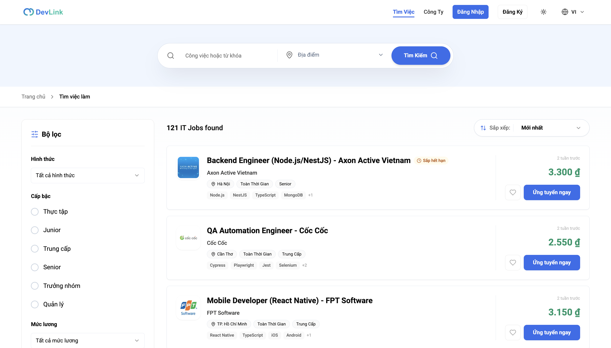
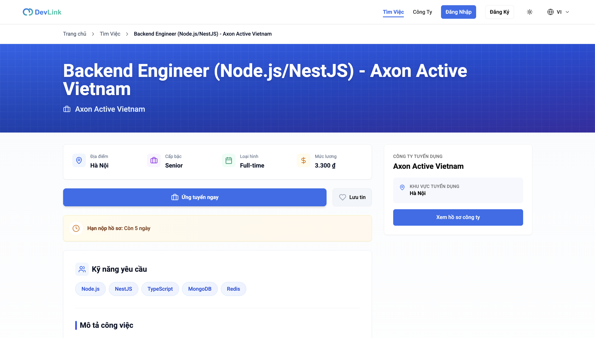
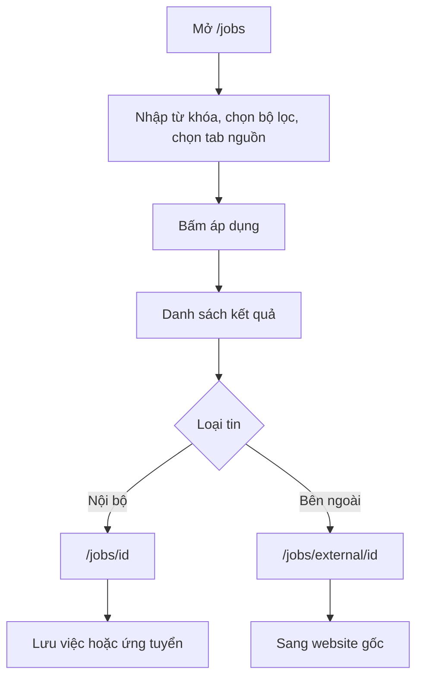

# Tìm kiếm việc làm

Tính năng cho phép ứng viên tìm tin tuyển dụng theo từ khóa, địa điểm, loại hình, cấp bậc, mức lương và nguồn, rồi xem chi tiết một tin. Trang dành cho người muốn biết trang `/jobs` làm được gì, và cho developer cần biết mỗi phần dùng component nào.

## Vì sao cần

Ứng viên cần thu hẹp hàng loạt tin về vài tin phù hợp. Trang `/jobs` gom cả tin do nhà tuyển dụng đăng trên DevLink và tin DevLink tổng hợp từ website khác vào một danh sách, nên người dùng không phải tìm ở nhiều nơi.

**Đối tượng:** mọi người, kể cả khách chưa đăng nhập. Lưu việc hoặc ứng tuyển thì cần đăng nhập.

**Đánh đổi:**

- Trang đầu của danh sách và trang chi tiết được render trên server và giữ trong cache Next.js khoảng 5 phút, nên tin mới hoặc vừa đóng có thể chưa hiện ngay; xem [Chiến lược cache](../02-architecture/caching-strategy.md).
- Tin từ nguồn ngoài chỉ hiển thị thông tin hạn chế và dẫn người dùng sang website gốc; xem [Việc làm từ nguồn ngoài](external-job-aggregation.md).

## Giao diện

Trang danh sách: ô tìm kiếm, bộ lọc bên trái, danh sách thẻ tin và phân trang.

Trang chi tiết tin nội bộ: thông tin vị trí, công ty, nút ứng tuyển và nút lưu.

## Luồng nghiệp vụ

Sơ đồ rút gọn hành trình tìm việc; trình tự kỹ thuật xem [Tìm kiếm và lọc việc làm](../05-business-flows/sequences/search-and-filter-jobs.md).

| Chức năng | Hành vi |
| --- | --- |
| Tìm theo từ khóa | `q` trên URL; ô nhập gợi ý kỹ năng khi gõ từ 2 ký tự và nhớ 5 từ khóa gần nhất trong `localStorage` |
| Địa điểm | `locationCode` trên URL; đường dẫn cũ dùng `location` vẫn được đổi sang mã |
| Loại hình, cấp bậc, mức lương | Chọn trong danh sách; chỉ áp dụng khi bấm áp dụng |
| Tab nguồn | Tất cả, nội bộ, bên ngoài; áp dụng ngay |
| Sắp xếp | Mới nhất, cũ nhất, lương giảm dần, lương tăng dần |
| Phân trang | Mặc định 10 tin mỗi trang |
| Lưu việc | Chỉ với tin nội bộ; chưa đăng nhập thì mở modal đăng nhập |
| Chi tiết tin nội bộ | Có nút ứng tuyển; chưa đăng nhập thì mở modal đăng nhập và sau khi đăng nhập mở hộp thoại ứng tuyển |

Trạng thái bộ lọc nằm trên URL nên có thể chia sẻ đường dẫn; tham số mặc định không được ghi vào URL.

## Trang chi tiết tin nội bộ

Trang `/jobs/<id>` render trên server bằng `fetchPublicJobById`. Nếu không có tin, trang trả 404. Trang có thêm dữ liệu có cấu trúc dạng `application/ld+json` trong HTML. Số ngày còn lại tính từ `endDate`.

Chi tiết cách ứng tuyển ở [Ứng tuyển](job-application.md).

## API liên quan

| Hook hoặc hàm | Endpoint | Dùng ở |
| --- | --- | --- |
| `fetchPublicJobSearch` | `GET /job-search` | Tải đầu trang `/jobs` trên server |
| `useSearchJobsQuery` | `GET /job-search` | Khi đổi bộ lọc |
| `fetchPublicJobById` | `GET /jobs/:id` | Trang chi tiết |
| `useGetSkillCatalogQuery`, `useGetPopularSkillsQuery` | Danh mục và kỹ năng phổ biến | Gợi ý ở ô tìm kiếm |

Bảng đầy đủ: [Endpoint Job Search](../06-api-and-data/endpoints/job-search.md), [Endpoint Jobs](../06-api-and-data/endpoints/jobs.md).

## Dữ liệu và kiểm tra

Kiểu dữ liệu kết quả ở [Model JobSearchItem](../06-api-and-data/models/job-search-item.md); tin nội bộ ở [Model Job](../06-api-and-data/models/job.md). Bảng tham số URL và API ở [Phân trang và lọc](../06-api-and-data/pagination-filtering.md).

## Trường hợp lỗi

| Tình huống | Hành vi |
| --- | --- |
| Server không lấy được dữ liệu đầu | Danh sách tải lại bằng RTK Query ngay khi mở |
| Giá trị lạ trong URL | Bị thay bằng mặc định |
| Không có kết quả | Danh sách rỗng. Nút đặt lại bộ lọc hiện khi có bộ lọc đang áp dụng hoặc bản nháp chưa áp dụng, không riêng lúc rỗng |
| Tin nội bộ không tồn tại | Trang 404 |

## Test cases

| Test | Nội dung |
| --- | --- |
| `src/features/job/hooks/use-job-list.test.tsx` | Bản nháp, áp dụng, đặt lại, đổi nguồn, cập nhật khi trạng thái ban đầu đổi |
| `src/lib/utils/public-listing.test.ts` | Chuẩn hóa địa điểm, nguồn, dựng tham số API và chuỗi query |
| `src/features/job/components/job-search-card.test.tsx` | Thẻ tin nội bộ có lương và nút lưu; tin ngoài không có; trạng thái sắp hết hạn |
| `src/features/job/components/job-card.test.tsx` | Nhãn lưu việc trước và sau khi hydrate |
| `src/components/ui/search-suggest-input.test.tsx` | Từ khóa gần đây, xóa một mục, chọn một mục |
| `src/app/[locale]/(main)/jobs/[id]/job-detail-page-client.test.tsx` | Trang chi tiết phía client |

Chưa có test cho: `jobs-page-client.tsx` (ghi URL, ngăn lọc trên điện thoại), trang `/jobs` phía server, phân trang.

## Source code liên quan

- [`src/app/[locale]/(main)/jobs/page.tsx`](../../src/app/[locale]/(main)/jobs/page.tsx): server, metadata
- [`src/app/[locale]/(main)/jobs/jobs-page-client.tsx`](../../src/app/[locale]/(main)/jobs/jobs-page-client.tsx): giao diện danh sách
- [`src/app/[locale]/(main)/jobs/[id]/page.tsx`](../../src/app/[locale]/(main)/jobs/[id]/page.tsx): trang chi tiết, dữ liệu có cấu trúc
- [`src/app/[locale]/(main)/jobs/[id]/job-detail-page-client.tsx`](../../src/app/[locale]/(main)/jobs/[id]/job-detail-page-client.tsx): nút ứng tuyển và lưu
- [`src/features/job/hooks/use-job-list.ts`](../../src/features/job/hooks/use-job-list.ts): trạng thái bộ lọc
- [`src/features/job/components/job-search-card.tsx`](../../src/features/job/components/job-search-card.tsx): thẻ kết quả
- [`src/components/search/job-search-box.tsx`](../../src/components/search/job-search-box.tsx): ô tìm kiếm
- [`src/components/ui/search-suggest-input.tsx`](../../src/components/ui/search-suggest-input.tsx): gợi ý và lịch sử tìm kiếm
- [`src/lib/utils/public-listing.ts`](../../src/lib/utils/public-listing.ts): đọc URL, dựng tham số

Tài liệu backend: [Job Search](https://github.com/QuocDuy21-10/it-job-portal-be/blob/main/docs/03-modules/job-search.md).

Đọc tiếp: [Việc làm từ nguồn ngoài](external-job-aggregation.md), [Ứng tuyển](job-application.md), [Rendering và SEO](../02-architecture/rendering-and-seo.md).
