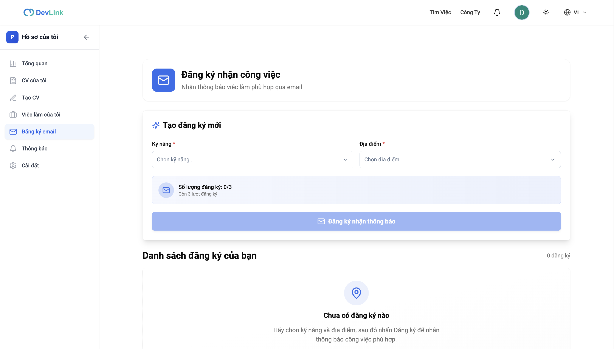
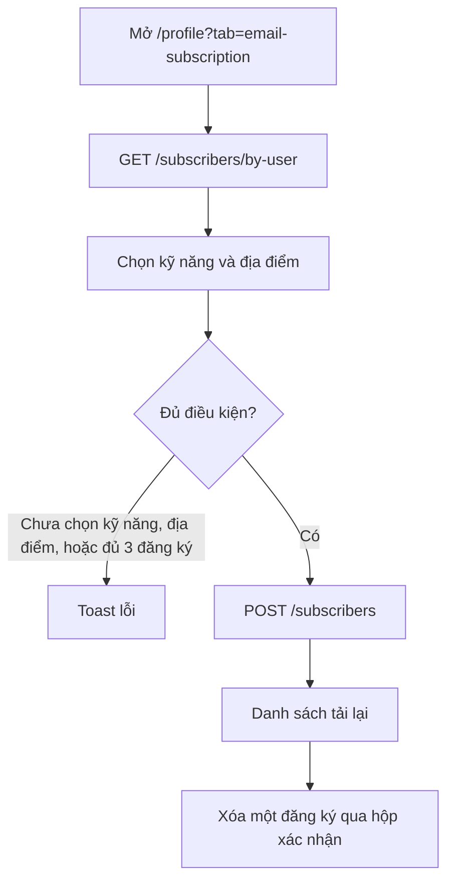

# Đăng ký nhận việc

Tính năng cho phép ứng viên đăng ký nhận email việc làm theo địa điểm và kỹ năng. Trang dành cho người muốn biết cách đăng ký và giới hạn, và cho developer sửa trang đăng ký.

## Vì sao cần

Ứng viên không muốn ngày nào cũng vào tìm. Đăng ký một lần với bộ kỹ năng và địa điểm mong muốn, rồi backend gửi việc phù hợp qua email.

**Đối tượng:** người dùng đã đăng nhập.

**Giới hạn:** mỗi người tối đa 3 đăng ký. Con số này do backend trả về trong `maxAllowed` (hiện backend đặt là 3); frontend đọc giá trị đó và dùng 3 làm mặc định khi chưa có phản hồi.

**Đánh đổi:** frontend chỉ quản lý danh sách đăng ký. Việc gửi email do backend thực hiện; tài liệu này chưa kiểm tra lịch gửi hay nội dung email.

## Giao diện

Trang đăng ký: ô chọn kỹ năng, ô chọn địa điểm, nút đăng ký và danh sách đăng ký hiện có.

## Luồng nghiệp vụ

Sơ đồ rút gọn hành trình đăng ký.

| Chức năng | Hành vi |
| --- | --- |
| Chọn kỹ năng | Ô chọn nhiều, tùy chọn lấy từ danh mục kỹ năng của backend, xem [Endpoint Skills](../06-api-and-data/endpoints/skills.md) |
| Chọn địa điểm | Một mã địa điểm |
| Email | Lấy từ tài khoản (`user.email`) và gửi kèm khi tạo |
| Kiểm tra trước khi gửi | Phải đăng nhập, có ít nhất một kỹ năng, có địa điểm, và số đăng ký hiện tại chưa chạm `maxAllowed` |
| Danh sách | Mỗi đăng ký hiện kỹ năng và địa điểm; xóa qua hộp xác nhận |
| Cập nhật đăng ký | Giao diện không có; chỉ tạo và xóa |

## API liên quan

| Hook | Endpoint | Dùng ở |
| --- | --- | --- |
| `useGetSubscribersByUserQuery` | `GET /subscribers/by-user` | `email-subscription-page.tsx` |
| `useCreateSubscriberMutation` | `POST /subscribers` | `email-subscription-page.tsx` |
| `useDeleteSubscriberMutation` | `DELETE /subscribers/:id` | `email-subscription-page.tsx` |

Bảng đầy đủ, kể cả hook `updateSubscriber` đang gọi nhầm route tạo mới: [Endpoint Subscribers](../06-api-and-data/endpoints/subscribers.md).

## Dữ liệu và kiểm tra

Bản ghi đăng ký gồm `_id`, `name`, `email`, `skills`, `location`, `locationCode`, `createdBy`, `updatedBy`. Form tạo yêu cầu tên từ 2 ký tự, email hợp lệ, mã địa điểm và ít nhất một kỹ năng; trang tự điền `name` và `email` từ tài khoản.

## Trường hợp lỗi

| Tình huống | Hành vi |
| --- | --- |
| Chưa đăng nhập | Toast yêu cầu đăng nhập |
| Thiếu kỹ năng hoặc địa điểm | Toast lỗi, không gửi |
| Đã đủ số đăng ký | Toast nêu số tối đa, không gửi |
| Backend từ chối khi tạo hoặc xóa | Toast với thông điệp của backend hoặc thông điệp dự phòng |

## Test cases

Chưa có test cho trang đăng ký nhận việc và danh sách đăng ký.

## Source code liên quan

- [`src/components/profile/pages/email-subscription-page.tsx`](../../src/components/profile/pages/email-subscription-page.tsx): trang và form
- [`src/components/profile/subscription-list.tsx`](../../src/components/profile/subscription-list.tsx): danh sách và xóa
- [`src/features/subscriber/redux/subscriber.api.ts`](../../src/features/subscriber/redux/subscriber.api.ts): endpoint
- [`src/features/subscriber/schemas/subscriber.schema.ts`](../../src/features/subscriber/schemas/subscriber.schema.ts): kiểu và kiểm tra
- [`src/hooks/use-skill-catalog.ts`](../../src/hooks/use-skill-catalog.ts): danh mục kỹ năng

Tài liệu backend: [Thông báo và email](https://github.com/QuocDuy21-10/it-job-portal-be/blob/main/docs/03-modules/notifications-and-mail.md).

Đọc tiếp: [Thông báo](notifications.md), [Hồ sơ người dùng](user-profile.md), [Tìm kiếm việc làm](job-search.md).
