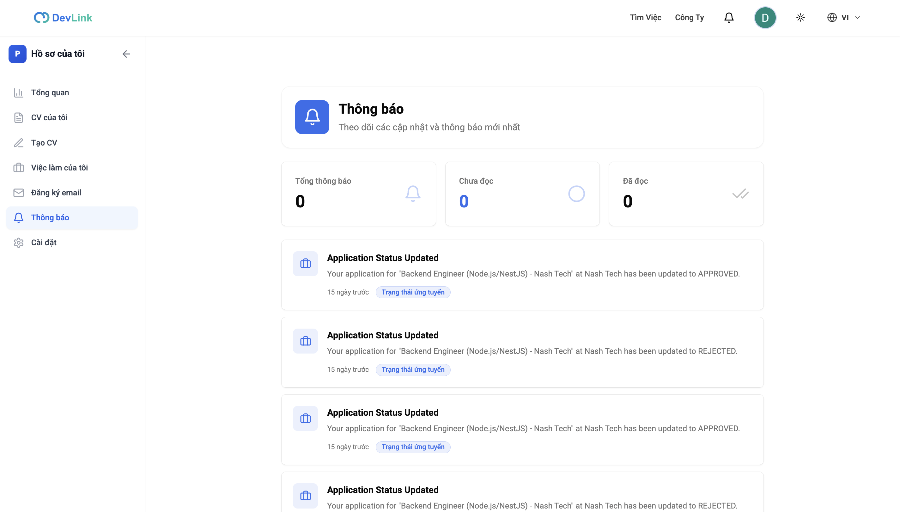
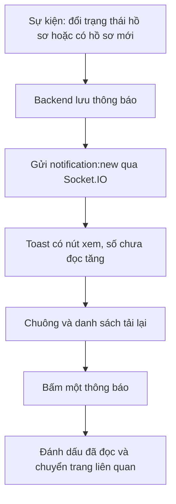

# Thông báo

Tính năng báo cho người dùng khi có sự kiện liên quan: ứng viên nhận thông báo khi trạng thái hồ sơ đổi, nhà tuyển dụng nhận thông báo khi có hồ sơ mới. Thông báo hiện ở chuông trên thanh đầu trang và ở trang thông báo. Trang dành cho người muốn biết thông báo hiện ở đâu, và cho developer sửa chuông hay trang thông báo.

## Vì sao cần

Trạng thái hồ sơ và hồ sơ mới là việc người dùng cần biết sớm mà không phải mở từng trang. Thông báo đến ngay khi đang mở website và vẫn xem lại được sau đó.

**Đối tượng:** người dùng đã đăng nhập. Hai loại thông báo hiện có: `APPLICATION_STATUS_CHANGE` (ứng viên) và `NEW_APPLICATION` (nhà tuyển dụng).

**Đánh đổi:** thông báo thời gian thực chỉ đến khi trình duyệt đang mở kết nối; thông báo bị bỏ lỡ vẫn nằm trong danh sách và số chưa đọc được tải từ backend.

## Giao diện

Trang thông báo: số liệu tổng, chưa đọc, đã đọc và danh sách thông báo phân trang.

| Nơi hiện | Thành phần | Nội dung |
| --- | --- | --- |
| Thanh đầu trang | `NotificationBell` | Biểu tượng chuông kèm số chưa đọc (hiện `99+` khi quá 99); danh sách 5 thông báo mới nhất; nút "đánh dấu tất cả đã đọc" |
| Trang `/profile?tab=notifications` | `NotificationsPage` | Danh sách 10 thông báo mỗi trang, ba ô số liệu, phân trang, nút "đánh dấu tất cả đã đọc" |

## Luồng nghiệp vụ

Sơ đồ rút gọn; trình tự kỹ thuật xem [Thông báo thời gian thực](../05-business-flows/sequences/realtime-notifications.md).

| Chức năng | Hành vi |
| --- | --- |
| Số chưa đọc | Tải từ `GET /notifications/unread-count` và đồng bộ vào Redux; giảm ngay khi đánh dấu đã đọc và hoàn lại nếu lỗi |
| Đánh dấu đã đọc | Một thông báo (khi bấm) hoặc tất cả; mỗi thông báo chỉ gửi một lần cùng lúc |
| Liên kết theo loại | Đổi trạng thái hồ sơ dẫn tới `/profile?tab=my-jobs`; hồ sơ mới dẫn tới `/admin/resumes`; loại khác dẫn tới trang thông báo |
| Xóa | Hook có `deleteNotification` nhưng chưa thành phần giao diện nào gọi nó |

## API liên quan

| Hook hoặc sự kiện | Endpoint | Dùng ở |
| --- | --- | --- |
| `useGetNotificationsQuery` | `GET /notifications` | Chuông, trang thông báo |
| `useGetUnreadCountQuery` | `GET /notifications/unread-count` | `use-notification.ts` |
| `useMarkAsReadMutation`, `useMarkAllAsReadMutation` | `PATCH /notifications/:id/read`, `PATCH /notifications/read-all` | `use-notification.ts` |
| Sự kiện `notification:new` | Socket.IO, namespace `/notifications` | `NotificationInitializer` |

Bảng đầy đủ: [Endpoint Notifications](../06-api-and-data/endpoints/notifications.md).

## Dữ liệu và kiểm tra

Một thông báo gồm `_id`, `type`, `title`, `message`, `isRead`, `data` (tùy chọn: `resumeId`, `jobId`, `companyId`, `status`), `createdAt`, `updatedAt`. Frontend khai báo thêm `recipient` trong khi backend lưu `userId`; chưa kiểm tra phản hồi thật.

## Trường hợp lỗi

| Tình huống | Hành vi |
| --- | --- |
| Không tải được danh sách | Chuông và trang có trạng thái lỗi kèm nút thử lại |
| Đánh dấu đã đọc lỗi | Số chưa đọc được hoàn lại, không có thông báo lỗi riêng |
| Mất kết nối socket | Socket.IO tự kết nối lại tối đa 5 lần; thông báo bỏ lỡ có trong danh sách |

## Test cases

Chưa có test cho chuông, trang thông báo, `use-notification` và `NotificationInitializer`.

## Source code liên quan

- [`src/components/notification/notification-bell.tsx`](../../src/components/notification/notification-bell.tsx): chuông
- [`src/components/notification/notification-initializer.tsx`](../../src/components/notification/notification-initializer.tsx): nhận `notification:new`
- [`src/components/profile/pages/notifications-page.tsx`](../../src/components/profile/pages/notifications-page.tsx): trang thông báo
- [`src/hooks/use-notification.ts`](../../src/hooks/use-notification.ts): số chưa đọc, đánh dấu đã đọc, liên kết
- [`src/features/notification/redux/notification.slice.ts`](../../src/features/notification/redux/notification.slice.ts): số chưa đọc trong Redux
- [`src/lib/socket/socket-provider.tsx`](../../src/lib/socket/socket-provider.tsx): kết nối socket

Tài liệu backend: [Thông báo và email](https://github.com/QuocDuy21-10/it-job-portal-be/blob/main/docs/03-modules/notifications-and-mail.md).

Đọc tiếp: [Thông báo thời gian thực](../05-business-flows/sequences/realtime-notifications.md), [Theo dõi hồ sơ](application-tracking.md), [Giao tiếp thời gian thực](../02-architecture/realtime-communication.md).
