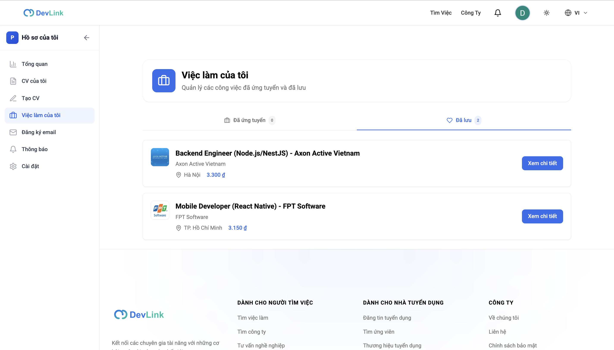
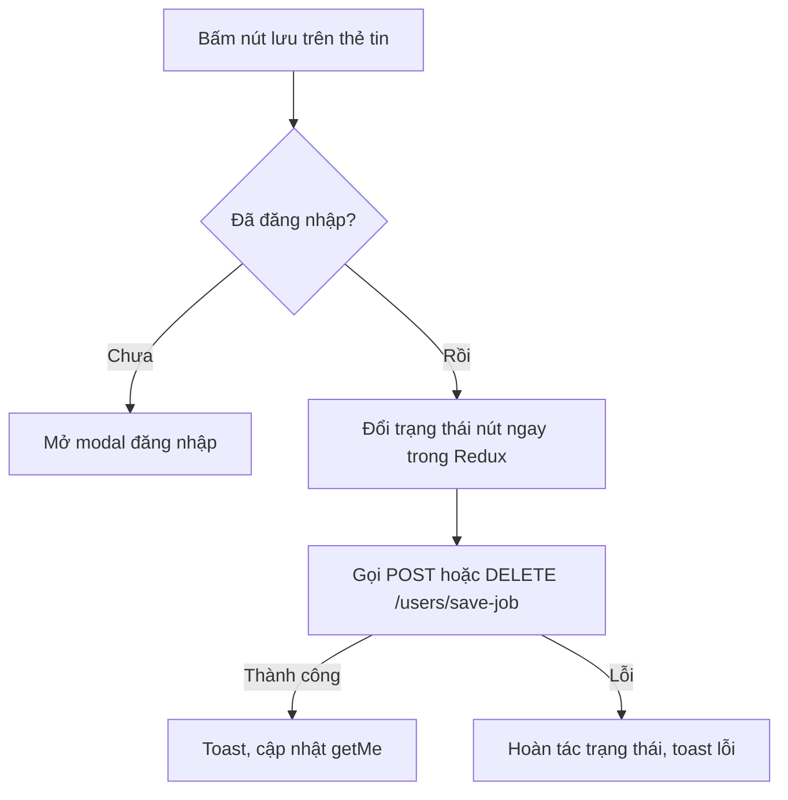

# Việc làm đã lưu

Tính năng cho phép ứng viên đánh dấu một tin tuyển dụng để xem lại sau và xem danh sách các tin đã lưu. Trang dành cho người muốn biết cách lưu và xem lại, và cho developer sửa nút lưu hoặc danh sách.

## Vì sao cần

Ứng viên hiếm khi quyết định ứng tuyển ngay. Lưu tin giúp họ quay lại so sánh mà không phải tìm lại.

**Đối tượng:** người dùng đã đăng nhập. Khách bấm nút lưu sẽ được mời đăng nhập.

**Điều kiện:** chỉ tin nội bộ lưu được; tin từ nguồn ngoài không có nút lưu, xem [Việc làm từ nguồn ngoài](external-job-aggregation.md).

**Đánh đổi:** nút lưu đổi trạng thái ngay trước khi backend trả lời (cập nhật lạc quan) và hoàn tác nếu lỗi, nên người dùng có thể thấy nút đổi rồi đổi lại khi mạng lỗi.

## Giao diện

Trang "Việc của tôi" có hai tab: việc đã ứng tuyển và việc đã lưu.

## Luồng nghiệp vụ

Sơ đồ rút gọn hành vi của hook `useJobFavorite`.

| Chức năng | Hành vi |
| --- | --- |
| Nút lưu | Có trên thẻ kết quả tìm kiếm (tin nội bộ), thẻ tin ở trang chủ và trang chi tiết tin |
| Trạng thái đã lưu | Lấy từ danh sách mã tin trong thông tin đăng nhập; hợp nhất ba tên cũ, xem [Model User](../06-api-and-data/models/user.md) |
| Trước khi trang hydrate | Nút ở trạng thái chưa lưu và bị vô hiệu, để tránh lệch giữa server và trình duyệt |
| Danh sách đã lưu | Tab "đã lưu" ở `/profile?tab=my-jobs`, gọi `GET /users/saved-jobs` với `page` 1, `limit` 10 |
| Lưu qua chat | Trợ lý AI có thể đề xuất lưu việc và chờ xác nhận, xem [Trợ lý AI](ai-career-assistant.md) |

> [!WARNING]
> Tab "đã lưu" chỉ hiển thị 10 tin đầu tiên. `my-jobs-page.tsx` giữ `currentPage` luôn bằng 1 (không có chỗ nào đổi) và không có nút phân trang, trong khi số đếm trên tab lấy từ tổng số tin đã lưu. Người có hơn 10 tin đã lưu sẽ thấy số đếm lớn hơn số tin hiển thị.

## API liên quan

| Hook | Endpoint | Dùng ở |
| --- | --- | --- |
| `useSaveJobMutation`, `useUnsaveJobMutation` | `POST` và `DELETE /users/save-job` | `hooks/use-job-favorite.ts` |
| `useGetSavedJobsQuery` | `GET /users/saved-jobs` | `profile/pages/my-jobs-page.tsx` |

Bảng đầy đủ: [Endpoint Users](../06-api-and-data/endpoints/users.md).

## Dữ liệu và kiểm tra

Dạng một tin đã lưu (`SavedJob`): `_id`, `name`, `skills`, `company`, `location`, `salary`, `level`, `startDate`, `endDate`, `formOfWork`, `status` tùy chọn. Phản hồi phân trang có `meta: { current, pageSize, pages, total }`, khác hình dạng của các danh sách khác.

## Trường hợp lỗi

| Tình huống | Hành vi |
| --- | --- |
| Chưa đăng nhập | Mở modal đăng nhập |
| Backend từ chối | Hoàn tác nút, toast với thông điệp của backend |
| Không tải được danh sách | Chưa kiểm tra giao diện báo lỗi riêng cho tab này |

## Test cases

| Test | Nội dung |
| --- | --- |
| `src/features/job/hooks/use-job-favorite.test.tsx` | Đọc trạng thái từ `savedJobIds`; nút chưa lưu trước khi hydrate; không gửi trước khi hydrate; lưu lạc quan và hoàn tác khi lỗi; bỏ lưu |
| `src/features/auth/redux/auth.slice.test.ts` | Hợp nhất danh sách việc đã lưu |
| `src/features/job/components/job-card.test.tsx` | Nhãn lưu trước và sau khi hydrate |

Chưa có test cho: tab "đã lưu" của trang việc của tôi.

## Source code liên quan

- [`src/features/job/hooks/use-job-favorite.ts`](../../src/features/job/hooks/use-job-favorite.ts): logic lưu và hoàn tác
- [`src/features/profile/components/pages/my-jobs-page.tsx`](../../src/features/profile/components/pages/my-jobs-page.tsx): danh sách đã lưu
- [`src/features/user/redux/user.api.ts`](../../src/features/user/redux/user.api.ts): endpoint và cập nhật lạc quan
- [`src/features/auth/redux/auth.slice.ts`](../../src/features/auth/redux/auth.slice.ts): `addSavedJobId`, `removeSavedJobId`
- [`src/features/job/components/job-search-card.tsx`](../../src/features/job/components/job-search-card.tsx): nút lưu trên thẻ

Tài liệu backend: [Users](https://github.com/QuocDuy21-10/it-job-portal-be/blob/main/docs/03-modules/users.md).

Đọc tiếp: [Theo dõi hồ sơ](application-tracking.md), [Theo dõi công ty](company-following.md), [Tìm kiếm việc làm](job-search.md).
