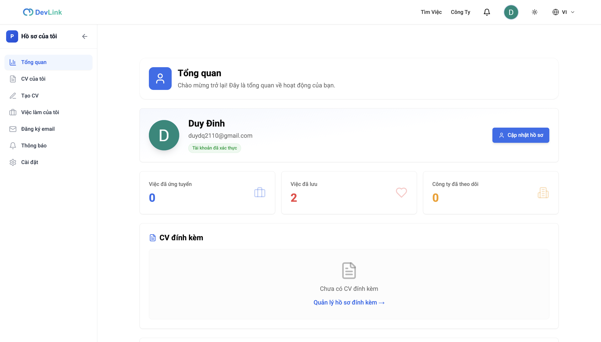
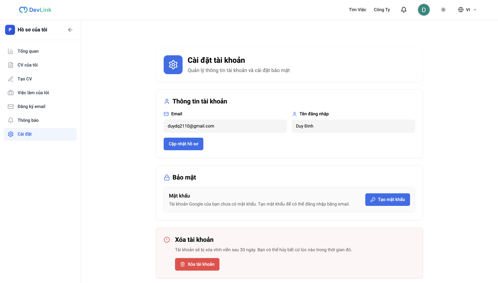

# Hồ sơ người dùng

Khu vực `/profile` là nơi ứng viên quản lý mọi thứ của mình: tổng quan, CV, việc làm, đăng ký nhận việc, thông báo và cài đặt tài khoản. Trang dành cho người muốn biết khu vực này gồm những gì, và cho developer sửa các tab.

## Vì sao có một khu vực riêng

Những việc của riêng ứng viên (CV, hồ sơ đã nộp, việc đã lưu, đăng ký nhận việc, thông báo) được gom về một nơi với thanh bên cố định, thay vì rải ở nhiều trang công khai.

**Đối tượng:** ứng viên đã đăng nhập.

> [!WARNING]
> `/profile` không có guard phía frontend: layout `(profile)` và trang không kiểm tra đăng nhập. Người chưa đăng nhập vẫn mở được trang, và các lời gọi API bên trong bị backend từ chối. Việc thực thi quyền thuộc về backend; xem [Phân quyền](../02-architecture/authorization.md).

## Giao diện

Tab tổng quan: số hồ sơ đã nộp, số việc đã lưu, số công ty đang theo dõi, phần CV đính kèm và gợi ý các việc tiếp theo.

Tab cài đặt: thông tin tài khoản, bảo mật và khu vực xóa tài khoản.

## Các tab

Trang `/profile` chọn nội dung theo tham số `tab` trên URL; giá trị không hợp lệ rơi về `overview`.

| Tab (`?tab=`) | Thành phần | Trang tính năng |
| --- | --- | --- |
| `overview` | `OverviewPage` | Mục này |
| `my-cv` | `MyCVPage` | Xem cảnh báo ở [Tạo CV](cv-builder.md) |
| `create-cv` | `CreateCVPage` | [Tạo CV](cv-builder.md) |
| `my-jobs` | `MyJobsPage` | [Theo dõi hồ sơ](application-tracking.md), [Việc làm đã lưu](saved-jobs.md) |
| `email-subscription` | `EmailSubscriptionPage` | [Đăng ký nhận việc](job-subscriptions.md) |
| `notifications` | `NotificationsPage` | [Thông báo](notifications.md) |
| `settings` | `SettingsPage` | Mục này và [Xóa tài khoản](account-deletion.md) |

Ngoài ra `/profile/cv-preview` là trang riêng để xem trước và tải PDF, xem [Xuất CV ra PDF](cv-pdf-export.md).

Điều hướng: thanh bên trên màn hình lớn có đủ 7 tab và thu gọn được; thanh dưới trên điện thoại (`ProfileBottomNav`) có 6 tab, không có tab đăng ký nhận việc.

## Tab cài đặt

| Phần | Nội dung |
| --- | --- |
| Thông tin tài khoản | Hiện email và tên người dùng (chỉ đọc); nút "cập nhật hồ sơ" chuyển sang tab tạo CV, không sửa trực tiếp ở đây |
| Bảo mật | Tài khoản có mật khẩu: đổi mật khẩu. Tài khoản Google chưa có mật khẩu: tạo mật khẩu. Trường hợp khác: không hiện gì |
| Xóa tài khoản | Khu vực nguy hiểm riêng, xem [Xóa tài khoản](account-deletion.md) |

Đổi và tạo mật khẩu dùng `POST /auth/change-password` và `POST /auth/set-password`, xem [Endpoint Auth](../06-api-and-data/endpoints/auth.md).

## Banner chờ xóa

Layout `(profile)` gọi `GET /auth/me`; nếu có `scheduledDeletionAt` thì hiện banner báo ngày xóa và nút hủy ở đầu trang. Chi tiết ở [Xóa tài khoản](account-deletion.md).

## API liên quan

| Hook | Endpoint | Dùng ở |
| --- | --- | --- |
| `useGetMeQuery` | `GET /auth/me` | `profile/layout.tsx`, `overview-page.tsx`, `settings-page.tsx` |
| `useChangePasswordMutation`, `useSetPasswordMutation` | `POST /auth/change-password`, `POST /auth/set-password` | `settings-page.tsx` |

## Dữ liệu và kiểm tra

Dạng người dùng đang đăng nhập: [Model User](../06-api-and-data/models/user.md).

## Trường hợp lỗi

| Tình huống | Hành vi |
| --- | --- |
| Chưa đăng nhập | Trang vẫn hiện; lời gọi API bị backend từ chối (chưa kiểm tra giao diện hiển thị) |
| Đổi hoặc tạo mật khẩu lỗi | Toast với thông điệp của backend |

## Test cases

Chưa có test cho `OverviewPage`, `SettingsPage`, thanh bên và thanh dưới. Test của các tab con được liệt kê ở trang tính năng tương ứng.

## Source code liên quan

- [`src/app/[locale]/(profile)/profile/layout.tsx`](../../src/app/[locale]/(profile)/profile/layout.tsx): khung, banner chờ xóa
- [`src/app/[locale]/(profile)/profile/page.tsx`](../../src/app/[locale]/(profile)/profile/page.tsx): chọn tab theo URL
- [`src/components/profile/profile-sidebar.tsx`](../../src/components/profile/profile-sidebar.tsx): thanh bên
- [`src/components/profile/profile-bottom-nav.tsx`](../../src/components/profile/profile-bottom-nav.tsx): thanh dưới
- [`src/components/profile/pages/overview-page.tsx`](../../src/components/profile/pages/overview-page.tsx): tổng quan
- [`src/components/profile/pages/settings-page.tsx`](../../src/components/profile/pages/settings-page.tsx): cài đặt

Tài liệu backend: [Users](https://github.com/QuocDuy21-10/it-job-portal-be/blob/main/docs/03-modules/users.md).

Đọc tiếp: [Xóa tài khoản](account-deletion.md), [Tạo CV](cv-builder.md), [Xác thực](authentication.md).
