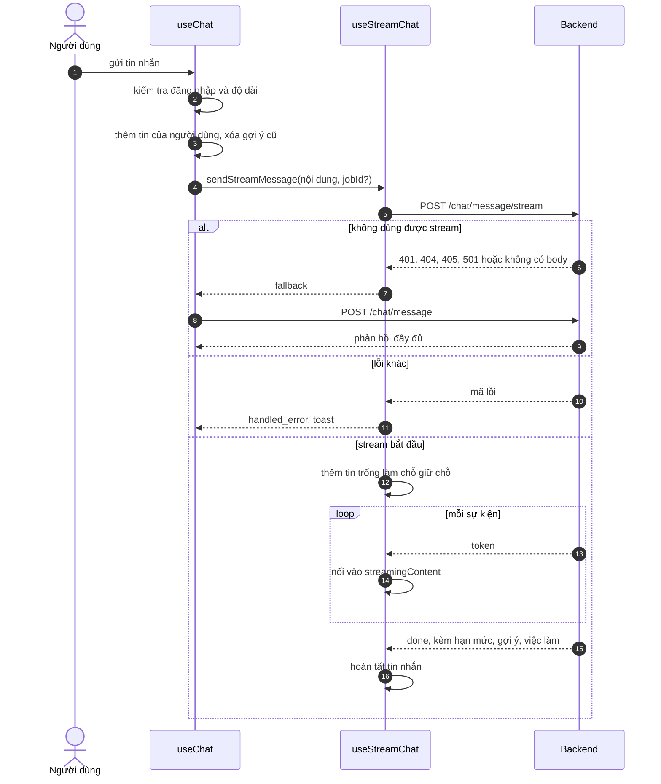
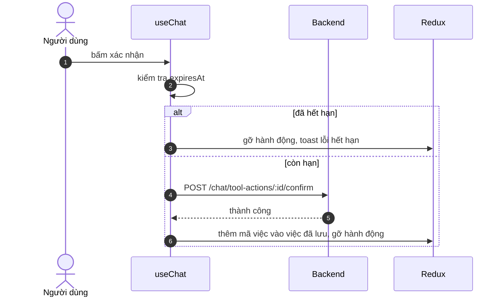

# Stream chat AI

Trang này vẽ trình tự từ lúc người dùng gửi một tin nhắn cho trợ lý AI đến khi nhận được câu trả lời, gồm cả đường dự phòng khi stream không dùng được và bước xác nhận hành động. Dành cho người cần biết các bước, và developer sửa hộp chat.

## Vì sao có hai đường gửi

Stream cho người dùng thấy câu trả lời hiện dần. Nhưng không phải lúc nào stream cũng dùng được (backend cũ không có route, token hết hạn, kết nối bị ngắt). Vì vậy `useChat` thử stream trước và chuyển sang endpoint thường khi cần, để người dùng vẫn nhận được câu trả lời.

## Luồng

Sơ đồ rút gọn: `useChat` chỉ dùng đường dự phòng khi `useStreamChat` báo `fallback`.

| Bước | Giải thích |
| --- | --- |
| 2 | Chưa đăng nhập thì toast và dừng; tin trống bị bỏ qua; tin dài hơn 1000 ký tự bị từ chối |
| 5 | Header có `Authorization` nếu có token trong `localStorage`. Stream dùng `fetch` nên không qua interceptor làm mới token: khi access token hết hạn, backend trả `401` và `useChat` chuyển sang `POST /chat/message` qua Axios, nơi cơ chế làm mới token có thể chạy |
| 10 | Mỗi `token` được cộng vào `streamingContent`; tin trống làm chỗ giữ chỗ chỉ nhận nội dung ở bước hoàn tất |
| 12 | Sự kiện `done` mang nội dung cuối, `quota`, `suggestedActions`, `recommendedJobs`, `recommendedJobIds`, `pendingToolActions`, `intent` |

## Sau khi nhận câu trả lời

| Việc | Hành vi |
| --- | --- |
| Hạn mức | Cập nhật `quota` trong Redux, lưu qua Redux Persist |
| Gợi ý câu hỏi | Hiện thành các nút gợi ý |
| Việc làm gợi ý | Với mỗi mã chưa có dữ liệu, `useChat` gọi `GET /jobs/:id` rồi ghi vào tin nhắn |

## Xác nhận hành động

Khi phản hồi có `pendingToolActions` (hiện chỉ `save_job`), giao diện hiện nút xác nhận và hủy.

Sơ đồ cho thấy việc lưu chỉ được thực hiện sau khi người dùng đồng ý, và hành động quá hạn bị gỡ khỏi tin nhắn. Hủy dùng `DELETE /chat/tool-actions/:id`.

## Nhánh lỗi

| Tình huống | Hành vi |
| --- | --- |
| Backend trả sự kiện `error` giữa chừng | Hoàn tất tin nhắn bằng thông điệp lỗi, cập nhật hạn mức nếu có, hiện toast |
| Luồng bị ngắt giữa chừng | Hoàn tất tin nhắn bằng phần đã nhận (nếu chưa bị người dùng hủy) |
| Người dùng bấm dừng | Giữ phần đã nhận; nếu chưa nhận gì thì tin nhắn ghi "Đã dừng tạo phản hồi." (chuỗi viết cứng bằng tiếng Việt) |
| Đường dự phòng cũng lỗi | Toast lỗi từ `useChat` |

## Source code liên quan

- [`src/features/chatbot/hooks/use-chat.ts`](../../../src/features/chatbot/hooks/use-chat.ts): điều phối, dự phòng, tool action
- [`src/features/chatbot/hooks/use-stream-chat.ts`](../../../src/features/chatbot/hooks/use-stream-chat.ts): gửi và đọc stream
- [`src/features/chatbot/lib/chat-stream.utils.ts`](../../../src/features/chatbot/lib/chat-stream.utils.ts): đọc sự kiện SSE
- [`src/features/chatbot/redux/chat-bot.slice.ts`](../../../src/features/chatbot/redux/chat-bot.slice.ts): state và các bước stream
- [`src/features/chatbot/components/chat-surface/index.tsx`](../../../src/features/chatbot/components/chat-surface/index.tsx): giao diện hộp chat

Backend: [Stream chat AI](https://github.com/QuocDuy21-10/it-job-portal-be/blob/main/docs/06-workflows/sequences/ai-chat-streaming.md) và [Module AI chat](https://github.com/QuocDuy21-10/it-job-portal-be/blob/main/docs/03-modules/ai-chat.md).

Đọc tiếp: [Trạng thái stream chat](../state-machines/chat-streaming-status.md), [Trợ lý AI](../../04-features/ai-career-assistant.md), [Endpoint Chat](../../06-api-and-data/endpoints/chat.md).
