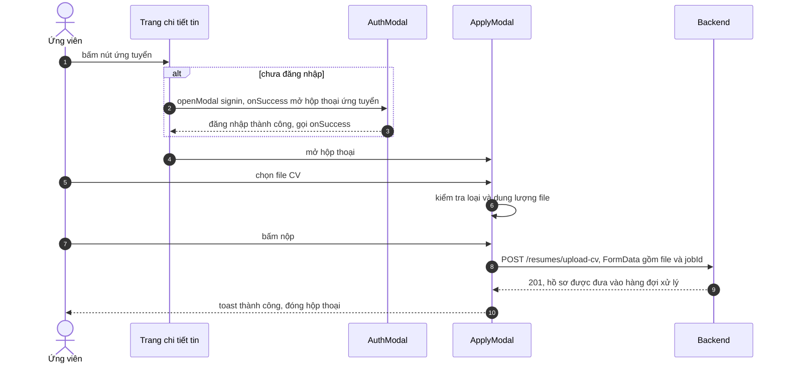

# Ứng tuyển công việc

Trang này vẽ trình tự từ lúc ứng viên bấm nút ứng tuyển đến khi hồ sơ được nộp. Dành cho người cần biết các bước và điều kiện, và cho developer sửa hộp thoại ứng tuyển.

## Vì sao có bước kiểm tra ở frontend

Hồ sơ là một file CV. Nếu để backend từ chối mọi file không hợp lệ thì người dùng phải đợi cả lần tải lên mới biết file sai. Vì vậy hộp thoại kiểm tra loại và dung lượng ngay khi chọn file. Backend vẫn kiểm tra lại, vì quy tắc ở frontend chỉ là lớp tiện lợi cho người dùng.

## Luồng

Sơ đồ rút gọn: chỉ `file` và `jobId` được gửi; các ô họ tên, số điện thoại và email trên form không nằm trong dữ liệu gửi.

| Bước | Giải thích |
| --- | --- |
| 2 | Kiểm tra `isAuthenticated`; chưa đăng nhập thì mở modal và truyền `onSuccess` để sau khi đăng nhập hộp thoại ứng tuyển tự mở |
| 6 | Chỉ nhận `application/pdf`, `application/msword` và `.docx` (MIME); tối đa 5 MB; sai thì hiện toast và không giữ file |
| 7 | Chưa chọn file thì hiện lỗi "cần chọn file" và không gửi |
| 8 | Gửi `FormData`, Axios không đặt `Content-Type` thủ công |
| 9 | Frontend chỉ coi là thành công khi `statusCode` là 201 |

Trên màn hình nhỏ (tối đa 640 px) hộp thoại hiện dạng ngăn kéo (`Drawer`), màn hình lớn hiện `Dialog`.

## Backend làm gì sau khi nhận

Theo `resumes.controller.ts` và `resume-processing.service.ts`: backend lưu file, tạo hồ sơ với trạng thái `PENDING`, đưa vào hàng đợi xử lý và báo cho nhà tuyển dụng có hồ sơ mới. Chi tiết nằm ở tài liệu backend, không lặp lại ở đây.

## Nhánh lỗi

| Tình huống | Hành vi |
| --- | --- |
| File sai loại hoặc quá 5 MB | Toast lỗi, giữ nguyên hộp thoại |
| Chưa chọn file | Hiện thông báo lỗi dưới ô chọn file và toast |
| Backend từ chối (ví dụ vượt giới hạn 20 lần mỗi giờ, tin không hợp lệ) | Toast với `error.data.message`, hộp thoại giữ nguyên |
| `statusCode` khác 201 | Ném lỗi với `response.message` rồi hiện toast |
| Chưa đăng nhập | Không mở được hộp thoại cho tới khi đăng nhập |

## Source code liên quan

- [`src/app/[locale]/(main)/jobs/[id]/job-detail-page-client.tsx`](../../../src/app/[locale]/(main)/jobs/[id]/job-detail-page-client.tsx): nút ứng tuyển và kiểm tra đăng nhập
- [`src/components/modals/apply-modal.tsx`](../../../src/components/modals/apply-modal.tsx): hộp thoại, kiểm tra file, gọi API
- [`src/contexts/auth-modal-context.tsx`](../../../src/contexts/auth-modal-context.tsx): `openModal` và `onSuccess`
- [`src/features/resume/redux/resume.api.ts`](../../../src/features/resume/redux/resume.api.ts): `createResumeWithUpload`

Backend: [Use case ứng tuyển](https://github.com/QuocDuy21-10/it-job-portal-be/blob/main/docs/06-workflows/use-cases/job-application.md) và [Resumes](https://github.com/QuocDuy21-10/it-job-portal-be/blob/main/docs/03-modules/resumes.md).

Đọc tiếp: [Ứng tuyển (tính năng)](../../04-features/job-application.md), [Trạng thái hồ sơ](../state-machines/application-status.md), [Endpoint Resumes](../../06-api-and-data/endpoints/resumes.md).
