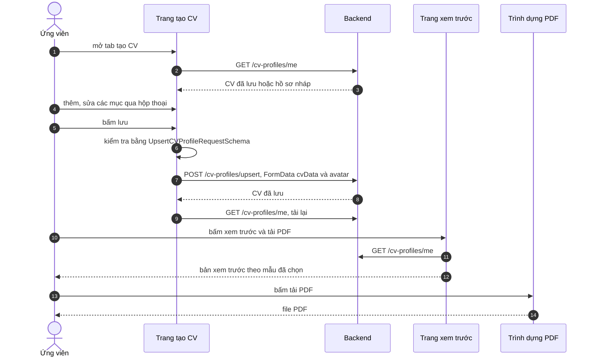

# Tạo và xuất CV

Trang này vẽ trình tự từ lúc ứng viên mở trình tạo CV, nhập và lưu dữ liệu, đến lúc xem trước và tải PDF. Dành cho người cần biết dữ liệu đi qua những đâu, và vì sao xem trước chỉ hiện dữ liệu đã lưu.

## Vì sao tách bước lưu và bước xem trước

Trình tạo CV giữ mọi thay đổi trong state của trang cho tới khi người dùng bấm lưu; mỗi lần lưu gửi toàn bộ CV lên backend một lượt. Trang xem trước không nhận dữ liệu từ trang tạo mà tải lại CV từ backend. Vì vậy thay đổi chưa lưu sẽ không xuất hiện trong bản xem trước hay file PDF.

## Luồng

Sơ đồ rút gọn: dữ liệu chỉ đi qua backend khi lưu, và trang xem trước luôn đọc lại từ backend.

| Bước | Giải thích |
| --- | --- |
| 3 | Backend trả hồ sơ nháp dựng từ tài khoản nếu chưa có CV; trang chuẩn hóa dữ liệu trước khi dùng |
| 5 | Mỗi nhóm nội dung có hộp thoại riêng; dữ liệu được ghi vào state của trang, chưa gửi đi |
| 7 | Nếu sai, hiện toast kèm đường dẫn field và lỗi đầu tiên; không gọi API |
| 8 | Dữ liệu CV là chuỗi JSON trong trường `cvData`; ảnh đại diện (nếu vừa chọn) là trường `avatar` |
| 10 | Sau khi lưu, trang tải lại CV rồi chuẩn hóa để hiển thị, và xóa file ảnh đang giữ |
| 11 | Nút xem trước bị vô hiệu khi mức hoàn thành dưới 15% |
| 14 | Người dùng chọn mẫu `classic`, `modern` hoặc `minimal`; xem trước PDF là tùy chọn bật tắt |
| 15 | PDF được dựng ngay trên trình duyệt, không qua backend |

## Ảnh đại diện trong PDF

Ảnh nằm ở backend nên trình duyệt có thể bị chặn khi trình dựng PDF tải ảnh (CORS). Hàm `getProxiedImageUrl` đổi địa chỉ ảnh của backend thành `/api/proxy-image?url=...`; route này tải ảnh phía server rồi trả lại cùng nguồn gốc. Ảnh ở máy chủ khác, ảnh dạng `data:` hoặc đường dẫn tương đối được giữ nguyên.

Route chỉ cho phép tải từ `localhost:8081` và host lấy từ `NEXT_PUBLIC_API_URL` (sau khi bỏ `http://` hoặc `https://`), nên không thể dùng để tải địa chỉ tùy ý.

## Nhánh lỗi

| Tình huống | Hành vi |
| --- | --- |
| Không tải được CV | `useCV` ghi lỗi; trang hiện toast lỗi chung |
| Dữ liệu không hợp lệ | Toast "dữ liệu không hợp lệ" kèm lỗi đầu tiên, không lưu |
| Backend từ chối lúc lưu | `upsertCV` trả `null` và ghi lỗi vào `error` |
| Chưa có CV ở trang xem trước | Hiện thông báo và nút quay lại tạo CV |
| Tạo PDF lỗi | Nút tải đổi thành nút lỗi, không bấm được |

## Source code liên quan

- [`src/features/cv-builder/components/create-cv-page/index.tsx`](../../../src/features/cv-builder/components/create-cv-page/index.tsx): tải, kiểm tra, lưu
- [`src/features/cv-builder/hooks/use-cv.ts`](../../../src/features/cv-builder/hooks/use-cv.ts): `fetchMyCVProfile`, `upsertCV`
- [`src/features/cv-builder/components/cv-preview-page.tsx`](../../../src/features/cv-builder/components/cv-preview-page.tsx): xem trước và chọn mẫu
- [`src/features/cv-builder/components/pdf/download-pdf-button.tsx`](../../../src/features/cv-builder/components/pdf/download-pdf-button.tsx): tải PDF
- [`src/features/cv-builder/lib/pdf/image-helpers.ts`](../../../src/features/cv-builder/lib/pdf/image-helpers.ts): `getProxiedImageUrl`
- [`src/app/api/proxy-image/route.ts`](../../../src/app/api/proxy-image/route.ts): proxy ảnh
- [`src/features/cv-builder/utils/cv-helpers.ts`](../../../src/features/cv-builder/utils/cv-helpers.ts): mức hoàn thành

Backend: [Use case quản lý CV](https://github.com/QuocDuy21-10/it-job-portal-be/blob/main/docs/06-workflows/use-cases/cv-management.md).

Đọc tiếp: [Tạo CV](../../04-features/cv-builder.md), [Xuất CV ra PDF](../../04-features/cv-pdf-export.md), [Endpoint CV Profiles](../../06-api-and-data/endpoints/cv-profiles.md).
