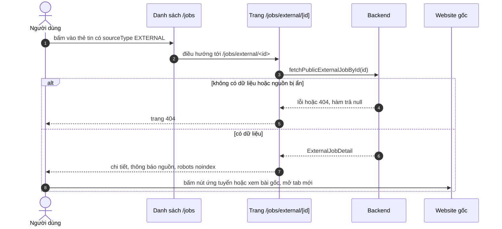

# Chuyển tới tin tuyển dụng bên ngoài

Trang này vẽ hành trình từ một kết quả tìm kiếm là tin của nguồn ngoài đến lúc người dùng sang website gốc để ứng tuyển. Dành cho người cần biết DevLink hiển thị gì, giữ lại gì và chuyển người dùng đi đâu.

## Vì sao không ứng tuyển ngay trên DevLink

Tin ngoài thuộc về website khác; DevLink chỉ tổng hợp để người dùng tìm thấy. Hồ sơ phải nộp ở nơi đăng tin, nên trang chi tiết chỉ đóng vai cầu nối: cho xem thông tin được phép hiển thị rồi dẫn sang nguồn. Một số nguồn không cho đăng lại nội dung, nên DevLink chỉ hiện thông tin tóm tắt và đường dẫn tới trang gốc.

## Luồng

Sơ đồ cho thấy người dùng rời DevLink bằng liên kết mở ở tab mới, không có bước nào gửi hồ sơ qua DevLink.

| Bước | Giải thích |
| --- | --- |
| 2 | Thẻ kết quả chọn `/jobs/external/<id>` chỉ dựa vào `sourceType` |
| 3 | Lời gọi phía server, bọc `cache()`, `revalidate` 300 giây |
| 5 | `fetchPublicEntity` trả `null` cho mọi lỗi, nên server không phân biệt 404 với lỗi mạng |
| 6 | Trang đặt `robots: { index: false, follow: false }` |
| 8 | Liên kết có `target="_blank"` và `rel="noopener noreferrer nofollow"` |

## Giao diện trang chi tiết thay đổi theo dữ liệu

| Dữ liệu | Giao diện |
| --- | --- |
| `status` là `CLOSED` | Hiện thông báo đã đóng, ẩn nút ứng tuyển |
| `applyUrl` không phải `http:` hoặc `https:` | Ẩn nút ứng tuyển |
| `sourceUrl` không an toàn | Ẩn liên kết "xem bài gốc" |
| `descriptionHtml` rỗng | Hiện câu hướng dẫn xem đầy đủ ở nguồn, kèm liên kết gốc nếu an toàn |
| `descriptionHtml` có nội dung | Hiển thị mô tả bằng `html-react-parser` |
| `sourceKey` là `topdev` hoặc `itviec` | Thông báo nguồn nêu tên website; còn lại nêu tên công ty |
| `isRemote` là `false` | Mục nơi làm việc ghi "chưa rõ", không khẳng định làm tại chỗ |

Kiểm tra an toàn bằng `isSafeHttpUrl`: chỉ chấp nhận giao thức `http:` và `https:`, để chặn `javascript:` hay `data:` từ dữ liệu bên thứ ba.

> [!WARNING]
> Mô tả được hiển thị qua `html-react-parser`, và code ghi chú rằng backend đã làm sạch HTML lúc nhập. Frontend không tự làm sạch thêm lần nào. Chưa kiểm tra phía backend trong tài liệu này.

## Nhánh lỗi

| Tình huống | Hành vi |
| --- | --- |
| Tin không tồn tại hoặc nguồn ẩn | `notFound()`, cả trong `generateMetadata` lẫn trang |
| Backend không phản hồi | Cũng là `notFound()`, vì lỗi bị trả thành `null` |

## Source code liên quan

- [`src/app/[locale]/(main)/jobs/external/[id]/page.tsx`](../../../src/app/[locale]/(main)/jobs/external/[id]/page.tsx): metadata `noindex`, `notFound`
- [`src/features/job/components/external-job-detail-content.tsx`](../../../src/features/job/components/external-job-detail-content.tsx): giao diện và điều kiện hiển thị
- [`src/features/job/components/job-search-card.tsx`](../../../src/features/job/components/job-search-card.tsx): chọn đường dẫn theo `sourceType`
- [`src/lib/utils/is-safe-http-url.ts`](../../../src/lib/utils/is-safe-http-url.ts): kiểm tra URL
- [`src/lib/utils/public-content.ts`](../../../src/lib/utils/public-content.ts): `fetchPublicExternalJobById`

Backend: [Vòng đời tin ngoài](https://github.com/QuocDuy21-10/it-job-portal-be/blob/main/docs/06-workflows/state-machines/external-job-lifecycle.md) và [service tìm kiếm](https://github.com/QuocDuy21-10/it-job-portal-be/blob/main/src/job-search/job-search.service.ts).

Đọc tiếp: [Việc làm từ nguồn ngoài](../../04-features/external-job-aggregation.md), [Model JobSearchItem](../../06-api-and-data/models/job-search-item.md), [Rendering và SEO](../../02-architecture/rendering-and-seo.md).
