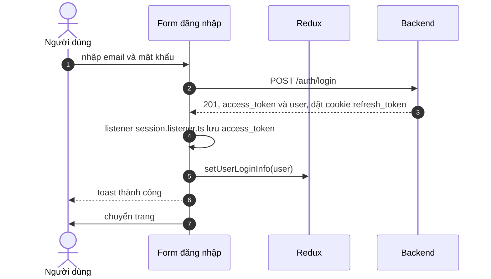
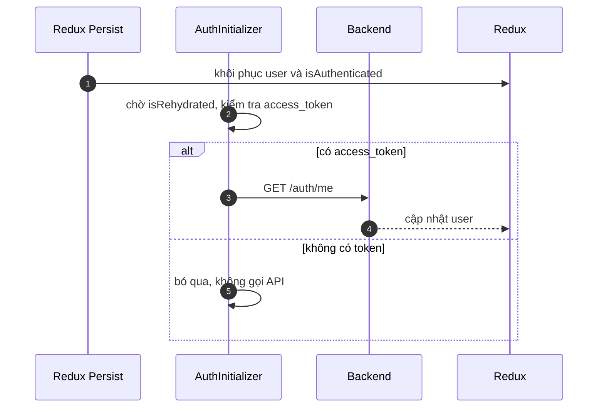
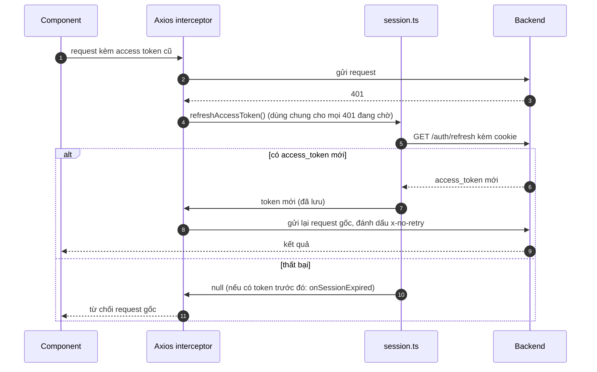

# Đăng nhập và làm mới token

Trang này vẽ ba luồng nối tiếp nhau: đăng nhập, khôi phục phiên khi mở lại trang, và gặp 401 khi access token hết hạn. Dành cho người cần hình dung thứ tự các bước trước khi đọc code hoặc sửa lỗi phiên đăng nhập.

## Vì sao cần xem theo trình tự

Phiên đăng nhập do ba nơi cùng giữ: `localStorage` (access token), cookie của backend (refresh token) và Redux (thông tin người dùng). Lỗi phiên thường do ba nơi này lệch nhau, nên cần xem chúng thay đổi lúc nào.

Cơ chế chi tiết, kể cả những điểm cần chạy thử, nằm ở [Xác thực](../../02-architecture/authentication.md); trang này chỉ vẽ trình tự.

## Luồng 1: đăng nhập

Sơ đồ rút gọn luồng của trang `/login`; modal đăng nhập làm tương tự nhưng gọi callback thay vì chuyển trang.

| Bước | Giải thích |
| --- | --- |
| 3 | Backend đặt cookie `refresh_token`; code frontend không đọc cookie này |
| 4 | Listener chỉ lưu token khi `login`/`googleLogin` thành công và có `access_token` |
| 5 | Redux Persist lưu `user` và `isAuthenticated` |
| 7 | Trang `/login` chờ 100 ms để Redux Persist kịp ghi, rồi chuyển tới `returnUrl` nếu đó là đường dẫn trong site (bắt đầu bằng đúng một dấu `/`), nếu không thì tới trang mặc định theo vai trò |

Trang mặc định theo vai trò: `SUPER ADMIN` về `/admin`, `HR` về `/admin/resumes`, `NORMAL USER` về `/`.

Nhánh lỗi: nếu backend trả lỗi, form hiện toast với `error.data.message`, không lưu token và không đổi state.

## Luồng 2: mở lại trang

Sơ đồ cho thấy `getMe` chỉ chạy khi còn token, nên không có vòng lặp 401 khi chưa đăng nhập.

Nếu `getMe` bị từ chối, slice xóa `user` và đặt `isAuthenticated = false`.

## Luồng 3: gặp 401

Các request 401 cùng lúc dùng chung một lần làm mới (single-flight), và request gốc chỉ được gửi lại đúng một lần.

| Bước | Giải thích |
| --- | --- |
| 5 | Bỏ qua nếu URL có `/login` hoặc `/register`, request đã mang `x-no-retry`, hoặc request không gửi token |
| 6 | Dùng `axios` trần, kèm cookie |
| 9 | Request gửi lại được đánh dấu `x-no-retry` để không lặp vô hạn |
| 12 | Thất bại: `sessionExpired` xóa token và cache, `ClientLayout` hiện toast và chuyển về `/login?returnUrl=...` |

## Backend làm gì ở phía mình

Theo `auth-session.service.ts`, mỗi lần làm mới backend xóa phiên cũ, tạo phiên mới cùng cookie `refresh_token` mới, nên token cũ không dùng lại được. Khi phiên không còn hoặc đã dùng, backend xóa cookie và trả `400` (không phải `401`). Frontend coi mọi lần `/auth/refresh` thất bại (kể cả `400`) là phiên đã hết hạn. Chi tiết nằm ở tài liệu backend.

## Source code liên quan

- [`src/lib/axios/axios-instance.ts`](../../../src/lib/axios/axios-instance.ts): interceptor gắn token, làm mới khi 401
- [`src/features/auth/redux/auth.slice.ts`](../../../src/features/auth/redux/auth.slice.ts): phản ứng với `login`, `getMe`, `logout`
- [`src/components/auth-initializer.tsx`](../../../src/components/auth-initializer.tsx): khôi phục phiên
- [`src/app/[locale]/(auth)/login/page.tsx`](../../../src/app/[locale]/(auth)/login/page.tsx): đăng nhập, `returnUrl`
- [`src/lib/security/safe-url.ts`](../../../src/lib/security/safe-url.ts): lọc `returnUrl`
- [`src/shared/constants/roles.ts`](../../../src/shared/constants/roles.ts): trang mặc định theo vai trò
- [`src/components/client-layout.tsx`](../../../src/components/client-layout.tsx): xử lý khi làm mới thất bại

Backend: [Làm mới token](https://github.com/QuocDuy21-10/it-job-portal-be/blob/main/docs/06-workflows/sequences/refresh-token.md) và [Auth và phiên](https://github.com/QuocDuy21-10/it-job-portal-be/blob/main/docs/03-modules/auth-and-sessions.md).

Đọc tiếp: [Xác thực (tính năng)](../../04-features/authentication.md), [Endpoint Auth](../../06-api-and-data/endpoints/auth.md), [Xác thực (kiến trúc)](../../02-architecture/authentication.md).
