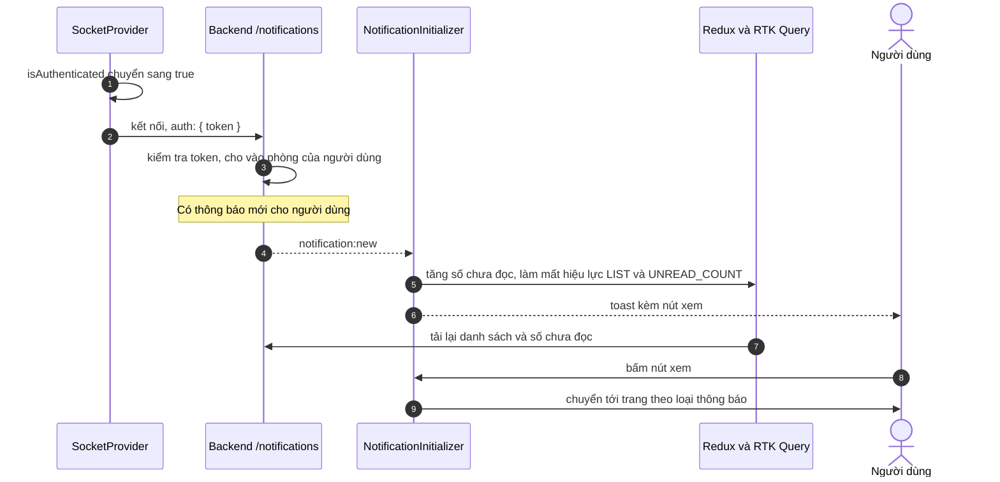

# Thông báo thời gian thực

Trang này vẽ trình tự từ lúc người dùng đăng nhập đến khi nhận một thông báo mới qua Socket.IO và thấy nó trên chuông. Dành cho người cần biết kết nối được mở khi nào, sự kiện nào cập nhật giao diện, và developer sửa phần thông báo.

## Vì sao dùng Socket.IO

Thông báo (hồ sơ đổi trạng thái, hồ sơ mới) cần đến ngay khi xảy ra mà không phải tải lại trang. Socket.IO cho backend đẩy thông báo xuống đúng người dùng. Luồng chat AI dùng một cơ chế khác (SSE), xem [Stream chat AI](ai-chat-streaming.md).

## Luồng

Sơ đồ rút gọn: thông báo đẩy qua socket, còn danh sách và số chưa đọc luôn được tải lại từ API.

| Bước | Giải thích |
| --- | --- |
| 1 | `SocketProvider` kết nối khi `isAuthenticated` là `true` và ngắt khi đăng xuất |
| 2 | Kết nối tới `<API_BASE_URL_IMAGE>/notifications` với `auth: { token }` lấy từ `localStorage`; ưu tiên `websocket`, dự phòng `polling`; tự kết nối lại tối đa 5 lần, cách nhau 1 giây |
| 3 | Backend kiểm tra JWT trong lúc bắt tay và cho kết nối vào phòng riêng của người dùng, nên nhiều thiết bị cùng nhận |
| 5 | Sự kiện tên `notification:new`, dữ liệu là một `Notification` |
| 6 | `incrementUnreadCount` và `invalidateTags` cho `{ Notification, LIST }` và `{ Notification, UNREAD_COUNT }` |
| 7 | Toast có nút "xem" |
| 10 | Liên kết theo loại: `APPLICATION_STATUS_CHANGE` tới `/profile?tab=my-jobs`; `NEW_APPLICATION` tới `/admin/resumes` |

## Khi socket bị ngắt

| Tình huống | Hành vi |
| --- | --- |
| Backend ngắt (`io server disconnect`), ví dụ token hết hạn | Frontend đặt lại `auth.token` bằng token hiện có trong `localStorage` và kết nối lại |
| Lỗi kết nối | Chỉ ghi `console.error`, không thông báo cho người dùng |
| Thông báo bị bỏ lỡ lúc mất kết nối | Vẫn nằm trong danh sách, và số chưa đọc được tải lại từ `GET /notifications/unread-count` |

> [!NOTE]
> Token trong `auth` được đọc một lần lúc kết nối. Khi access token được làm mới bởi Axios, socket đang mở không tự đổi token; token mới chỉ được dùng khi socket kết nối lại. Chưa chạy thử.

## Source code liên quan

- [`src/lib/socket/socket-provider.tsx`](../../../src/lib/socket/socket-provider.tsx): mở và đóng kết nối
- [`src/lib/socket/use-socket.ts`](../../../src/lib/socket/use-socket.ts): `useSocketEvent`
- [`src/components/notification/notification-initializer.tsx`](../../../src/components/notification/notification-initializer.tsx): xử lý `notification:new`
- [`src/hooks/use-notification.ts`](../../../src/hooks/use-notification.ts): liên kết theo loại, số chưa đọc
- [`src/app/[locale]/layout.tsx`](../../../src/app/[locale]/layout.tsx): nơi gắn `SocketProvider` và `NotificationInitializer`

Backend: [Realtime](https://github.com/QuocDuy21-10/it-job-portal-be/blob/main/docs/05-api/realtime.md) và [gateway](https://github.com/QuocDuy21-10/it-job-portal-be/blob/main/src/notifications/notifications.gateway.ts).

Đọc tiếp: [Thông báo](../../04-features/notifications.md), [Giao tiếp thời gian thực](../../02-architecture/realtime-communication.md), [Endpoint Notifications](../../06-api-and-data/endpoints/notifications.md).
