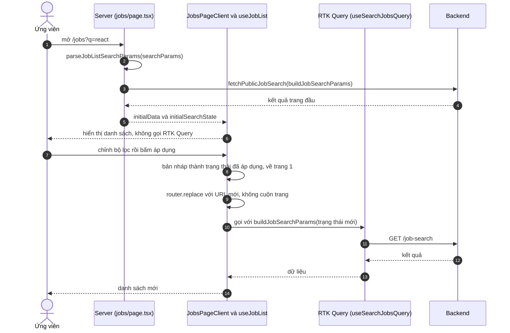

# Tìm kiếm và lọc việc làm

Trang này vẽ trình tự từ lúc ứng viên mở `/jobs` đến khi đổi bộ lọc và thấy kết quả mới. Dành cho người cần biết khi nào dữ liệu đến từ server, khi nào từ RTK Query, và vì sao đổi bộ lọc không làm trang nhảy.

## Vì sao tách bước nhập và bước áp dụng

Người dùng thường chỉnh vài ô lọc (từ khóa, địa điểm, loại hình, cấp bậc, mức lương) rồi mới muốn xem kết quả. Nếu mỗi lần chỉnh đều gọi API thì vừa tốn request vừa làm danh sách nhấp nháy. Vì vậy `useJobList` giữ hai trạng thái: **bản nháp** (đang chỉnh) và **đã áp dụng** (đang hiển thị). Chỉ khi áp dụng, bản nháp mới thành trạng thái đã áp dụng và gây ra request.

Tab nguồn (tất cả, nội bộ, bên ngoài), sắp xếp, trang và số kết quả mỗi trang áp dụng ngay, không qua bản nháp.

## Luồng

Sơ đồ rút gọn: URL là nguồn của trạng thái ban đầu, và mỗi lần áp dụng bộ lọc URL được ghi lại.

| Bước | Giải thích |
| --- | --- |
| 2 | Giá trị lạ hoặc không hợp lệ trong URL bị thay bằng mặc định; chi tiết bảng tham số ở [Phân trang và lọc](../../06-api-and-data/pagination-filtering.md) |
| 3 | Lời gọi phía server dùng `fetch` với `revalidate` 300 giây; nếu lỗi trả `null` |
| 5 | `shouldUseInitialData` đúng khi trạng thái hiện tại bằng trạng thái ban đầu, khi đó `useSearchJobsQuery` được `skip` |
| 8 | `applyFilters` luôn đưa `page` về 1 |
| 9 | Ghi URL bằng `router.replace`, nên không thêm mục vào lịch sử trình duyệt |
| 10 | Khi trạng thái khác trạng thái ban đầu, truy vấn RTK Query chạy; bước 9 và 10 diễn ra song song |

## Các thao tác khác

| Thao tác | Hành vi |
| --- | --- |
| Đổi trang | `setPage`, áp dụng ngay |
| Đổi sắp xếp | `setSortBy`, về trang 1 |
| Đổi tab nguồn | `setSource`, về trang 1 |
| Đặt lại | `resetAllFilters` xóa bản nháp, bộ lọc, sắp xếp, và đưa nguồn về `all` |
| Ngăn lọc trên điện thoại | Truy vấn thứ hai `skip` đến khi ngăn mở, dùng để đếm số kết quả theo bản nháp trước khi áp dụng |

## Nhánh lỗi

| Tình huống | Hành vi |
| --- | --- |
| Server không lấy được dữ liệu đầu | `initialData` là `null`, nên `useJobList` không dùng dữ liệu server và RTK Query chạy ngay |
| RTK Query lỗi | Danh sách rỗng; toast chung chỉ hiện với 403, 500 hoặc mất mạng, xem [Xử lý lỗi](../../06-api-and-data/error-handling.md) |

Backend trộn tin nội bộ và tin ngoài, sắp xếp và phân trang; phần đó thuộc tài liệu backend, không lặp lại ở đây.

## Source code liên quan

- [`src/app/[locale]/(main)/jobs/page.tsx`](../../../src/app/[locale]/(main)/jobs/page.tsx): tải dữ liệu đầu trên server
- [`src/app/[locale]/(main)/jobs/jobs-page-client.tsx`](../../../src/app/[locale]/(main)/jobs/jobs-page-client.tsx): giao diện, ghi URL
- [`src/hooks/use-job-list.ts`](../../../src/hooks/use-job-list.ts): bản nháp, trạng thái áp dụng, `skip`
- [`src/lib/utils/public-listing.ts`](../../../src/lib/utils/public-listing.ts): đọc URL, dựng tham số
- [`src/features/job/redux/job.api.ts`](../../../src/features/job/redux/job.api.ts): `searchJobs`
- [`src/lib/utils/public-content.ts`](../../../src/lib/utils/public-content.ts): `fetchPublicJobSearch`

Backend: [Quy trình tìm kiếm hợp nhất](https://github.com/QuocDuy21-10/it-job-portal-be/blob/main/docs/06-workflows/sequences/unified-job-search.md).

Đọc tiếp: [Tìm kiếm việc làm](../../04-features/job-search.md), [Phân trang và lọc](../../06-api-and-data/pagination-filtering.md), [Chiến lược cache](../../02-architecture/caching-strategy.md).
