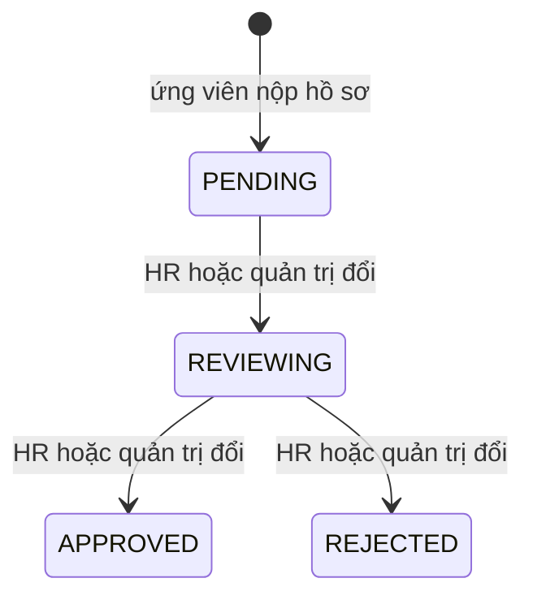

# Trạng thái hồ sơ ứng tuyển

Trang này mô tả các trạng thái của một hồ sơ ứng tuyển, ai được đổi trạng thái và giao diện hiển thị mỗi trạng thái thế nào. Dành cho người xử lý hồ sơ, và cho developer cần thêm hoặc sửa trạng thái.

## Vì sao cần trạng thái

Ứng viên muốn biết hồ sơ của mình đang ở đâu; nhà tuyển dụng cần một cách đánh dấu hồ sơ đã xem hay chưa. Trạng thái là thông tin chung giữa hai phía: nhà tuyển dụng đổi, ứng viên nhìn thấy.

> [!WARNING]
> Backend có 5 trạng thái, frontend chỉ biết 4. Trạng thái `INTERVIEWING` không có trong schema, form và danh sách lọc của frontend. Xem mục "Điểm lệch" bên dưới.

## Sơ đồ

Sơ đồ vẽ luồng xử lý thông thường, không phải ràng buộc. Code không kiểm tra thứ tự: backend ghi trạng thái được gửi lên mà không so với trạng thái hiện tại, và form của frontend cho chọn bất kỳ trong 4 trạng thái, nên thực tế có thể chuyển từ trạng thái nào sang trạng thái nào cũng được.

## Bảng trạng thái

| Giá trị | Ở frontend | Ở backend | Ý nghĩa | Hiển thị cho ứng viên (trang việc của tôi) |
| --- | :---: | :---: | --- | --- |
| `PENDING` | Có | Có | Vừa nộp, chưa xử lý | Nhãn "Đang chờ" |
| `REVIEWING` | Có | Có | Đang được xem xét | Nhãn "Đang xem xét" |
| `INTERVIEWING` | Không | Có | Được mời phỏng vấn | Hiện nhãn "Từ chối" (xem bên dưới) |
| `APPROVED` | Có | Có | Được chấp nhận | Nhãn "Đã duyệt" |
| `REJECTED` | Có | Có | Không được chọn | Nhãn "Từ chối" |

## Ai đổi trạng thái

| Hành động | Ai | Ở đâu |
| --- | --- | --- |
| Tạo hồ sơ (`PENDING`) | Ứng viên đã đăng nhập | Hộp thoại ứng tuyển, `POST /resumes/upload-cv` |
| Đổi trạng thái | `HR`, `SUPER ADMIN` | Trang quản trị hồ sơ, `PATCH /resumes/:id` với `{ status }` |

Backend từ chối HR đổi trạng thái của hồ sơ không thuộc công ty của họ (403). Mỗi lần đổi, backend ghi thêm một mục vào `histories` gồm trạng thái, thời điểm và người đổi.

Sau khi đổi, backend tạo thông báo trong hệ thống cho ứng viên và gửi email về trạng thái mới; email có nội dung riêng cho `REVIEWING`, `INTERVIEWING`, `APPROVED` và `REJECTED`.

## Giao diện theo trạng thái

| Màn hình | Cách xử lý |
| --- | --- |
| Bảng hồ sơ quản trị (`resume-table.tsx`) | Màu theo trạng thái: xanh lá cho `APPROVED`, đỏ cho `REJECTED`, xanh dương cho `REVIEWING`, vàng cho `PENDING`, xám cho giá trị khác |
| Bộ lọc trang quản trị | Có `PENDING`, `REVIEWING`, `APPROVED`, `REJECTED` |
| Form đổi trạng thái | Chỉ các trạng thái của frontend |
| Trang việc của tôi (`my-jobs-page.tsx`) | Chỉ phân biệt `PENDING`, `REVIEWING`, `APPROVED`; mọi giá trị còn lại đều hiện nhãn "Từ chối" |
| Thống kê (`statisticsDashboard.statuses`) | Có chuỗi dịch cho `INTERVIEWING` ("Phỏng vấn" ở bản tiếng Việt) |

## Điểm lệch

| Vấn đề | Chi tiết | Hệ quả |
| --- | --- | --- |
| `INTERVIEWING` có ở backend nhưng không có ở frontend | `EResumeStatus` có 5 giá trị; schema Zod, form và bộ lọc của frontend có 4 | Quản trị không chọn được `INTERVIEWING` từ giao diện này |
| Trang việc của tôi xử lý giá trị lạ như từ chối | Nhánh cuối của phép so sánh trả nhãn "Từ chối" | Hồ sơ ở `INTERVIEWING` sẽ hiện nhãn "Từ chối" nếu được đặt bằng cách khác (ví dụ gọi API trực tiếp) |
| Kiểu `status` | `ResumeAppliedJob.status` là `string` | Không có kiểm tra kiểu cho giá trị mới |

Chưa có ghi chép về lý do. Đây là chỗ frontend lệch backend; tài liệu ghi đúng hiện trạng và không sửa code.

## Source code liên quan

- [`src/features/resume/schemas/resume.schema.ts`](../../../src/features/resume/schemas/resume.schema.ts): danh sách trạng thái của frontend
- [`src/components/resume/resume-form.tsx`](../../../src/components/resume/resume-form.tsx): form đổi trạng thái
- [`src/components/resume/resume-table.tsx`](../../../src/components/resume/resume-table.tsx): màu theo trạng thái
- [`src/components/profile/pages/my-jobs-page.tsx`](../../../src/components/profile/pages/my-jobs-page.tsx): nhãn trạng thái cho ứng viên
- [`src/app/[locale]/(dashboard)/admin/resumes/page.tsx`](../../../src/app/[locale]/(dashboard)/admin/resumes/page.tsx): bộ lọc và đổi trạng thái
- [`src/hooks/use-resume.ts`](../../../src/hooks/use-resume.ts): gọi cập nhật

Backend: [Trạng thái hồ sơ](https://github.com/QuocDuy21-10/it-job-portal-be/blob/main/docs/06-workflows/state-machines/resume-status.md), [enum](https://github.com/QuocDuy21-10/it-job-portal-be/blob/main/src/resumes/enums/resume-status.enum.ts) và [service](https://github.com/QuocDuy21-10/it-job-portal-be/blob/main/src/resumes/resumes.service.ts).

Đọc tiếp: [Model Resume](../../06-api-and-data/models/resume.md), [Ứng tuyển công việc](../sequences/apply-for-job.md), [Ứng tuyển (tính năng)](../../04-features/job-application.md).
