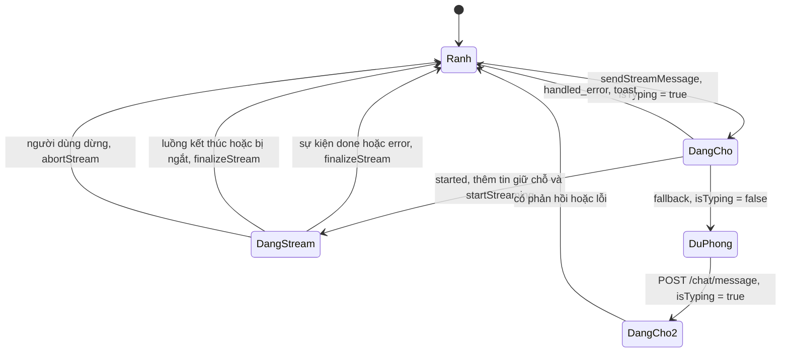

# Trạng thái stream chat

Trang này mô tả các trạng thái của một lượt gửi tin nhắn cho trợ lý AI: chờ phản hồi, đang stream, hoàn tất, bị dừng và chuyển sang đường dự phòng. Dành cho developer sửa hộp chat hoặc tìm lỗi "tin nhắn cứ quay".

## Vì sao cần trang này

Khác với trạng thái hồ sơ hay trạng thái duyệt tin, đây **không phải một giá trị lưu trong dữ liệu**. Không có field `status` nào cho stream. Trạng thái được suy ra từ hai cờ trong Redux (`isTyping`, `streamingMessageId`) và từ kết quả mà `sendStreamMessage` trả về. Hiểu cách ghép chúng giúp biết vì sao giao diện đang hiện chấm gõ, đang hiện chữ chạy hoặc đã yên.

## Các trạng thái

| Trạng thái | `isTyping` | `streamingMessageId` | Giao diện |
| --- | :---: | :---: | --- |
| Rảnh | `false` | `null` | Có thể gửi tin mới |
| Đang chờ phản hồi | `true` | `null` | Chấm báo trợ lý đang trả lời, chưa có chữ |
| Đang stream | `true` | có giá trị | Chữ hiện dần từ `streamingContent` |

`useStreamChat` còn trả `isStreaming`, bằng `streamingMessageId !== null`.

## Kết quả của `sendStreamMessage`

Hàm này cho `useChat` biết bước tiếp theo, bằng ba giá trị:

| Giá trị | Nghĩa | Điều kiện |
| --- | --- | --- |
| `started` | Stream đã bắt đầu | Phản hồi `ok` và có `body` |
| `handled_error` | Lỗi đã được thông báo, không dự phòng | Phản hồi không `ok` và mã khác 401, 404, 405, 501 |
| `fallback` | Cần gửi lại bằng đường thường | Mã 401, 404, 405, 501; không có `body`; hoặc `fetch` ném lỗi |

## Sơ đồ

Sơ đồ chỉ vẽ các chuyển trạng thái có trong `use-chat.ts`, `use-stream-chat.ts` và `chat-bot.slice.ts`; `DangCho2` là chờ phản hồi của đường thường, cùng dấu hiệu `isTyping = true` như `DangCho`.

| Chuyển | Nơi thực hiện |
| --- | --- |
| Rảnh sang chờ | `dispatch(setIsTyping(true))` trong `sendStreamMessage` |
| Chờ sang stream | `addMessage` tin giữ chỗ rồi `startStreaming(messageId)` |
| Stream sang rảnh khi hoàn tất | `finalizeStream`, ghi nội dung cuối, đặt `isTyping = false` |
| Stream sang rảnh khi dừng | `abortStream`, giữ phần đã nhận, đặt `isTyping = false` |
| Chờ sang rảnh khi lỗi | `setIsTyping(false)` rồi toast |

## Điểm cần lưu ý

| Điểm | Chi tiết |
| --- | --- |
| Chuỗi viết cứng | `abortStream` ghi "Đã dừng tạo phản hồi." bằng tiếng Việt khi chưa nhận được chữ nào |
| Kết thúc không rõ | Nếu luồng kết thúc mà không có sự kiện `done`, `readStream` vẫn gọi `finalizeStream` bằng phần đã nhận |
| Gỡ component | Hủy luồng đang chạy khi hook bị gỡ |

## Source code liên quan

- [`src/features/chatbot/hooks/use-stream-chat.ts`](../../../src/features/chatbot/hooks/use-stream-chat.ts): kết quả `started`, `handled_error`, `fallback`
- [`src/features/chatbot/hooks/use-chat.ts`](../../../src/features/chatbot/hooks/use-chat.ts): dự phòng bằng `POST /chat/message`
- [`src/features/chatbot/redux/chat-bot.slice.ts`](../../../src/features/chatbot/redux/chat-bot.slice.ts): `startStreaming`, `finalizeStream`, `abortStream`
- [`src/features/chatbot/components/chat-surface/index.tsx`](../../../src/features/chatbot/components/chat-surface/index.tsx): giao diện theo trạng thái
- [`src/features/chatbot/components/chat-typing-indicator.tsx`](../../../src/features/chatbot/components/chat-typing-indicator.tsx): chấm báo đang trả lời

Đọc tiếp: [Stream chat AI](../sequences/ai-chat-streaming.md), [Endpoint Chat](../../06-api-and-data/endpoints/chat.md), [Model Chat Message](../../06-api-and-data/models/chat-message.md).
