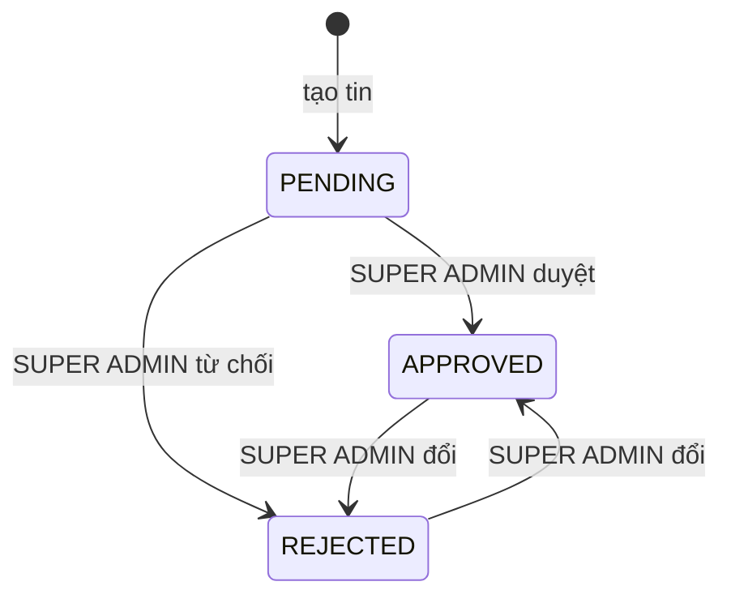

# Trạng thái duyệt tin tuyển dụng

Trang này mô tả các trạng thái duyệt của một tin tuyển dụng nội bộ, ai được duyệt và tin chưa duyệt hiển thị thế nào. Dành cho người duyệt tin, và developer sửa hộp thoại duyệt.

## Vì sao cần duyệt tin

Nhà tuyển dụng đăng tin nhưng nền tảng muốn kiểm soát nội dung hiển thị công khai. Vì vậy mọi tin mới ở trạng thái chờ duyệt và chỉ hiện công khai sau khi quản trị viên duyệt.

## Sơ đồ

Sơ đồ theo code backend: `approveJob` ghi trạng thái được gửi lên mà không so với trạng thái hiện tại, nhưng chỉ nhận `APPROVED` hoặc `REJECTED`, nên không có đường quay về `PENDING`. Sửa tin không đổi trạng thái duyệt.

## Bảng trạng thái

| Giá trị | Ý nghĩa | Hiển thị công khai | Nhãn ở bảng quản trị |
| --- | --- | :---: | --- |
| `PENDING` | Chờ duyệt, giá trị ban đầu | Không | Chờ duyệt (cũng là nhãn dự phòng khi thiếu giá trị) |
| `APPROVED` | Đã duyệt | Có, nếu còn mở và chưa hết hạn | Đã duyệt |
| `REJECTED` | Bị từ chối, kèm ghi chú tùy chọn | Không | Bị từ chối |

Theo backend, tin chỉ hiện công khai khi đồng thời: `isActive`, `approvalStatus` là `APPROVED`, `endDate` rỗng hoặc chưa qua, và chưa bị xóa mềm.

## Ai đổi trạng thái

| Hành động | Ai | Ở đâu |
| --- | --- | --- |
| Tạo tin (`PENDING`) | `HR`, `SUPER ADMIN` | Form tin ở trang quản trị tin |
| Duyệt hoặc từ chối | Chỉ `SUPER ADMIN` | Nút duyệt (biểu tượng khiên) ở mỗi dòng của bảng tin; backend khai báo `@Roles(SUPER ADMIN)` |

Nút duyệt chỉ hiện với người có quyền `approve` trên `Job` theo CASL, tức `SUPER ADMIN`; `HR` không thấy nút này.

## Hộp thoại duyệt

| Hạng mục | Chi tiết |
| --- | --- |
| Trạng thái | `APPROVED` hoặc `REJECTED`, mặc định `APPROVED` |
| Ghi chú | `approvalNote` tối đa 500 ký tự; ghi chú trống bị bỏ khỏi dữ liệu gửi |
| Sau khi duyệt | Backend ghi `approvalStatus`, `approvalNote`, `approvedBy`, `approvedAt` |
| Bộ lọc | Trang quản trị lọc theo `approvalStatus` bằng `approvalStatus=<giá trị>` |

## Trạng thái hoạt động là một chiều khác

Ngoài duyệt, tin còn có `isActive` và `endDate`. Backend tự đặt `isActive = false` khi quá `endDate` (cron theo giờ) và không tự bật lại. Chi tiết nằm ở [tài liệu backend](https://github.com/QuocDuy21-10/it-job-portal-be/blob/main/docs/06-workflows/state-machines/job-approval.md).

## Source code liên quan

- [`src/features/job/schemas/job.schema.ts`](../../../src/features/job/schemas/job.schema.ts): `EJobApprovalStatus`, `ApproveJobSchema`
- [`src/features/job/components/job-approval-dialog.tsx`](../../../src/features/job/components/job-approval-dialog.tsx): hộp thoại duyệt
- [`src/features/job/components/job-table.tsx`](../../../src/features/job/components/job-table.tsx): nút duyệt và nhãn trạng thái
- [`src/features/job/hooks/use-job.ts`](../../../src/features/job/hooks/use-job.ts): gọi `approveJob`
- [`src/lib/casl/ability.ts`](../../../src/lib/casl/ability.ts): quyền `approve`
- [`src/app/[locale]/(dashboard)/admin/jobs/page.tsx`](../../../src/app/[locale]/(dashboard)/admin/jobs/page.tsx): bộ lọc

Backend: [service](https://github.com/QuocDuy21-10/it-job-portal-be/blob/main/src/jobs/jobs.service.ts) và [controller](https://github.com/QuocDuy21-10/it-job-portal-be/blob/main/src/jobs/jobs.controller.ts).

Đọc tiếp: [Duyệt tin tuyển dụng](../../04-features/job-approval.md), [Model Job](../../06-api-and-data/models/job.md), [Endpoint Jobs](../../06-api-and-data/endpoints/jobs.md).
