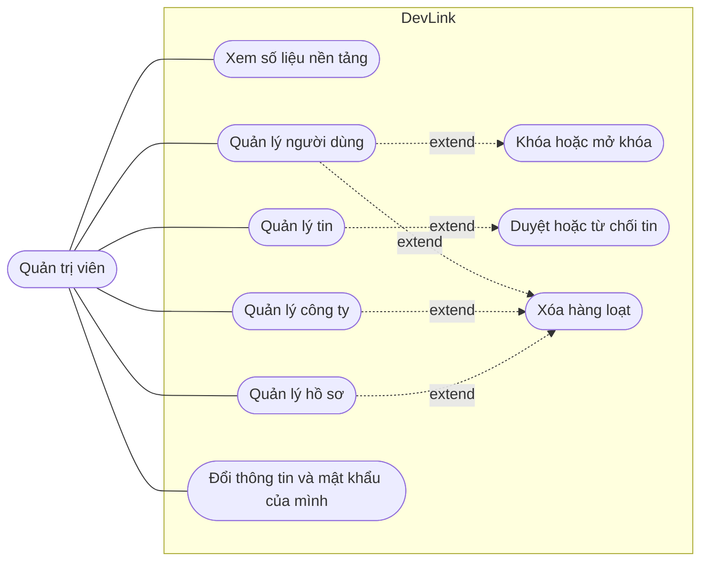

# Use case: Quản trị viên

Trang này liệt kê những việc quản trị viên (`SUPER ADMIN`) làm được trên DevLink. Dành cho người cần nhìn nhanh phạm vi của quản trị viên và biết mỗi việc nằm ở màn hình nào.

## Vì sao có trang riêng

Quản trị viên có toàn quyền trong bảng quyền của frontend (`manage` trên mọi đối tượng) và là người duy nhất duyệt tin, quản lý người dùng và xem số liệu toàn nền tảng.

## Sơ đồ

Sơ đồ rút gọn, không theo đúng ký pháp UML. Quản trị viên cũng dùng được mọi việc của khách; sơ đồ chỉ vẽ phần quản trị.

## Bảng use case

| Use case | Màn hình | Trang tính năng |
| --- | --- | --- |
| Xem số liệu toàn nền tảng | `/admin` | [Trang quản trị](../../04-features/admin-dashboard.md) |
| Quản lý người dùng: thêm, sửa, khóa, xóa | `/admin/users` | [Trang quản trị](../../04-features/admin-dashboard.md) |
| Quản lý công ty: thêm, sửa, xóa | `/admin/companies` | [Trang quản trị](../../04-features/admin-dashboard.md) |
| Quản lý tin tuyển dụng | `/admin/jobs` | [Duyệt tin tuyển dụng](../../04-features/job-approval.md) |
| Duyệt hoặc từ chối tin | Nút duyệt ở bảng tin | [Trạng thái duyệt tin](../state-machines/job-approval-status.md) |
| Quản lý hồ sơ, đổi trạng thái | `/admin/resumes` | [Trạng thái hồ sơ](../state-machines/application-status.md) |
| Xóa hàng loạt | Bảng người dùng, công ty, tin, hồ sơ | [Trang quản trị](../../04-features/admin-dashboard.md) |
| Cập nhật thông tin, đổi mật khẩu | `/admin/personal-info`, `/admin/change-password` | [Trang quản trị](../../04-features/admin-dashboard.md) |

## Lưu ý

- Sau khi đăng nhập, quản trị viên được đưa tới `/admin`.
- Quản trị viên bị chuyển khỏi `/hr/dashboard` về `/admin`.
- Không có trang quản lý vai trò hay quyền: ba vai trò cố định trong code.
- Các route quản trị người dùng, tạo và xóa công ty, duyệt tin ở backend đều khai báo chỉ cho `SUPER ADMIN`.

## Source code liên quan

- [`src/app/[locale]/(dashboard)/admin/`](../../../src/app/[locale]/(dashboard)/admin): các trang quản trị
- [`src/components/admin-route.tsx`](../../../src/components/admin-route.tsx): chặn truy cập
- [`src/lib/casl/ability.ts`](../../../src/lib/casl/ability.ts): quyền của `SUPER ADMIN`
- [`src/shared/config/admin-navigation.ts`](../../../src/shared/config/admin-navigation.ts): thanh bên theo quyền
- [`src/components/user/lock-user-dialog.tsx`](../../../src/components/user/lock-user-dialog.tsx): khóa người dùng

Đọc tiếp: [Nhà tuyển dụng](hr.md), [Khách](guest.md), [Phân quyền](../../02-architecture/authorization.md).
