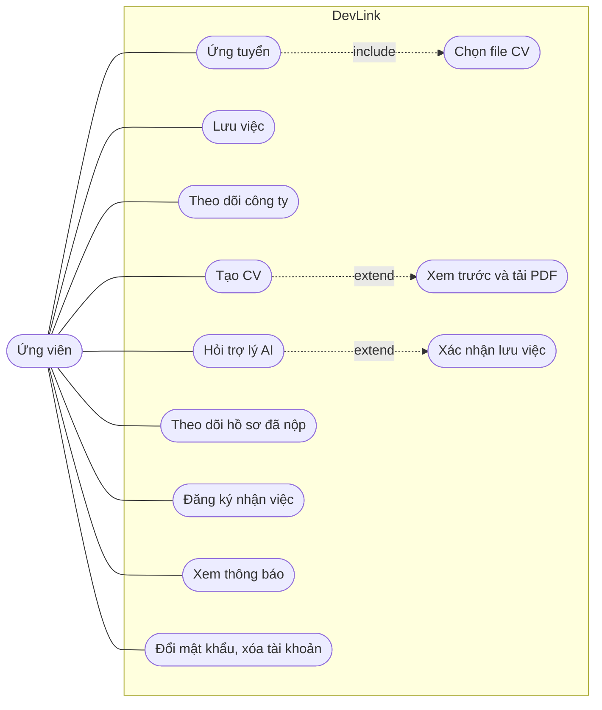

# Use case: Ứng viên

Trang này liệt kê những việc ứng viên (`NORMAL USER`) làm được sau khi đăng nhập. Dành cho người cần nhìn nhanh phạm vi của ứng viên và biết mỗi việc nằm ở màn hình nào.

## Vì sao có trang riêng

Ứng viên là nhóm dùng nhiều tính năng nhất: tìm việc, ứng tuyển, quản lý CV, theo dõi kết quả. Trang này gom chúng và chỉ ra chỗ nào dẫn sang tài liệu chi tiết.

## Sơ đồ

Sơ đồ rút gọn, không theo đúng ký pháp UML. Ứng viên làm được mọi việc của [khách](guest.md); sơ đồ chỉ vẽ phần thêm sau khi đăng nhập.

## Bảng use case

| Use case | Màn hình | Trang tính năng |
| --- | --- | --- |
| Ứng tuyển bằng file CV | Hộp thoại ở `/jobs/<id>` | [Ứng tuyển](../../04-features/job-application.md) |
| Lưu và bỏ lưu việc | Nút ở thẻ tin, trang tin; tab "đã lưu" của `/profile?tab=my-jobs` | [Việc làm đã lưu](../../04-features/saved-jobs.md) |
| Theo dõi công ty | Nút ở `/companies/<id>` | [Theo dõi công ty](../../04-features/company-following.md) |
| Tạo CV | `/profile?tab=create-cv` | [Tạo CV](../../04-features/cv-builder.md) |
| Xem trước và tải PDF | `/profile/cv-preview` | [Xuất CV ra PDF](../../04-features/cv-pdf-export.md) |
| Hỏi trợ lý AI, xác nhận lưu việc | Hộp chat nổi | [Trợ lý AI](../../04-features/ai-career-assistant.md) |
| Theo dõi hồ sơ đã nộp | `/profile?tab=my-jobs`, tab đã ứng tuyển | [Theo dõi hồ sơ](../../04-features/application-tracking.md) |
| Đăng ký nhận việc qua email | `/profile?tab=email-subscription` | [Đăng ký nhận việc](../../04-features/job-subscriptions.md) |
| Xem và đánh dấu thông báo | Chuông, `/profile?tab=notifications` | [Thông báo](../../04-features/notifications.md) |
| Xem tổng quan, cài đặt tài khoản | `/profile`, `/profile?tab=settings` | [Hồ sơ người dùng](../../04-features/user-profile.md) |
| Đổi hoặc đặt mật khẩu | Tab cài đặt | [Xác thực](../../04-features/authentication.md) |
| Yêu cầu và hủy xóa tài khoản | Tab cài đặt, liên kết email | [Xóa tài khoản](../../04-features/account-deletion.md) |

## Lưu ý

- Sau khi đăng nhập, ứng viên được đưa tới trang chủ `/`.
- Tab "CV của tôi" chưa thực sự tải file lên; xem cảnh báo ở [Tạo CV](../../04-features/cv-builder.md).
- Trang ứng tuyển ở giao diện không kiểm tra vai trò; quyền thật do backend quyết định.

## Source code liên quan

- [`src/app/[locale]/(profile)/profile/page.tsx`](../../../src/app/[locale]/(profile)/profile/page.tsx): các tab hồ sơ
- [`src/components/modals/apply-modal.tsx`](../../../src/components/modals/apply-modal.tsx): ứng tuyển
- [`src/components/chatbot/chat-widget.tsx`](../../../src/components/chatbot/chat-widget.tsx): trợ lý AI
- [`src/lib/casl/ability.ts`](../../../src/lib/casl/ability.ts): quyền của `NORMAL USER`
- [`src/shared/constants/roles.ts`](../../../src/shared/constants/roles.ts): trang mặc định theo vai trò

Đọc tiếp: [Khách](guest.md), [Nhà tuyển dụng](hr.md), [Vai trò người dùng](../../00-start-here/user-roles.md).
