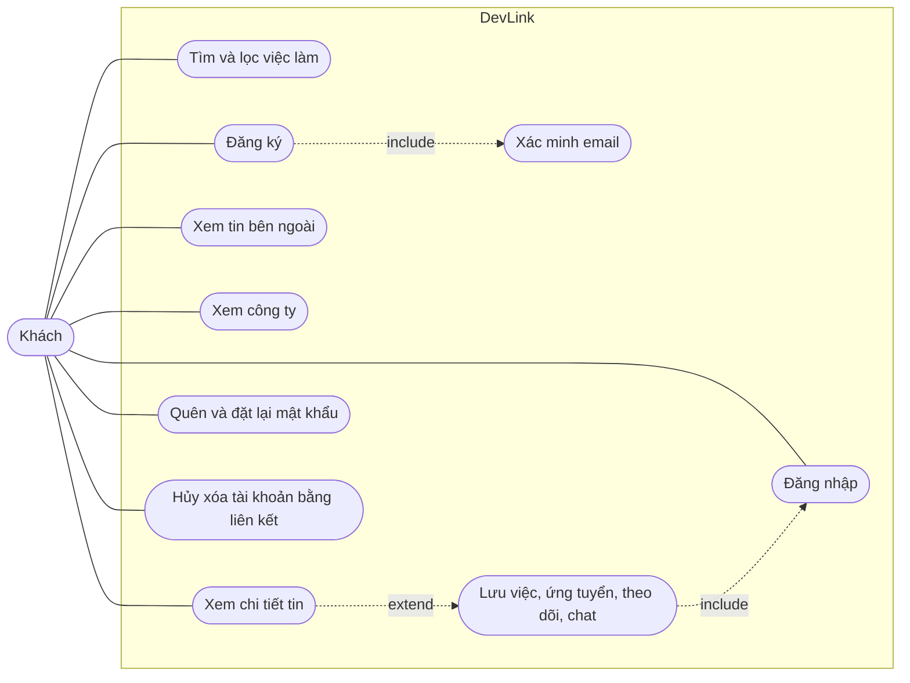

# Use case: Khách

Trang này liệt kê những việc người chưa đăng nhập làm được trên DevLink. Dành cho người cần nhìn nhanh phạm vi của khách và biết mỗi việc nằm ở màn hình nào.

## Vì sao có trang riêng

Phần lớn nội dung công khai mở cho mọi người để thu hút ứng viên, còn thao tác cá nhân (lưu, ứng tuyển, theo dõi, chat) cần đăng nhập. Trang này vẽ ranh giới đó.

## Sơ đồ

Sơ đồ rút gọn, không theo đúng ký pháp UML: đường chấm có nhãn `include` hoặc `extend` nối các use case, nhãn nằm trên cạnh. Với khách, mọi thao tác cá nhân đều dẫn tới bước đăng nhập.

## Bảng use case

| Use case | Màn hình | Trang tính năng |
| --- | --- | --- |
| Tìm và lọc việc làm | `/jobs` | [Tìm kiếm việc làm](../../04-features/job-search.md) |
| Xem chi tiết tin nội bộ | `/jobs/<id>` | [Tìm kiếm việc làm](../../04-features/job-search.md) |
| Xem tin bên ngoài | `/jobs/external/<id>` | [Việc làm từ nguồn ngoài](../../04-features/external-job-aggregation.md) |
| Xem danh sách và chi tiết công ty | `/companies`, `/companies/<id>` | [Danh bạ công ty](../../04-features/company-directory.md) |
| Đăng ký, xác minh email | `/register`, `/verify-email` | [Xác thực](../../04-features/authentication.md) |
| Đăng nhập (email, Google) | `/login`, modal | [Xác thực](../../04-features/authentication.md) |
| Quên và đặt lại mật khẩu | `/forgot-password`, `/reset-password` | [Xác thực](../../04-features/authentication.md) |
| Hủy xóa tài khoản bằng liên kết email | `/account/cancel-deletion` | [Xóa tài khoản](../../04-features/account-deletion.md) |
| Lưu việc, theo dõi công ty, ứng tuyển | Nút trên trang tin và công ty | Mở modal đăng nhập, xem [Việc làm đã lưu](../../04-features/saved-jobs.md), [Theo dõi công ty](../../04-features/company-following.md), [Ứng tuyển](../../04-features/job-application.md) |
| Trợ lý AI | Nút chat ở trang công khai | Hộp chat mời đăng nhập, xem [Trợ lý AI](../../04-features/ai-career-assistant.md) |

## Lưu ý

- Các trang `(auth)` chỉ dành cho khách; người đã đăng nhập bị chuyển sang trang mặc định.
- `/profile` không có guard phía frontend, nên khách mở được trang nhưng không có dữ liệu; xem [Hồ sơ người dùng](../../04-features/user-profile.md).
- Mọi giới hạn ở giao diện chỉ là lớp trình bày; backend mới là nơi thực thi quyền.

## Source code liên quan

- [`src/app/[locale]/(main)/`](../../../src/app/[locale]/(main)): các trang công khai
- [`src/app/[locale]/(auth)/layout.tsx`](../../../src/app/[locale]/(auth)/layout.tsx): chuyển người đã đăng nhập đi nơi khác
- [`src/contexts/auth-modal-context.tsx`](../../../src/contexts/auth-modal-context.tsx): modal đăng nhập khi cần
- [`src/lib/casl/ability.ts`](../../../src/lib/casl/ability.ts): quyền theo vai trò (khách không có quyền nào)

Đọc tiếp: [Ứng viên](candidate.md), [Vai trò người dùng](../../00-start-here/user-roles.md), [Phân quyền](../../02-architecture/authorization.md).
