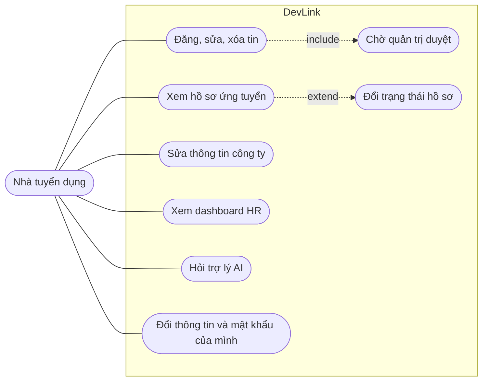

# Use case: Nhà tuyển dụng

Trang này liệt kê những việc nhà tuyển dụng (`HR`) làm được trên DevLink. Dành cho người cần nhìn nhanh phạm vi của HR và biết mỗi việc nằm ở màn hình nào.

## Vì sao có trang riêng

HR vừa dùng được khu quản trị (tin, hồ sơ, công ty) vừa có dashboard số liệu riêng cho công ty mình, nên cần một bảng gom lại và chỉ ra giới hạn so với quản trị viên.

## Sơ đồ

Sơ đồ rút gọn, không theo đúng ký pháp UML. Tin do HR đăng luôn ở trạng thái chờ duyệt; việc duyệt là của quản trị viên, không phải của HR.

## Bảng use case

| Use case | Màn hình | Trang tính năng |
| --- | --- | --- |
| Đăng, sửa, xóa tin tuyển dụng | `/admin/jobs` | [Duyệt tin tuyển dụng](../../04-features/job-approval.md) |
| Xem hồ sơ ứng tuyển, đổi trạng thái | `/admin/resumes` | [Trạng thái hồ sơ](../state-machines/application-status.md) |
| Xem và sửa thông tin công ty | `/admin/companies` | [Trang quản trị](../../04-features/admin-dashboard.md) |
| Xem số liệu tuyển dụng | `/hr/dashboard` | [Dashboard HR](../../04-features/hr-dashboard.md) |
| Hỏi trợ lý AI cho nhà tuyển dụng | Hộp chat ở khu HR | [Trợ lý AI](../../04-features/ai-career-assistant.md) |
| Cập nhật thông tin, đổi mật khẩu | `/admin/personal-info`, `/admin/change-password` | [Trang quản trị](../../04-features/admin-dashboard.md) |
| Nhận thông báo hồ sơ mới | Chuông | [Thông báo](../../04-features/notifications.md) |

## Giới hạn so với quản trị viên

| Việc | HR |
| --- | --- |
| Duyệt tin | Không; nút duyệt chỉ có với `SUPER ADMIN` |
| Quản lý người dùng | Không; mục "Người dùng" không hiện ở thanh bên |
| Tạo công ty, xóa công ty, xóa hồ sơ | Không; nút bị ẩn theo quyền CASL |
| Dashboard toàn nền tảng | Không; `/admin` chuyển HR sang `/hr/dashboard` |

## Lưu ý

- Sau khi đăng nhập, HR được đưa tới `/admin/resumes`, không phải dashboard.
- `/hr/dashboard` chỉ cho `HR`; quản trị viên bị chuyển về `/admin`.
- Phạm vi dữ liệu theo công ty của HR do backend áp dụng; giao diện không tự lọc. Chưa kiểm tra HR chưa gắn công ty thấy gì ngoài trạng thái "không có công ty" của dashboard.

## Source code liên quan

- [`src/app/[locale]/(dashboard)/layout.tsx`](../../../src/app/[locale]/(dashboard)/layout.tsx): khu quản trị
- [`src/app/[locale]/(hr-dashboard)/layout.tsx`](../../../src/app/[locale]/(hr-dashboard)/layout.tsx): khu HR
- [`src/components/hr-route.tsx`](../../../src/components/hr-route.tsx): chặn người không phải HR
- [`src/lib/casl/ability.ts`](../../../src/lib/casl/ability.ts): quyền của `HR`
- [`src/shared/config/admin-navigation.ts`](../../../src/shared/config/admin-navigation.ts): mục thanh bên theo quyền

Đọc tiếp: [Quản trị viên](administrator.md), [Ứng viên](candidate.md), [Vai trò người dùng](../../00-start-here/user-roles.md).
