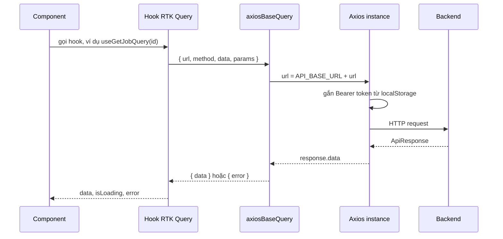

# Quy ước API

Trang này nói về những quy ước chung khi frontend gọi backend: địa chỉ, dạng phản hồi, cách khai báo endpoint mới và cách đặt tên hook. Dành cho người định thêm hoặc sửa một endpoint.

## Vì sao cần quy ước chung

Có hơn 70 endpoint trải trên 12 file. Nếu mỗi file tự quyết định cách nối URL, cách gửi tham số hay cách đọc phản hồi thì rất khó sửa lỗi chung, chẳng hạn như thêm header hoặc xử lý 401. Vì vậy mọi endpoint đi qua cùng một `baseApi`, một `baseQuery` và một Axios instance.

> [!WARNING]
> Địa chỉ backend được viết cứng trong code là `http://localhost:8081/api/v1`, không đọc từ biến môi trường. Đổi môi trường nghĩa là phải sửa file `constant.ts`. Xem [Biến môi trường](../01-getting-started/environment-variables.md).

## Đường đi của một request



Interceptor của Axios trả về `response.data`, nên `data` mà hook nhận chính là thân phản hồi `ApiResponse`, không phải đối tượng response của Axios.

## Các quy ước

| Hạng mục | Quy ước trong code |
| --- | --- |
| Địa chỉ | `API_BASE_URL` trong `src/shared/constants/constant.ts` |
| Nối URL | `axiosBaseQuery` nối `baseUrl + url` thành URL tuyệt đối |
| Timeout | 10 giây (`axios.create`) |
| Cookie | `withCredentials: true`, để gửi cookie refresh token |
| Xác thực | Header `Authorization: Bearer <access_token>` lấy từ `localStorage`, gắn ở request interceptor |
| Content-Type | `application/json`, trừ khi `data` là `FormData` |
| Upload file | Gửi `FormData`, không đặt Content-Type thủ công |
| Cache tag | Khai báo trong `tagTypes` của `baseApi` |

Cơ chế làm mới token khi gặp 401 nằm ở [Xác thực](../02-architecture/authentication.md).

## Dạng phản hồi

`ApiResponse<T>` được định nghĩa ở `src/shared/base/api-response.base.ts`:

| Field | Kiểu | Bắt buộc | Ý nghĩa |
| --- | --- | :---: | --- |
| `statusCode` | `number \| string` | Có | Mã trạng thái backend ghi trong thân phản hồi |
| `message` | `string \| null` | Có | Thông điệp từ backend, có thể `null` |
| `data` | `T` | Không | Dữ liệu chính |
| `timestamp` | `string \| null` | Không | Thời điểm phản hồi |
| `error` | `string \| string[]` | Không | Thông tin lỗi nếu có |

Danh sách phân trang có dạng `PaginatedResult<T>`, xem [Phân trang và lọc](pagination-filtering.md).

## Thêm một endpoint

1. Nếu nhóm API chưa có, tạo `src/features/<tên>/redux/<tên>.api.ts` và gọi `baseApi.injectEndpoints`.
2. Khai báo `builder.query` cho thao tác đọc hoặc `builder.mutation` cho thao tác ghi, ghi rõ kiểu `ApiResponse<...>`.
3. Thao tác đọc dùng `providesTags`, thao tác ghi dùng `invalidatesTags`. Tag mới phải được thêm vào `tagTypes` trong `src/lib/redux/api.ts`.
4. Export hook do RTK Query sinh ra.
5. Nếu logic phức tạp (toast, đóng dialog), bọc trong một hook ở `src/hooks/`.

```ts
// src/features/job/redux/job.api.ts (rút gọn)
export const jobApi = baseApi.injectEndpoints({
  endpoints: (builder) => ({
    getJob: builder.query<ApiResponse<Job>, string>({
      query: (id) => ({ url: `/jobs/${id}`, method: "GET" }),
      providesTags: (result, error, id) => [{ type: "Job", id }],
    }),
  }),
});
```

## Đặt tên

| Thành phần | Quy ước | Ví dụ |
| --- | --- | --- |
| Endpoint | Động từ + danh từ, camelCase | `getJob`, `createJob`, `bulkDeleteJobs` |
| Hook đọc | `use<Endpoint>Query` | `useGetJobQuery` |
| Hook ghi | `use<Endpoint>Mutation` | `useCreateJobMutation` |
| Schema form | `<Tên>FormData` trong `schemas/` | `CreateJobFormData` |

## Cách dựng tham số

Code không dùng một cách duy nhất. Có hai kiểu đang tồn tại cạnh nhau:

| Kiểu | Ví dụ | Ghi chú |
| --- | --- | --- |
| Tự nối chuỗi query | `getJobs` dựng `page=..&limit=..` rồi nối `filter` và `sort` | Dùng cho các danh sách quản trị theo kiểu lọc của backend |
| Truyền `params` cho Axios | `searchJobs` truyền đối tượng `JobSearchParams` | Axios tự mã hóa query string |

## Source code liên quan

- [`src/lib/redux/api.ts`](../../src/lib/redux/api.ts): `baseApi`, `tagTypes`
- [`src/lib/axios/axios-base-query.ts`](../../src/lib/axios/axios-base-query.ts): nối URL và chuẩn hóa lỗi
- [`src/lib/axios/axios-instance.ts`](../../src/lib/axios/axios-instance.ts): timeout, interceptor, token
- [`src/shared/base/api-response.base.ts`](../../src/shared/base/api-response.base.ts): `ApiResponse`
- [`src/shared/constants/constant.ts`](../../src/shared/constants/constant.ts): `API_BASE_URL`
- [`src/features/job/redux/job.api.ts`](../../src/features/job/redux/job.api.ts): ví dụ đầy đủ

Backend mô tả định dạng phản hồi và lỗi ở [Tổng quan API của backend](https://github.com/QuocDuy21-10/it-job-portal-be/blob/main/docs/05-api/api-overview.md).

Đọc tiếp: [Xử lý lỗi](error-handling.md), [Phân trang và lọc](pagination-filtering.md), [Cache và invalidation](cache-and-invalidation.md).
