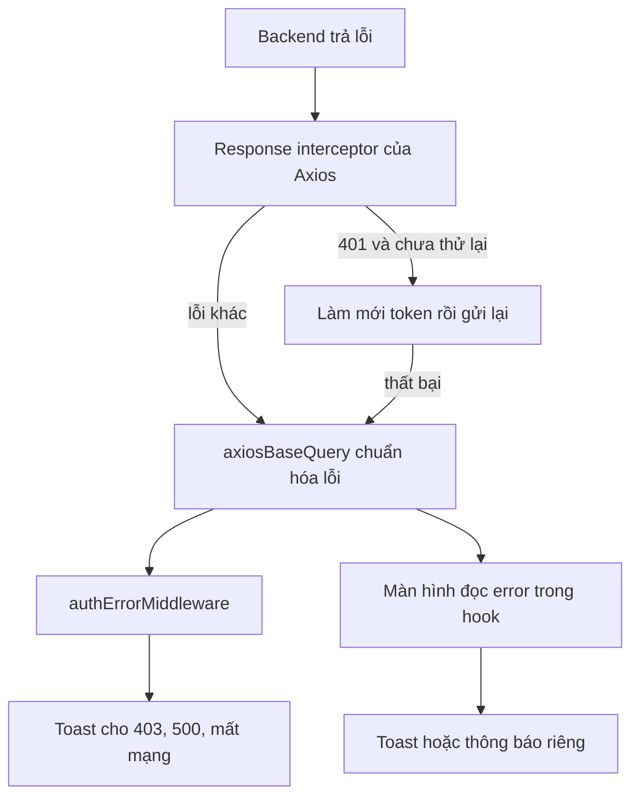

# Xử lý lỗi

Trang này mô tả lỗi từ backend đi qua frontend như thế nào, phần nào tự báo cho người dùng và phần nào do từng màn hình tự xử lý. Dành cho developer thêm màn hình mới hoặc tìm hiểu vì sao một lỗi hiện thông báo còn lỗi khác thì không.

## Vì sao cần hiểu

Lỗi được xử lý ở nhiều tầng. Nếu không biết tầng nào đã làm gì, bạn dễ thêm một thông báo trùng, hoặc ngược lại tưởng đã có thông báo trong khi thật ra chưa.

> [!NOTE]
> Backend không có bộ lọc lỗi tùy biến: lỗi theo dạng mặc định của NestJS, và `message` có thể là **mảng** khi lỗi do kiểm tra dữ liệu. Chi tiết ở [tài liệu backend](https://github.com/QuocDuy21-10/it-job-portal-be/blob/main/docs/05-api/api-overview.md).

## Các tầng xử lý



Sơ đồ cho thấy middleware chỉ xử lý một số mã chung, còn lại do từng màn hình tự đọc `error` từ hook.

## Dạng lỗi frontend nhận

`axiosBaseQuery` chuyển mọi lỗi của Axios thành đối tượng sau, đây là `error` mà hook RTK Query trả về:

| Field | Nguồn | Ý nghĩa |
| --- | --- | --- |
| `status` | `err.response?.status` | Mã HTTP; `undefined` khi không nhận được phản hồi |
| `data` | `err.response?.data` hoặc `err.message` | Thân phản hồi lỗi của backend |
| `message` | `err.message` | Thông điệp của Axios, ví dụ `Network Error` |

## Tầng 1: Axios interceptor

Chỉ lo hai trường hợp, cả hai đều thuộc luồng xác thực:

| Trường hợp | Hành vi |
| --- | --- |
| `401` trên request không phải đăng nhập hoặc đăng ký | Chỉ khi request có gửi token: gọi `refreshAccessToken()` (single-flight); thành công thì gửi lại request gốc |
| Làm mới token thất bại (người dùng đang có token) | `session.ts` gọi `onSessionExpired`: dispatch `sessionExpired`, xóa token và cache RTK Query, `ClientLayout` chuyển về `/login` |

Việc làm mới dùng `axios` trần nên lỗi của nó không đi qua interceptor; nhánh `400` trên `/auth/refresh` vì vậy chỉ chạy khi có request qua `axiosInstance` tới đúng đường dẫn đó. Chi tiết và các điểm cần chạy thử xem [Xác thực](../02-architecture/authentication.md).

## Tầng 2: `authErrorMiddleware`

Middleware bắt các action RTK Query bị từ chối:

| Điều kiện | Hành vi |
| --- | --- |
| `status === 403` | Toast lỗi, ưu tiên `data.message`, nếu không có thì dùng chuỗi `middleware.forbidden` |
| `status === 500` | Toast lỗi, ưu tiên `data.message`, nếu không có thì dùng chuỗi `middleware.serverError` |
| `message` chứa `Network Error` | Toast `middleware.networkError` |

Toast được gắn `id` để không hiện lặp. Ngoài ra middleware không xử lý `401` hay các mã khác.

> [!WARNING]
> Middleware đoán ngôn ngữ bằng cách lấy đoạn đầu của đường dẫn và chỉ nhận `vi` hoặc `en`, nếu không thì dùng `vi`. Vì tiếng Anh là ngôn ngữ mặc định và không có tiền tố URL, người dùng đang xem bản tiếng Anh sẽ nhận các toast chung này bằng tiếng Việt. Đây là hiện trạng của code, chưa có ghi chép về lý do.

## Tầng 3: từng màn hình

Màn hình tự đọc lỗi từ hook và quyết định thông báo. Mẫu thường gặp là lấy `error?.data?.message`, rồi `error?.message`, rồi chuỗi dịch làm giá trị dự phòng; mẫu này xuất hiện ở khoảng 26 file.

```ts
// src/app/[locale]/(auth)/login/page.tsx (rút gọn)
const errorMessage =
  error?.data?.message ||
  error?.message ||
  t("authModal.toasts.loginFailedFallback");
toast.error(errorMessage);
```

Vì `message` của backend có thể là mảng, giá trị này không phải lúc nào cũng là chuỗi. Chưa kiểm tra từng màn hình xem có xử lý trường hợp mảng hay không.

## Lỗi ở lời gọi phía server

Các hàm `fetchPublic*` không ném lỗi. Khi backend trả mã không thành công hoặc mất kết nối, chúng trả về `null`, và trang xử lý như không có dữ liệu. Không có toast ở đây vì trang chưa chạy trên trình duyệt.

| Nơi gọi | Khi lỗi | Kết quả với người dùng |
| --- | --- | --- |
| RTK Query trên trình duyệt | `error` trong hook | Tùy từng màn hình, cộng với toast chung ở tầng 2 |
| `fetchPublic*` trên server | Trả `null` | Trang hiển thị như không có dữ liệu |

## Source code liên quan

- [`src/lib/axios/axios-base-query.ts`](../../src/lib/axios/axios-base-query.ts): chuẩn hóa lỗi
- [`src/lib/axios/axios-instance.ts`](../../src/lib/axios/axios-instance.ts): xử lý 401 và 400 của refresh
- [`src/lib/redux/middleware/auth-error.middleware.ts`](../../src/lib/redux/middleware/auth-error.middleware.ts): toast chung
- [`src/lib/utils/public-content.ts`](../../src/lib/utils/public-content.ts): `fetchPublicEntity` trả `null`
- [`src/app/[locale]/(auth)/login/page.tsx`](../../src/app/[locale]/(auth)/login/page.tsx): ví dụ đọc `error?.data?.message`

Đọc tiếp: [Quy ước API](api-conventions.md), [Xác thực](../02-architecture/authentication.md), [Giao tiếp API](../02-architecture/api-communication.md).
