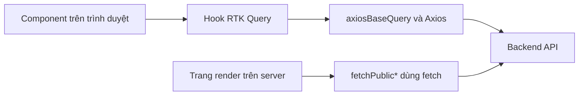

# Tổng quan API và dữ liệu

Nhóm tài liệu này mô tả phần **frontend** của việc gọi API: hook nào gọi endpoint nào, frontend gửi tham số gì, kiểu dữ liệu ra sao và cache được làm mới khi nào. Hợp đồng API đầy đủ (phản hồi chi tiết, mã lỗi, schema) thuộc về backend và được dẫn link sang đó, không chép lại.

## Vì sao chia như vậy

Backend là nguồn đúng cho hình dạng dữ liệu và quy tắc nghiệp vụ. Nếu frontend chép lại request/response đầy đủ thì sẽ có hai bản mô tả và chúng sẽ dần lệch nhau. Vì thế mỗi trang ở đây chỉ ghi những gì chỉ frontend biết: tham số mà code thực sự gửi, hook bọc endpoint, cache tag, nơi dùng và cách UI xử lý kết quả.

| Câu hỏi | Trả lời ở |
| --- | --- |
| Frontend gọi endpoint nào, bằng hook nào | Trang `endpoints/*` của nhóm này |
| Một đối tượng dữ liệu có những field gì ở frontend | Trang `models/*` của nhóm này |
| Backend trả gì, báo lỗi gì, lưu ở collection nào | Tài liệu của backend, xem [Tham chiếu dữ liệu backend](backend-data-reference.md) |

## Hai đường gọi API

Hai đường độc lập: request từ trình duyệt đi qua RTK Query và Axios, còn trang công khai render trên server dùng `fetch` riêng. Chi tiết xem [Giao tiếp API](../02-architecture/api-communication.md).

Streaming chat là đường thứ ba, dùng `fetch` riêng trong hook `use-stream-chat`; xem trang endpoint `chat`.

## Bản đồ file API

Mỗi file `*.api.ts` trong `src/features/` khai báo một nhóm endpoint. Tổng cộng có 78 endpoint trong 12 file.

| File API | Số endpoint | Trang endpoint |
| --- | :---: | --- |
| `auth/redux/auth.api.ts` | 15 | `endpoints/auth` |
| `job/redux/job.api.ts` | 9 | `endpoints/jobs` và `endpoints/job-search` |
| `resume/redux/resume.api.ts` | 8 | `endpoints/resumes` |
| `cv-profile/redux/cv-profile.api.ts` | 2 | `endpoints/cv-profiles` |
| `chatbot/redux/chat-bot.api.ts` | 5 | `endpoints/chat` |
| `company/redux/company.api.ts` | 7 | `endpoints/companies` |
| `user/redux/user.api.ts` | 14 | `endpoints/users` |
| `notification/redux/notification.api.ts` | 5 | `endpoints/notifications` |
| `subscriber/redux/subscriber.api.ts` | 7 | `endpoints/subscribers` |
| `skill/redux/skill.api.ts` | 2 | `endpoints/skills` |
| `statistics/redux/statistics.api.ts` | 2 | `endpoints/statistics` |
| `file/redux/file.api.ts` | 2 | `endpoints/files` |

Trang endpoint: [Auth](endpoints/auth.md), [Jobs](endpoints/jobs.md), [Job Search](endpoints/job-search.md), [Resumes](endpoints/resumes.md), [CV Profiles](endpoints/cv-profiles.md), [Chat](endpoints/chat.md), [Companies](endpoints/companies.md), [Users](endpoints/users.md), [Notifications](endpoints/notifications.md), [Subscribers](endpoints/subscribers.md), [Skills](endpoints/skills.md), [Statistics](endpoints/statistics.md), [Files](endpoints/files.md). Trang model: [User](models/user.md), [Job](models/job.md), [JobSearchItem](models/job-search-item.md), [Resume](models/resume.md), [CV Profile](models/cv-profile.md), [Chat Message](models/chat-message.md), [Company](models/company.md). Thông báo, đăng ký nhận việc và kỹ năng chưa có trang model riêng; định nghĩa nằm ở `schemas/` của từng module.

## Đọc tiếp

- [Quy ước API](api-conventions.md): base URL, dạng phản hồi, cách thêm endpoint.
- [Xử lý lỗi](error-handling.md)
- [Phân trang và lọc](pagination-filtering.md)
- [Cache và invalidation](cache-and-invalidation.md)
- [Tham chiếu dữ liệu backend](backend-data-reference.md)

## Source code liên quan

- [`src/lib/redux/api.ts`](../../src/lib/redux/api.ts): `baseApi`, danh sách tag và `baseQuery`
- [`src/features/`](../../src/features): các module, mỗi module có `redux/*.api.ts`
- [`src/lib/utils/public-content.ts`](../../src/lib/utils/public-content.ts): lời gọi `fetch` phía server

Đọc tiếp: [Giao tiếp API](../02-architecture/api-communication.md), [Quản lý state](../02-architecture/state-management.md).
