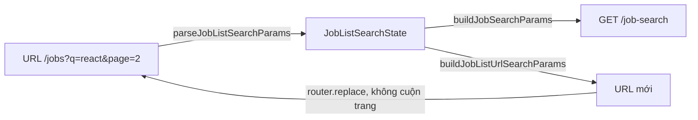

# Phân trang và lọc

Trang này giải thích frontend gửi tham số phân trang, lọc và sắp xếp thế nào, và vì sao danh sách tìm việc công khai và danh sách quản trị dùng hai cách khác nhau. Dành cho developer thêm bộ lọc hoặc đổi cách hiển thị danh sách.

## Vì sao có hai cách

Backend có hai kiểu route danh sách:

- Route CRUD như `/jobs`, `/companies`, `/users` nhận bộ lọc dưới dạng query string tự do, do thư viện `api-query-params` của backend đọc (`name=/abc/i`, `sort=-createdAt`).
- Route tìm kiếm hợp nhất `/job-search` nhận một tập tham số cố định và có kiểm tra giá trị.

Frontend giữ nguyên hai kiểu đó thay vì ép về một: danh sách quản trị cần lọc linh hoạt, còn trang tìm việc công khai cần tham số rõ ràng và an toàn.

## Dạng dữ liệu phân trang

Mọi danh sách phân trang có dạng `PaginatedResult<T>` ở `src/shared/types/pagination.ts`:

| Field | Kiểu | Ý nghĩa |
| --- | --- | --- |
| `result` | `T[]` | Các phần tử của trang hiện tại |
| `meta.pagination.current_page` | `number` | Trang hiện tại |
| `meta.pagination.per_page` | `number` | Số phần tử mỗi trang |
| `meta.pagination.total_pages` | `number` | Tổng số trang |
| `meta.pagination.total` | `number` | Tổng số phần tử |

Backend nêu một ngoại lệ ở `GET /cv-profiles`, trả `{ data, total, page, limit }`; xem [tài liệu backend](https://github.com/QuocDuy21-10/it-job-portal-be/blob/main/docs/05-api/api-overview.md).

## Kiểu 1: danh sách CRUD

Tham số nhận vào là `PaginatedQueryParams`:

| Field | Kiểu | Mặc định ở hook | Ý nghĩa |
| --- | --- | --- | --- |
| `page` | `number` | 1 | Trang |
| `limit` | `number` | 10 | Số phần tử mỗi trang |
| `filter` | `string` | rỗng | Đoạn query nối thẳng vào URL, ví dụ `isActive=true` |
| `sort` | `string` | rỗng | Đoạn query nối thẳng, ví dụ `sort=-createdAt` |
| `keyword` | `string` | không có | Chỉ `getJobs` gửi, được `encodeURIComponent` |

`getJobs` và `getCompanies` dựng `page=..&limit=..`, rồi nối `filter` và `sort` nguyên văn. Ví dụ từ trang chủ:

```ts
useGetJobsQuery({ page: jobsPage, limit: ITEMS_PER_PAGE, filter: "isActive=true", sort: "sort=-createdAt" });
// GET /jobs?page=1&limit=..&isActive=true&sort=-createdAt
```

Danh sách công ty công khai lọc theo tên bằng `name=/<từ khóa>/i`, do `buildCompanyListQueryArgs` dựng và có `encodeURIComponent`.

> [!WARNING]
> `filter` và `sort` được nối thẳng vào URL, nên người gọi phải tự bảo đảm giá trị đã được mã hóa. Danh sách công ty công khai, danh sách việc của công ty và `keyword` có dùng `encodeURIComponent`; trang quản trị tin dựng `name=/<từ khóa>/i` mà không mã hóa từ khóa.

## Kiểu 2: tìm việc hợp nhất

Trạng thái của trang `/jobs` được giữ trong URL, đọc bằng `parseJobListSearchParams`, rồi đổi thành tham số API bằng `buildJobSearchParams`. Giá trị lạ trong URL bị thay bằng mặc định.

| Tham số URL | Giá trị chấp nhận | Tham số API | Ghi chú |
| --- | --- | --- | --- |
| `q` | chuỗi bất kỳ | `keyword` | Bỏ khoảng trắng hai đầu |
| `locationCode` | mã địa điểm | `locationCode` | Cũng nhận `location` và đổi thành mã |
| `type` | `all`, `Full-time`, `Part-time`, `Internship`, `Freelance`, `Remote`, `Hybrid`, `Other` | `formOfWork` | `all` thì không gửi |
| `experience` | `all`, `Internship`, `Junior`, `Mid`, `Senior`, `Lead`, `Manager` | `level` | `all` thì không gửi |
| `salary` | `all`, `0-10000000`, `10000000-20000000`, `20000000-50000000`, `50000000-999999999` | `salaryMin`, `salaryMax` | Tách chuỗi tại dấu `-` |
| `source` | `all`, `internal`, `external` | `source` | `all` thì không gửi |
| `sort` | `-createdAt`, `createdAt`, `-salary`, `salary` | `sort` | Đổi thành `newest`, `oldest`, `salary_desc`, `salary_asc` |
| `page` | số nguyên dương | `page` | Mặc định 1 |
| `limit` | số nguyên dương | `limit` | Mặc định 10 |

`JobSearchParams` luôn có `page`, `limit`, `sort`; các trường còn lại chỉ có khi người dùng chọn.

Backend giới hạn `limit` tối đa 50 và `keyword` tối đa 100 ký tự (`job-search.constants.ts`). Frontend chỉ kiểm tra `limit` là số nguyên dương và không tự cắt về 50, nên kết quả khi vượt trần do backend quyết định.

## Đồng bộ với URL



Khi người dùng đổi bộ lọc, trang gọi `router.replace` với URL mới và `scroll: false`. Tham số có giá trị mặc định không được ghi vào URL, vì vậy trang mặc định luôn có URL gọn. Đây cũng là cơ sở để trang quyết định biến thể nào được lập chỉ mục, xem [Rendering và SEO](../02-architecture/rendering-and-seo.md).

Danh sách công ty cũng đồng bộ với URL theo cách tương tự nhưng chỉ có `q`, `page`, `limit`, và kích thước trang mặc định là 9.

## Hiển thị phân trang

Hai component cùng tồn tại:

| Component | Props chính | Dùng ở |
| --- | --- | --- |
| `SimplePagination` | `page`, `totalPages`, `onPageChange` | Trang `/jobs`, lấy `totalPages` từ `meta.pagination.total_pages` |
| `Pagination` | `currentPage`, `pageSize`, `totalItems`, `onPageChange`, `onPageSizeChange` | Tự tính số trang bằng `Math.ceil(totalItems / pageSize)` |

## Source code liên quan

- [`src/shared/types/pagination.ts`](../../src/shared/types/pagination.ts): `PaginatedResult`, `PaginatedQueryParams`
- [`src/lib/utils/public-listing.ts`](../../src/lib/utils/public-listing.ts): đọc URL, dựng tham số API và URL
- [`src/features/job/hooks/use-job-list.ts`](../../src/features/job/hooks/use-job-list.ts): trạng thái bộ lọc và truy vấn
- [`src/features/job/schemas/job-search.schema.ts`](../../src/features/job/schemas/job-search.schema.ts): `JobSearchParams`
- [`src/features/job/redux/job.api.ts`](../../src/features/job/redux/job.api.ts): `getJobs`, `searchJobs`
- [`src/features/company/redux/company.api.ts`](../../src/features/company/redux/company.api.ts): `getCompanies`
- [`src/app/[locale]/(main)/jobs/jobs-page-client.tsx`](../../src/app/[locale]/(main)/jobs/jobs-page-client.tsx): `router.replace`
- [`src/components/simple-pagination.tsx`](../../src/components/simple-pagination.tsx): thanh phân trang của trang `/jobs`
- [`src/components/pagination.tsx`](../../src/components/pagination.tsx): thanh phân trang có chọn kích thước trang

Backend mô tả route tìm kiếm ở [Job Search API](https://github.com/QuocDuy21-10/it-job-portal-be/blob/main/docs/05-api/endpoints/job-search.md).

Đọc tiếp: [Quy ước API](api-conventions.md), [Cache và invalidation](cache-and-invalidation.md), [Chiến lược cache](../02-architecture/caching-strategy.md).
